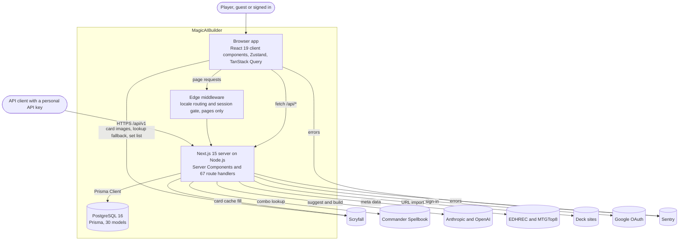
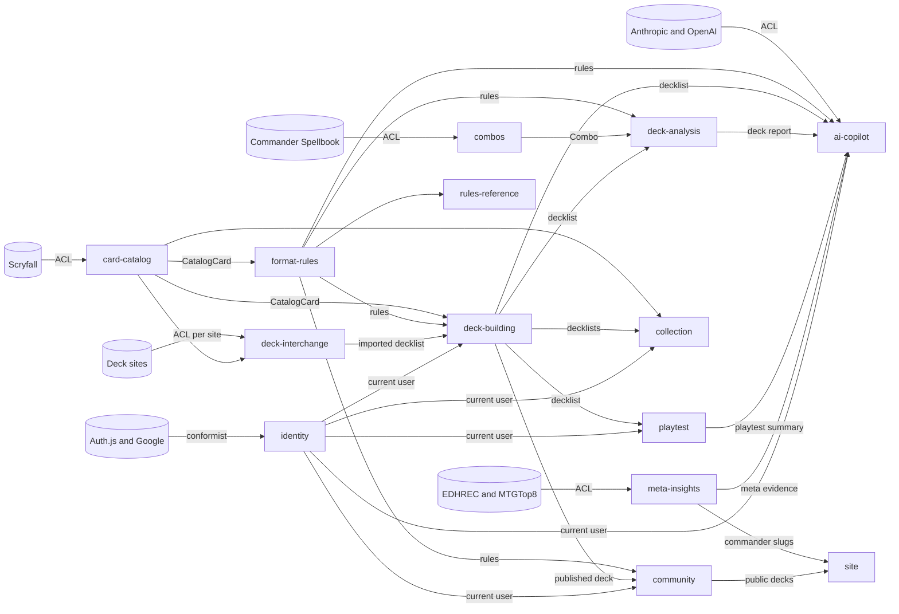
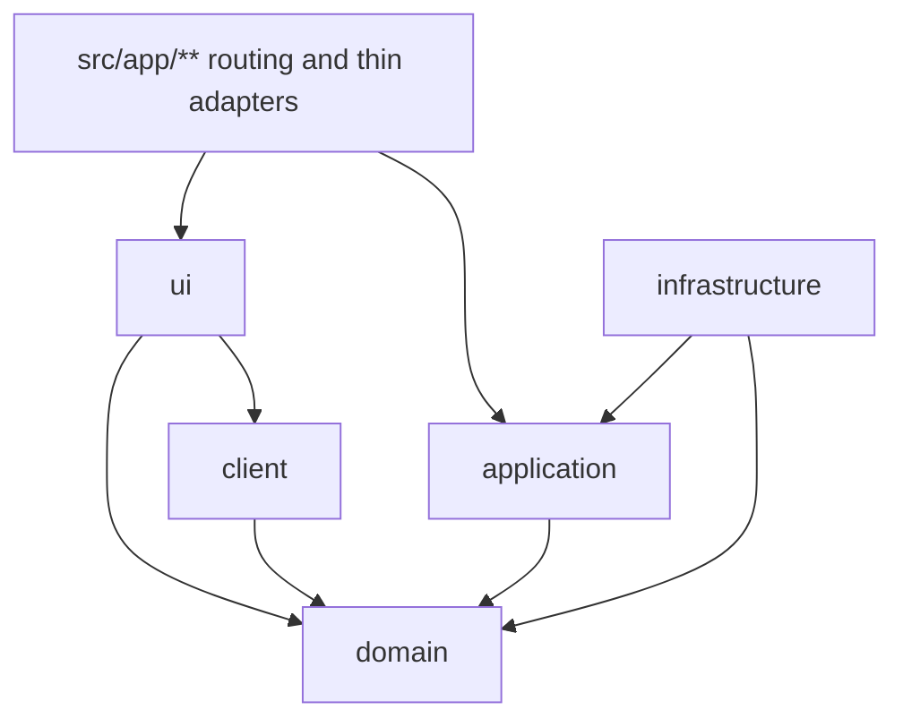

# Architecture

> **Scope.** How MagicAIBuilder is structured: the system and its neighbours, the bounded
> contexts, the layers inside a context, the entry points, and where new code goes. It describes
> the **target** decided on 2026-11-10 and, honestly, the **current state** measured on `dev` at
> `872f08ff` the same day.
>
> **Related.** Decisions and their reasons: [docs/adr/](../adr/README.md). Domain terms:
> [CONTEXT.md](../../CONTEXT.md). Stack, local setup and feature notes:
> [technical.md](technical.md). Comment and documentation rules:
> [code-documentation.md](code-documentation.md). Testing method: [tdd-with-ai.md](tdd-with-ai.md).

## Contents

- [Purpose](#purpose)
- [The system and its neighbours](#the-system-and-its-neighbours)
- [Bounded contexts](#bounded-contexts)
- [Context map](#context-map)
- [Layers and dependency rules](#layers-and-dependency-rules)
- [Entry points](#entry-points)
- [Where does this code go?](#where-does-this-code-go)
- [Current state and target](#current-state-and-target)
- [Migration approach](#migration-approach)
- [The context template](#the-context-template)
- [How to read the code base today](#how-to-read-the-code-base-today)

## Purpose

MagicAIBuilder helps Magic: The Gathering players build, analyse and playtest Commander decks,
with an AI copilot whose suggestions are checked against the rules before they are shown. It is
one Next.js 15 application (React 19, TypeScript strict) backed by one PostgreSQL database through
Prisma, served in English and French.

The architecture serves three goals:

1. **Find code by business area.** Everything about combos, playtests or the card catalog lives
   in one folder, named in the domain's language.
2. **Keep the rules right and in one place.** Commander rules are written once, as pure functions
   that cite the Comprehensive Rules, and the server is their authority
   ([ADR 0009](../adr/0009-legality-is-a-report-and-the-server-owns-rules.md)).
3. **Change one thing at a time.** A provider change touches one adapter; a rule change touches one
   function; a context can move or be rewritten without touching its neighbours' internals.

The style is a **modular monolith**: one deployable application, split into bounded contexts with
explicit public APIs ([ADR 0001](../adr/0001-modular-monolith-by-bounded-context.md)).

## The system and its neighbours

C4 container view. Arrows show who calls whom.



| Container           | Technology                                                           | Responsibility                                                                                                                                                                          | Where                                                                                |
| ------------------- | -------------------------------------------------------------------- | --------------------------------------------------------------------------------------------------------------------------------------------------------------------------------------- | ------------------------------------------------------------------------------------ |
| Browser app         | React 19 client components, Zustand 5, TanStack Query 5, dnd-kit     | The builder, analysis panels, playtest, collection and community screens. Holds view state and optimistic copies of decks.                                                              | 228 `"use client"` modules under `src/components`, `src/lib/*/store.ts`, `src/hooks` |
| Edge middleware     | next-intl, Auth.js Edge configuration                                | Locale prefix (`en` unprefixed, `fr` under `/fr`) and the sign-in redirect for protected pages. Its matcher excludes `/api`.                                                            | `src/middleware.ts`, `src/lib/auth/edge-config.ts`, `src/lib/auth/public-paths.ts`   |
| Next.js server      | Next.js 15 App Router on Node.js, Auth.js 5 (Google and credentials) | Server Components, 67 route handlers including the public `/api/v1` API, the shared Scryfall cache, provider calls.                                                                     | `src/app/**`                                                                         |
| Database            | PostgreSQL 16, Prisma 6                                              | Decks, collections, community data, sessions, caches. Docker locally; hosted in production (see [infrastructure.md](infrastructure.md)).                                                | `prisma/schema.prisma`                                                               |
| Scryfall            | HTTPS JSON API                                                       | Card data, search, printings, rulings, images. The server fills a shared cache (cards 24 h, searches 1 h); the browser reads through it and calls Scryfall directly only as a fallback. | `src/lib/scryfall/`                                                                  |
| Commander Spellbook | HTTPS JSON API                                                       | Combos contained in a decklist, used for the combo panel and the bracket estimate.                                                                                                      | `src/modules/combos/infrastructure/`, `src/app/api/combos/route.ts`                  |
| Anthropic, OpenAI   | HTTPS JSON APIs                                                      | The AI copilot: suggestions and deck builds, Anthropic first, then OpenAI, then a mock.                                                                                                 | `src/app/api/ai/**`, `src/lib/ai/`                                                   |
| EDHREC, MTGTop8     | JSON and HTML scraping                                               | What the wider meta plays for a commander, and how it shifts.                                                                                                                           | `src/modules/meta-insights/infrastructure/`, `src/app/api/meta/**`                   |
| Deck sites          | JSON or HTML per site                                                | URL import from Moxfield, Archidekt, TappedOut, MTGTop8, MTGDecks, AetherHub and EDHREC.                                                                                                | `src/lib/import/`, `src/app/api/import/**`                                           |
| Google OAuth        | OAuth 2.0 through Auth.js                                            | Sign-in. Email and password sign-in is local.                                                                                                                                           | `src/lib/auth/config.ts`                                                             |
| Sentry              | `@sentry/nextjs`                                                     | Error tracking, browser and server.                                                                                                                                                     | `src/instrumentation*.ts`, `sentry.*.config.ts`                                      |

## Bounded contexts

A bounded context is a part of the product inside which every term has one meaning. "Card", for
example, means a printing in the card catalog, a row with a quantity and a zone in deck building,
an owned copy in the collection, and a game object in the playtest. The glossary of each context
is in [CONTEXT.md](../../CONTEXT.md).

| Kind       | Context          | Folder             | Covers                                                                                                                                                                                                                                                             | Tables owned                                                                                                                                 |
| ---------- | ---------------- | ------------------ | ------------------------------------------------------------------------------------------------------------------------------------------------------------------------------------------------------------------------------------------------------------------ | -------------------------------------------------------------------------------------------------------------------------------------------- |
| Core       | Format rules     | `format-rules`     | Commander rules shared by the server and the browser: colour identity, copy limits and basic lands, commander eligibility and pairing (partner variants, Background, Doctor's companion, Friends forever), companion, banlist, Game Changers, bracket definitions. | none                                                                                                                                         |
| Core       | Deck building    | `deck-building`    | Decks, cards in decks, zones, categories, snapshots and versions, folders, sharing, forks, guest decks, the editor, the builder and the wizard's deck creation.                                                                                                    | `Deck`, `DeckCard`, `DeckFolder`, `DeckSnapshot`                                                                                             |
| Core       | Deck analysis    | `deck-analysis`    | Read-only evaluation of a decklist: stats, mana curve, mana alignment, turn-one odds, bracket estimate, themes, commander rules check, price, comparison.                                                                                                          | none                                                                                                                                         |
| Core       | Playtest         | `playtest`         | Game simulation in the browser, the London mulligan and the free multiplayer mulligan, keep advice, recorded sessions.                                                                                                                                             | `PlaytestSession`                                                                                                                            |
| Core       | AI copilot       | `ai-copilot`       | Suggest and build use cases, prompts, the model port, validation of model output before display.                                                                                                                                                                   | none yet                                                                                                                                     |
| Supporting | Card catalog     | `card-catalog`     | The Scryfall anti-corruption layer: the `CatalogCard` type, search, printings, images, localised card text, rulings, the shared cache.                                                                                                                             | `CardCache`, `ScryfallSearchCache`                                                                                                           |
| Supporting | Combos           | `combos`           | The Commander Spellbook adapter. The **pilot** context of the migration.                                                                                                                                                                                           | none (in-memory cache)                                                                                                                       |
| Supporting | Meta insights    | `meta-insights`    | EDHREC and MTGTop8 adapters, meta snapshots and their history.                                                                                                                                                                                                     | `MetaCache`, `MetaSnapshot`                                                                                                                  |
| Supporting | Deck interchange | `deck-interchange` | Import and export: one adapter per site, the decklist text parsers, export formats, proxy sheets.                                                                                                                                                                  | none                                                                                                                                         |
| Supporting | Collection       | `collection`       | Owned cards and quantities, acquisition intents, acquisition plans, shopping lists.                                                                                                                                                                                | `CollectionCard`, `AcquisitionIntent`                                                                                                        |
| Supporting | Community        | `community`        | Public decks, discovery, profiles, follows, votes, ratings and reviews, comments, saved decks, card packages, reports and moderation.                                                                                                                              | `DeckVote`, `DeckRating`, `DeckComment`, `DeckReport`, `SavedPublicDeck`, `PublicDeckFolder`, `CardPackage`, `CardPackageCard`, `UserFollow` |
| Generic    | Identity         | `identity`         | Accounts, sessions, onboarding, settings, API keys and scopes, the moderator role.                                                                                                                                                                                 | `User`, `Account`, `Session`, `VerificationToken`, `ApiKey`, `NotificationPreference`                                                        |
| Generic    | Rules reference  | `rules-reference`  | The Comprehensive Rules pages, the Game Changers and banlist pages.                                                                                                                                                                                                | none (file data)                                                                                                                             |
| Generic    | Site             | `site`             | SEO, sitemap, robots, Open Graph images, the landing page.                                                                                                                                                                                                         | none                                                                                                                                         |

**Core** contexts are where the product differs from its competitors; they get the most modelling
effort and tactical DDD. **Supporting** contexts are needed but not differentiating; plain use
cases are enough. **Generic** contexts solve problems every web app has.

**The shared kernel** is not a context. It holds code with no business meaning that every context
uses: UI primitives and the app shell (`src/components/ui/*`, `src/components/layout/*`), the
logger (`src/lib/logger.ts`), internationalisation (`src/i18n/*`), the Prisma client
(`src/lib/db/prisma.ts`) and authentication helpers (`src/lib/auth/*`). It stays where it is for
now, because moving it would rewrite 25 to 79 importers per file for no gain
([ADR 0001](../adr/0001-modular-monolith-by-bounded-context.md)). New shared code goes next to it.

## Context map

Arrows run from **upstream** (the supplier) to **downstream** (the consumer). Labels name the
relationship or the published type. **ACL** is an anti-corruption layer
([ADR 0004](../adr/0004-anti-corruption-layers-for-external-providers.md)).



How to read it:

- **Format rules is the most upstream core context.** Every context that judges a deck uses its
  pure functions, so a rule is written once and gives the same answer on the server and in the
  browser. On the server, legality is reported and never refuses a write. The browser keeps its
  current checks as player feedback (the copy clamp, the companion check and the "already in the
  deck" check); a refactor never changes them, and changing them is an owner decision
  ([ADR 0009](../adr/0009-legality-is-a-report-and-the-server-owns-rules.md)).
- **Deck building owns the deck.** Other contexts read decklists, and change a deck only by
  calling a deck-building use case. Today two routes write deck tables from other contexts
  (`src/app/api/community/card-packages/[packageId]/apply/route.ts` and
  `src/app/api/decks/[id]/playtest-sessions/route.ts`); both move behind deck-building use cases.
- **The AI copilot is the most downstream context.** It reads the decklist, the analysis report,
  the playtest summary and the meta evidence, and its output is validated with format rules before
  it is shown.
- **Providers stop at their adapter.** Their types never cross the ACL.

**Where the code contradicts the map today.** The architecture audit measured these inversions;
each is removed by a phase 1 slice or by its context's move series.

| Inversion                              | Evidence                                                                                                                                                        | Fix                                                                                        |
| -------------------------------------- | --------------------------------------------------------------------------------------------------------------------------------------------------------------- | ------------------------------------------------------------------------------------------ |
| Card catalog imports deck building     | Deck-aware widgets in `src/components/card/` and `src/components/search/`, and `src/lib/scryfall/search.ts:2-9` importing deck types, formats and pairing rules | Deck-aware widgets move to deck building; the types and formats search needs move upstream |
| Playtest and AI depend on each other   | `src/lib/playtest/ai-context.ts` imports the AI schema while the AI route imports `ai-context`                                                                  | `ai-context.ts` moves to the AI copilot                                                    |
| The app shell depends on deck building | `src/components/layout/Header.tsx:7,13` imports the import dialog and the deck store                                                                            | The header takes its actions as a slot                                                     |
| Deck store calls the collection store  | `src/lib/deck/store.ts:12`                                                                                                                                      | Composed in the UI instead                                                                 |

## Layers and dependency rules

Inside a context, code is split by what it depends on. A layer folder exists only when the context
needs it ([ADR 0001](../adr/0001-modular-monolith-by-bounded-context.md)).



An arrow means "may import". `infrastructure` implements the ports that `application` declares,
so the dependency points inward.

| Layer             | Holds                                                                                                                                 | May import                                                                                                                 | Must not import                                                                                    |
| ----------------- | ------------------------------------------------------------------------------------------------------------------------------------- | -------------------------------------------------------------------------------------------------------------------------- | -------------------------------------------------------------------------------------------------- |
| `domain/`         | Readonly types and pure functions: rules, value types, ports when the domain owns them                                                | Its own `domain/`; other contexts' `index.ts`; the pure shared helpers `src/lib/guards.ts` and `src/lib/text/`             | React, Next.js, Prisma, Zustand, TanStack Query, `fetch`, `process.env`, `window`; any other layer |
| `application/`    | Use cases (`makeX(deps) → x(input)`), port interfaces, input contracts                                                                | Its own `domain/` and ports; other contexts' `index.ts` and `server.ts`; the server shared kernel (logger)                 | React, Next.js routing, Prisma directly, `client/`, `ui/`                                          |
| `infrastructure/` | Prisma repositories, provider adapters with their wire types and mappers, recorded fixtures. Server-only, except a browser API client | Its own `domain/` and `application/` ports; `src/lib/db/prisma.ts`, `src/lib/http.ts`, the logger                          | `ui/`, `client/`, other contexts' internals                                                        |
| `client/`         | The typed browser API client, Zustand stores, TanStack Query hooks                                                                    | Its own `domain/`; other contexts' `index.ts` and `client.ts`; browser-safe shared helpers                                 | `server.ts`, `application/`, `infrastructure/`, Prisma                                             |
| `ui/`             | React components: containers compose presentational components; logic lives in hooks or the domain                                    | Its own `client/` and `domain/`; other contexts' `index.ts`, `client.ts` and `ui/*` paths; `src/components/ui`, `src/i18n` | `server.ts`, `application/`, `infrastructure/`, Prisma                                             |
| `src/app/**`      | Pages, layouts, route handlers, metadata, sitemap, robots                                                                             | Any context's `server.ts`, `index.ts`, `client.ts` and `ui/*`; the shared kernel                                           | Another context's `domain/`, `application/`, `infrastructure/` or `client/` internals              |
| Shared kernel     | UI primitives, app shell, logger, i18n, Prisma client, auth helpers                                                                   | Other shared kernel files                                                                                                  | Anything under `src/modules/` or `src/app/`                                                        |

**A route handler or page** does three things: parse its input with Zod, call one use case, map the
result to a response. It keeps no business rule and calls no Prisma model directly. Route handlers
stay route handlers; they are not converted to Server Actions.

**Domain modelling** follows [ADR 0003](../adr/0003-domain-as-readonly-data-and-pure-functions.md):
readonly data and pure functions, discriminated unions, branded IDs where IDs can be mixed up,
parse once at the boundary, plain factories instead of a DI container.

## Entry points

Each context exposes up to three files
([ADR 0002](../adr/0002-module-entry-points-index-server-client.md)):

| File        | Contains                                                                      | Safe in                                         |
| ----------- | ----------------------------------------------------------------------------- | ----------------------------------------------- |
| `index.ts`  | Pure domain types and functions                                               | Server, browser, Edge middleware                |
| `server.ts` | `import "server-only"`, then the use cases wired to their production adapters | Server only (route handlers, Server Components) |
| `client.ts` | Client-safe hooks, stores and the typed API client                            | Browser and Client Components                   |

UI components are imported by path (`@/modules/<context>/ui/<Component>`), never through a barrel.
Entry files use explicit named re-exports, not `export *`. Other contexts import only these entry
points or a `ui/` component path.

The shape of a context, as the pilot left it (the folder names are fixed; these are the real
combos files, see [the context template](#the-context-template)):

```text
src/modules/combos/
  README.md            purpose, layers, public API, data flow, ports, invariants, testing, gaps
  domain/              combo.ts: the Combo type and the two-card policy; deck-query.ts; lookup-policy.ts
  application/         ports.ts: ComboCache, ComboSourceBudget, ComboSource; lookup-deck-combos.ts
  infrastructure/      find-my-combos.ts and spellbook-variant.ts: the ACL; combo-cache.ts;
                       spellbook-budget.ts; fixtures/find-my-combos-v1.ts
  client/              api.ts: the typed client of POST /api/combos; useCombos.ts
  ui/                  CombosPanel.tsx
  testing/             in-memory-combo-source.ts; combo-source-contract.ts; spellbook-msw.ts
  index.ts             export { isTwoCardInfiniteCombo, type Combo, … } from "./domain/…"
  server.ts            import "server-only"; export const lookupDeckCombos = makeLookupDeckCombos({ … })
  client.ts            export { fetchCombosForDeck, useCombos }
  entry-points.test.ts pins the runtime export list of each entry point
```

## Where does this code go?

Answer the questions in order; the first "yes" decides.

|   # | Question                                                                                                                                                         | Then it goes in                                                        |
| --: | ---------------------------------------------------------------------------------------------------------------------------------------------------------------- | ---------------------------------------------------------------------- |
|   1 | Is it a Next.js routing file: a page, layout, route handler, `loading`, `error`, metadata, sitemap or robots?                                                    | `src/app/**`, kept thin: parse, call one use case, map                 |
|   2 | Is it a Commander or format rule that the server and the browser both need (colour identity, copy limits, pairing, companion, banlist, Game Changers, brackets)? | `format-rules/domain/`, with its Comprehensive Rules citation          |
|   3 | Is it a pure rule, calculation or type of one business area, with no IO and no React?                                                                            | `<context>/domain/`                                                    |
|   4 | Does it carry out a business action on the server: load, decide, save?                                                                                           | `<context>/application/`, as a use case taking its ports as parameters |
|   5 | Does it talk to Prisma, a provider, the file system or a secret?                                                                                                 | `<context>/infrastructure/`, behind a port, server-only                |
|   6 | Does it hold browser state, call the app's API from the browser, or wrap TanStack Query?                                                                         | `<context>/client/`                                                    |
|   7 | Is it JSX?                                                                                                                                                       | `<context>/ui/`: a container composes small presentational components  |
|   8 | Is it generic, used by several contexts, with no business meaning (a button, `cn`, the logger, i18n)?                                                            | The shared kernel, next to the existing kernel files                   |

**Which context?** The one whose glossary in [CONTEXT.md](../../CONTEXT.md) defines the main noun
of the code. If two contexts are involved, the code belongs to the one that owns the data it
changes, and the other calls its use case.

**Until a context has moved,** put new code in the folder that holds its siblings today (see
[How to read the code base today](#how-to-read-the-code-base-today)), shaped as the target layer
would be: a pure rule in its own file with no IO, logic out of route handlers and into a function
the route calls, no new `vi.mock` of an internal module. Do not create `src/modules/<context>/` by
hand; a context moves in its own series, by codemod.

## Current state and target

Measured on `dev` at `872f08ff` (2026-11-10). Counts cover non-test `.ts` and `.tsx` files under
`src/` unless stated.

| Aspect                 | Target                                                 | Today                                                                                                                                                                                                                                                                                                                                 |
| ---------------------- | ------------------------------------------------------ | ------------------------------------------------------------------------------------------------------------------------------------------------------------------------------------------------------------------------------------------------------------------------------------------------------------------------------------- |
| Organisation           | 14 contexts under `src/modules/`                       | `src/modules/` does not exist. 517 production files (67,140 lines): `src/components` 190, `src/lib` 185, `src/app` 106 (67 route handlers), `src/hooks` 29, `src/i18n` 4, root 3                                                                                                                                                      |
| Mixed folders          | One context per folder                                 | `src/lib/deck/` holds 59 files across about five contexts; `src/components/deck/` holds 74 across about nine                                                                                                                                                                                                                          |
| Route handlers         | Parse, call one use case, map                          | 53 of 67 import Prisma, with 155 inline Prisma calls (138 `prisma.<model>.<op>`, 6 `prisma.$…`, 11 inside transactions). The largest is `src/app/api/ai/suggest/route.ts` with 654 lines                                                                                                                                              |
| Application layer      | Use cases behind ports                                 | No port, repository or use case exists                                                                                                                                                                                                                                                                                                |
| Pages                  | Server Components composing contexts                   | The builder page is a 1,192-line `"use client"` page. Two server files query Prisma directly (`src/app/sitemap.ts`, `src/app/[locale]/moderation/reports/page.tsx`). Three server pages fetch the app's own API over HTTP (`u/[username]`, `commanders/[slug]/decks`, and the public deck page through `src/lib/deck/public-deck.ts`) |
| Client state           | Stores hold view state; rules come from `format-rules` | `src/lib/deck/store.ts` is 2,550 lines of `"use client"` code mixing state, HTTP, Scryfall calls, rules and toasts                                                                                                                                                                                                                    |
| Server/client boundary | `server-only` checked at build time                    | No `server-only` import. 228 `"use client"` modules. No client module reaches Prisma today, by convention only                                                                                                                                                                                                                        |
| Anti-corruption layers | Wire types stay in `infrastructure/`                   | `ScryfallCard` is referenced by 36 other production files (30 outside `src/lib/scryfall/`); Anthropic and OpenAI are called with raw `fetch` in two routes; one 481-line file adapts seven deck sites                                                                                                                                 |
| Dependency direction   | No cycles, no inward-to-outward imports                | 0 runtime cycles, 3 type-only cycles; 11 layer violations (5 `lib → app`, 3 `lib → hooks`, 3 component or hook `→ app`). All 14 start in the dependency-cruiser baseline ([ADR 0007](../adr/0007-architecture-enforcement-in-stages.md))                                                                                              |
| Tests                  | Fakes, contract tests, typed mocks                     | 406 colocated test files; 274 path-bound `vi.mock`/`vi.doMock` calls in 138 files (62 mock `@/lib/db/prisma`); 0 typed `vi.mock(import(…))`; 60 files stub `fetch`; 0 MSW; 2 in-memory fakes                                                                                                                                          |
| Comments               | Header, contract TSDoc, cited rules                    | The architecture audit found JSDoc on 60.6 % of exports; 13 production files cite a Comprehensive Rules number                                                                                                                                                                                                                        |
| Enforcement            | Staged tools                                           | `next lint` with the Next.js presets only; no dependency-cruiser, no size limits; 32 modules over 300 lines                                                                                                                                                                                                                           |

**How the numbers were measured.** Each figure is reproducible with `find`, `wc -l` and `grep` on
the commit above, for example:

```bash
# Route handlers that import Prisma
grep -lE "@/lib/db/prisma|@prisma/client" $(find src/app/api -name 'route.ts*') | wc -l
# Path-bound mocks of the project's own modules
grep -rhoE "vi\.(mock|doMock)\(['\"](\.|@/)[^'\"]*['\"]" src e2e | wc -l
```

Figures attributed to "the architecture audit" come from an import-graph analysis of the same
commit made for the clean-code programme.

## Migration approach

The migration is incremental: the tree stays shippable after every pull request, and the work can
stop after any context without leaving a half-moved tree.

| Phase | Content                                                                                                                                                                                                                                                                          | Decisions                                                                                                                        |
| ----- | -------------------------------------------------------------------------------------------------------------------------------------------------------------------------------------------------------------------------------------------------------------------------------- | -------------------------------------------------------------------------------------------------------------------------------- |
| 0     | Documentation (this document, the ADRs, the glossary), agent rules, tooling (ESLint flat config, `server-only`, dependency-cruiser with a baseline of the 11 layer violations and the 3 type-only cycles, the move codemod)                                                      | [0001](../adr/0001-modular-monolith-by-bounded-context.md)–[0009](../adr/0009-legality-is-a-report-and-the-server-owns-rules.md) |
| B     | Behaviour fixes already in flight, each a `fix/` pull request with a Red test                                                                                                                                                                                                    | [0009](../adr/0009-legality-is-a-report-and-the-server-owns-rules.md)                                                            |
| 1     | Decouple in place, without moving folders: fix the inversions above, move shared types out of `src/app`, rename the browser HTTP clients out of `src/lib/db/`; write characterization tests for the store, the builder page, `DeckWizard`, the playtest engine and the AI routes | [0005](../adr/0005-testing-strategy-fakes-contracts-and-characterization.md)                                                     |
| 2     | Pilot context: `combos` (6 external importers, an adapter and a contract fixture already, a route that holds logic). It proves the template, the codemod, the entry points and gate staging                                                                                      | [0002](../adr/0002-module-entry-points-index-server-client.md), [0007](../adr/0007-architecture-enforcement-in-stages.md)        |
| 3+    | The other contexts in increasing order of risk; `deck-building` last                                                                                                                                                                                                             | [0004](../adr/0004-anti-corruption-layers-for-external-providers.md)                                                             |

The architecture audit proposes this order after the pilot: rules-reference, meta-insights,
playtest, collection and deck-interchange; then card-catalog with its `CatalogCard` type; then
identity, community, ai-copilot and deck-analysis; deck-building last, because it is the largest,
the most changed and touched by every pending branch. Format rules was named as a context after
that audit; its modules come out of `src/lib/deck/` and change their input type to `CatalogCard`,
so it fits best right after card-catalog. Confirm its slot when phase 4 is planned.

Rules for every series:

- **One context per series of small pull requests.** Pure moves and logic changes are separate
  pull requests. A behaviour change found during a refactor gets its own `fix/` pull request with
  a Red test; it is never hidden in a move.
- **Moves are made by a committed, idempotent codemod** driven by a move map (see
  [Running a move](#running-a-move) below). It rewrites static imports, `import()` expressions,
  `vi.mock` paths and `require` calls. Files move byte-identical, so git's rename detection carries
  concurrent edits across.
- **Temporary re-export shims** are allowed only within a series and are removed at its end, with
  one known exception: a shim cannot be removed while the on-hold AI metering branch
  (`feat/ai-usage-metering-and-monthly-quota`) still imports the old path. The move codemod also
  rewrites the import lines of that branch's files: rebase the branch and run the codemod on it.
  This small, known conflict is accepted.
- **Pending branches.** A file that a pending branch edits is not touched until that branch merges.
- **Dead code.** Only code with no importer and no product intent is deleted. Orphaned features
  (tested store actions with no reachable UI, the "Collection only" toggle) are listed for the
  owner, not deleted; the favourites and templates stubs were deleted once the owner decided (OD-02).
- **Each series ends** with the context's `README.md`, its `docs/functional/<context>.md`, its
  comments brought to the standard, and its dependency-cruiser rules at `error`.

### Running a move

A move pull request appends its entries to `scripts/refactor/moves.json` and runs
`pnpm refactor:apply-moves` (first with `--dry-run`). The codemod moves each file with `git mv`,
rewrites every module specifier that names it in `src/`, `e2e/` and `scripts/` (imports, `import()`
and `typeof import()`, `require`, and the path of every `vi.mock`-family call), keeps `@/`
specifiers as `@/`, keeps the dependency-cruiser baseline and the ESLint suppressions in step with
the moved paths, and refuses to write anything if a specifier would resolve to no file. It leaves the
rewrites unstaged, so the pure renames are committed first and the rewrites second. The map only
grows, and a second run changes nothing, so a branch that predates a move is rebased and then runs
the same command. It also rewrites the paths that root configs write by hand (`vitest.config.ts`,
`next.config.ts`, `sonar-project.properties`, the dependency-cruiser patterns), and reports what it
does not change: a moved file that leaves or joins a coverage or test list, and the old paths still
named in docs and configs, which are fixed by hand. An entry marked `"shim": true` keeps a temporary
re-export shim at its old path; the codemod lists it in `eslint.config.mjs`, where the
`migration-guard/no-shim-import` rule fails any import or `vi.mock` of that path. Details and limits:
[scripts/refactor/README.md](../../scripts/refactor/README.md).

## The context template

The `combos` pilot ran from CMB-01 (#1384, 2026-11-11) to CMB-08 (2026-11-12), eight pull requests
in two days. This section is its retrospective: the checklist every later context copies, and what
the pilot got wrong or found slower than planned. The master plan rows that cite it are the
`RR-`, `MI-`, `PT-`, `COL-` and later series.

### The checklist

1. **Folder layout.** `src/modules/<context>/` with `domain/`, `application/`, `infrastructure/`,
   `client/`, `ui/` and `testing/`, each only when the context needs it, plus `README.md`. The
   [sketch above](#entry-points) shows the real combos files. Ports live in `application/ports.ts`;
   the provider's wire type and its mapper (`toX`) stay in `infrastructure/` with the recorded
   fixture under `infrastructure/fixtures/<call>-v1.ts` ([ADR 0004](../adr/0004-anti-corruption-layers-for-external-providers.md)).
2. **Entry points.** `index.ts` (pure), `server.ts` (`import "server-only"`, the composition root
   that wires `makeX(ports)` once) and `client.ts`; UI by path. Each re-exports by name only what
   is imported outside the context. `entry-points.test.ts` pins the runtime export list of each
   file, so a dropped export fails a test before it fails a build.
3. **Ports and the contract suite.** One hand-written in-memory fake per owned port in `testing/`,
   one shared `describe<Port>Contract(makeHarness)` run against the fake and the real adapter
   through MSW with the recorded payload ([ADR 0005](../adr/0005-testing-strategy-fakes-contracts-and-characterization.md)).
   The contract states what both must do and names what it leaves to adapter tests (wording,
   ordering).
4. **README and functional doc.** `src/modules/<context>/README.md` on the per-context template of
   [code-documentation.md](code-documentation.md); `docs/functional/<context>.md`, indexed in
   `docs/functional/README.md`; the `CONTEXT.md` rows point at the new files; a module header on
   every file, TSDoc on every export, a URL and date on every external limit.
5. **Mutation testing.** `stryker.config.mjs` mutates `src/modules/*/domain/**`, so a new `domain/`
   folder joins the nightly without a config change; the closing pull request records the baseline
   score (combos: 37 mutants, 100 %, 10 compile errors).
6. **Slice order.** Characterize, move, value type, use case, contract, docs, enforce. Each is one
   pull request; the move is the scheduling point of the series, and logic changes come after it,
   in the new location. The pilot inserted a tooling slice (mutation testing) that no later series
   repeats.
7. **Enforce (the closing slice).** Add the context to `CLOSED_CONTEXTS` in
   `.dependency-cruiser.cjs`, which turns its six boundary rules from `warn` to `error`; prune the
   known-violations baseline with `--baseline-mode shrink-only`; delete the series' shims and their
   `"shim": true` marks in `scripts/refactor/moves.json` after a whole-repository grep for the old
   paths (`src/`, `e2e/`, `scripts/`, docs); record the Red of each rule on a deliberate violation
   and the baseline count before and after.

### What went wrong, or took longer

- **Every slice outgrew its estimate**, by two to ten times in lines: the tests, comments and docs
  the standard asks for, not the code, made the difference. CMB-01 was planned at +120 lines and
  landed at +925; CMB-07 at +300 and landed at +445. Plan a context's series on the pilot's sizes,
  not on the move's.
- **Characterization found behaviour to pin as bugs.** Four tests pin the ten-card minimum's
  counting rules and the companion exclusion (B2-43), and two pin the infinity-keyword heuristic
  (no B2 row). They stay pinned: a behaviour change is never hidden in a series.
- **The floor rules missed a layer leak.** The move left the provider type `SpellbookVariant` in
  `client/api.ts`, imported by two `infrastructure/` files. No rule forbade `infrastructure/` →
  `client/`; review caught it and CMB-03 moved the type into `domain/`. CMB-08 added
  `infrastructure-not-browser` so the next series cannot repeat it.
- **No use case at move time.** For two slices `server.ts` said "there is no use case yet". Moving
  first was right (the route kept working), but a context should extract its use case right after
  the move, before docs describe a shape that is still changing.
- **A rebase mid-series means re-running the codemod.** The route kit (#1395) landed during CMB-02
  and the codemod rewrote 7 more specifiers in 2 files. The codemod does not run Prettier, so the
  longer `@/modules/…` specifiers broke `prettier --check` on two files until the next commit.
- **The pre-commit hook refused a stale ESLint suppression** once `CombosPanel.tsx` shrank below its
  `max-lines` entry (CMB-03); `eslint --prune-suppressions` fixes it, and reorders two entries.
- **Zod stayed in `domain/`.** `deck-query.ts` still builds the request schema, against ADR 0003's
  "parse once at the boundary". `domain-is-pure` does not ban Zod, so the gate lets it through;
  moving the schema to the route is an open structural follow-up, not a CMB slice.
- **One port of three has a contract suite.** `ComboCache` and `ComboSourceBudget` keep local fakes
  in the use-case test; a budget contract needs a clock port. Plan the contract slice per port.
- **Stryker under pnpm** needed its plugins named explicitly (`node_modules` is strict), and
  related-test mode pulls in the builder page tests because the page imports the combos UI: 181
  tests for 37 mutants. Watch the nightly's duration as contexts join.
- **Docs drift lasted three slices.** The Spellbook row of this document named `src/lib/combos/`
  from CMB-02 to CMB-08, the sketch above kept its planned file names, and 24 old-path mentions
  remain in dated audits, ADR problem statements and product specs (left on purpose; two relative
  links in `docs/product/specs/` broke). The codemod's old-path report lists them: read it in every
  slice, not only in the move.
- **Shims were never needed.** The only pending-branch importer (the builder page, held by the AI
  metering branch) was rewritten with the owner's agreement, so the pilot exercised neither the
  `"shim": true` path of the codemod nor the `migration-guard/no-shim-import` rule in production.
  The first series that needs a shim is also the first to test that path.
- **Rule names in prose go stale.** The README named `combos-through-entry-points`, which the
  generic rule set renamed. Name rules in docs only where a reader must find them in the config.

## How to read the code base today

Until a context has moved, its code is spread over the current folders. This map tells you where
to look. It is a reading guide, not the move map: the file-level assignment is decided in each
context's series.

| Today                                                                                                                                                                                                                                                                                                                                                                                                                                                                                                                                                                 | Target context                                                                                 |
| --------------------------------------------------------------------------------------------------------------------------------------------------------------------------------------------------------------------------------------------------------------------------------------------------------------------------------------------------------------------------------------------------------------------------------------------------------------------------------------------------------------------------------------------------------------------- | ---------------------------------------------------------------------------------------------- |
| `src/modules/combos/` (moved; see its README), `src/app/api/combos/`                                                                                                                                                                                                                                                                                                                                                                                                                                                                                                  | combos                                                                                         |
| `src/lib/deck/{formats,game-constants,color-identity,multiples,pairing,commander-eligibility,companion,legality,check-deck-legality,validation}.ts`, `src/lib/constants/brackets.ts`, `src/lib/mana/`                                                                                                                                                                                                                                                                                                                                                                 | format-rules                                                                                   |
| `src/lib/deck/{stats,analysis-types,bracket,mana-alignment,turn-one,binomial,draw-odds,draw-odds-library,themes,format-stats,commander-rules-check,comparison,weakest-card,warning-groups,pricing,card-role-explanation}.ts`, `src/hooks/{useBracketScore,useDeckPrice}.ts`, the analysis panels in `src/components/deck/` (`DeckStats`, `ManaCurve`, `BracketIndicator`, …)                                                                                                                                                                                          | deck-analysis                                                                                  |
| The rest of `src/lib/deck/` (`types`, `store`, `store-factories`, `deck-version`, `snapshot-restore`, `fork`, `guest-deck`, `guest-claim`, `bulk-edit*`, `command-zone-rows`, `categories`, …), `src/lib/db/{deck-api,snapshot-api}.ts` (browser HTTP clients despite the folder name), `src/lib/validation/{deck,card}.ts`, `src/hooks/{useGuestDeckClaim}.ts`, `src/components/builder/`, most of `src/components/deck/`, the deck-aware widgets in `src/components/card/`, `src/app/[locale]/{builder,decks}/`, `src/app/api/{decks,deck,deck-folders,templates}/` | deck-building                                                                                  |
| `src/lib/playtest/*` except `ai-context.ts`, `src/hooks/usePlaytestHistory.ts`, `src/components/playtest/`, `src/app/api/decks/[id]/playtest-sessions/`                                                                                                                                                                                                                                                                                                                                                                                                               | playtest                                                                                       |
| `src/lib/ai/`, `src/lib/validation/ai.ts`, `src/lib/playtest/ai-context.ts`, `src/hooks/{useAISuggestions,useAIDeckBuild}.ts`, the AI panels and `DeckWizard.tsx` in `src/components/deck/`, `src/app/api/ai/`                                                                                                                                                                                                                                                                                                                                                        | ai-copilot                                                                                     |
| `src/lib/scryfall/`, `src/lib/cache-limits.ts`, `src/lib/deck/{batch-fetch,store-card-faces}.ts`, `src/hooks/{useCardSearch,useCardPrintings,useBanlist,useGameChangers,useLocalizedCardText,useLocalizedDeckIndex}.ts`, the catalog widgets in `src/components/card/`, `src/components/search/`, `src/app/api/{cache,proxy-card-image}/`                                                                                                                                                                                                                             | card-catalog                                                                                   |
| `src/modules/meta-insights/` (moved; see its README), `src/app/api/meta/`. `src/lib/meta/commander-slug.ts` is the community context's (COM-02)                                                                                                                                                                                                                                                                                                                                                                                                                       | meta-insights                                                                                  |
| `src/lib/import/`, `src/lib/deck/{import,export,proxy,proxy-print-html}.ts`, `src/lib/deck/fixtures/`, the import and export dialogs in `src/components/deck/`, `src/app/api/import/`                                                                                                                                                                                                                                                                                                                                                                                 | deck-interchange                                                                               |
| `src/lib/collection/`, `src/hooks/useAcquisitionIntent.ts`, `src/components/collection/`, `src/app/[locale]/collection/`, `src/app/api/collection/`                                                                                                                                                                                                                                                                                                                                                                                                                   | collection                                                                                     |
| `src/lib/{community,ratings,social}/`, `src/components/{community,profile,moderation}/`, the card-package panels in `src/components/deck/`, `src/app/[locale]/{u,commanders,deck,share,saved-decks,moderation}/`, `src/app/api/{community,users,moderation,share}/`                                                                                                                                                                                                                                                                                                   | community                                                                                      |
| `src/lib/api/{authenticate,keys,scopes,openapi}.ts`, `src/hooks/{useApiKeys,useOnboarding}.ts`, `src/components/{auth,settings,onboarding}/`, `src/app/[locale]/{auth,settings}/`, `src/app/api/{auth,user,v1}/`                                                                                                                                                                                                                                                                                                                                                      | identity                                                                                       |
| `src/modules/rules-reference/` (moved; see its README), `src/app/[locale]/rules/`                                                                                                                                                                                                                                                                                                                                                                                                                                                                                     | rules-reference                                                                                |
| `src/lib/seo/`, `src/components/landing/`, `src/app/{sitemap,robots}.ts`, `src/app/api/og/`                                                                                                                                                                                                                                                                                                                                                                                                                                                                           | site                                                                                           |
| `src/components/{ui,layout}/`, `src/lib/logger.ts`, `src/i18n/`, `src/lib/db/prisma.ts`, `src/lib/auth/`                                                                                                                                                                                                                                                                                                                                                                                                                                                              | shared kernel (stays)                                                                          |
| `src/lib/{http,rate-limit,crypto-random,security-headers,guards,download-text-file}.ts`, `src/lib/async/`, `src/lib/api/{json-body,idempotency-key}.ts`, `src/lib/db/{create-once,json-payload,prisma-errors}.ts`, `src/lib/{theme,ui}/`, `src/hooks/{useToast,useTheme,useKeyboardShortcuts,useCopyToClipboard,useBoundedSession,useResizePanel}.ts`, `src/components/providers/`                                                                                                                                                                                    | generic helpers and app shell: shared kernel candidates, decided in phase 1 and the last phase |

Folders that stay where Next.js or the tooling expects them: `src/app/` (routing),
`src/middleware.ts`, `src/instrumentation*.ts`, `src/i18n/` (loaded by `next.config.ts`),
`src/messages/` (locale catalogs), `src/styles/`, `src/test/` (shared test helpers and fakes).

Modules with no production importer are listed for an owner decision rather than mapped. The
owner's decision OD-02 (2026-11-12, P1-32) deleted the first batch of library scaffolds
(`src/lib/versioning/branching.ts`, `src/lib/recommendations/engine.ts`,
`src/lib/shortcuts/shortcuts.ts`, `src/lib/archetypes/`, `src/lib/challenges/`,
`src/lib/export/stats-export.ts`, `src/lib/constants/benchmarks.ts`, `src/lib/deck/analytics.ts`
and the unused `validateDeck` engine); git history keeps them.
