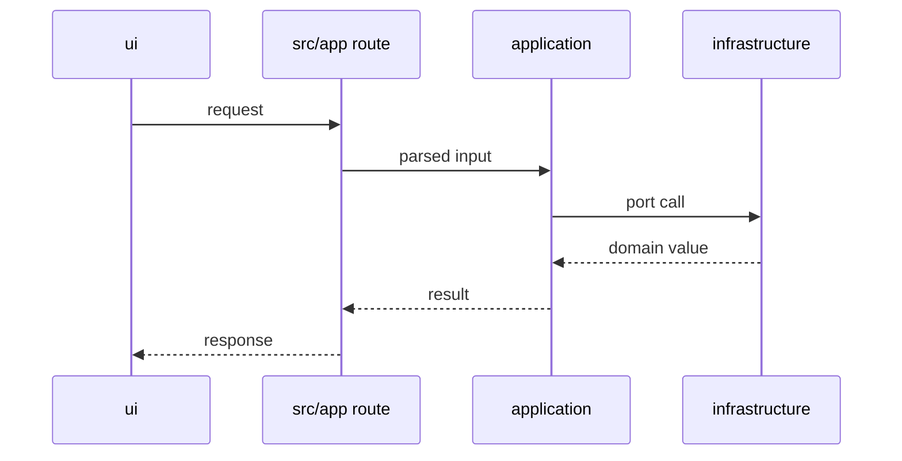

# Code documentation standard

> **Decision:** [ADR 0006](../adr/0006-comment-and-documentation-standard.md). **Applies to:**
> every new module, and every module a pull request touches. **Related:**
> [CONTEXT.md](../../CONTEXT.md) for domain words, [architecture.md](architecture.md) for where
> code lives.

The owner asked for "a lot of comments". This standard reads that as **a lot of information**:
every comment must tell the reader something the code cannot. A comment that repeats the code is
noise, and noise hides the comments that matter.

Four principles:

1. **Information, not paraphrase.** Write what the name and the type cannot say: the contract,
   the rule, the source, the reason.
2. **Once, next to where it applies.** A fact lives in one place. Other places link to it.
3. **Write the header and the contract first.** Writing them before the code is a design step:
   if the contract is hard to state, the design is not clear yet.
4. **A false comment is a bug.** Changing code obliges you to re-read and fix the comments of the
   functions you changed and their module header, in the same commit.

## Contents

- [Module header](#module-header)
- [Contract comments on exports](#contract-comments-on-exports)
- [Why-comments inside a body](#why-comments-inside-a-body)
- [Citing the Comprehensive Rules](#citing-the-comprehensive-rules)
- [Citing external limits](#citing-external-limits)
- [What not to write](#what-not-to-write)
- [Examples from this code base](#examples-from-this-code-base)
- [Where each kind of documentation lives](#where-each-kind-of-documentation-lives)
- [Per-context README template](#per-context-readme-template)
- [Functional documentation template](#functional-documentation-template)
- [Enforcement](#enforcement)

## Module header

Every module opens with a block that says what it is for. A reader who opens the file should know,
before reading any code, whether this is the file they need.

```ts
/**
 * <One sentence: what this module is responsible for, in domain words.>
 *
 * <Where it sits: the bounded context and the part of it this module covers.>
 * <Main collaborators: what it calls and what calls it, when that is not obvious.>
 * <Rules: the Comprehensive Rules numbers or other sources it implements.>
 * <Not responsible for: what a reader might look for here but will find elsewhere.>
 *
 * @module <context>/<file>
 */
```

- Keep it short: three to eight lines of text is typical. Leave out a line that has nothing to say.
- The `@module` tag names the module as `<context>/<file>` (today, `<lib folder>/<file>`), as
  `src/lib/playtest/free-mulligan.ts` does.
- Route handlers and pages get a header too: which URL, which use case, who may call it.
- Test files need no header unless they hold shared fixtures or a characterization suite, which
  must say what behaviour it pins and why.

## Contract comments on exports

Every exported function, type and constant gets a TSDoc block that states its **contract**.

```ts
/**
 * <What it does or what it is, as a result in domain words.>
 *
 * <Input constraints: units, ranges, what an empty or absent value means.>
 * <Edge cases and errors: what happens at the limits, what it throws or returns on failure.>
 * <Why: the reason for a non-obvious choice, with its source.>
 *
 * @param name - <only what the name and the type do not already say>
 * @returns <only when the summary does not already say it>
 * @throws <ErrorType> <when>
 * @example <for a policy whose outcome is not obvious>
 */
```

What a contract covers, when it applies:

| Item                          | Example                                                                    |
| ----------------------------- | -------------------------------------------------------------------------- |
| Result in domain words        | "Cards a London mulligan puts on the bottom."                              |
| Preconditions                 | "`deckCards` holds one entry per physical card; commanders are not in it." |
| Postconditions and guarantees | "Never below zero." "Sorted by card name, then id."                        |
| Absence                       | "Returns `null` when the deck has no one-drop."                            |
| Errors                        | "Throws `HttpStatusError` when Scryfall answers 5xx."                      |
| Side effects                  | "Writes the guest deck to `localStorage`."                                 |
| Units                         | "Milliseconds." "Percentage points, negative when starved."                |
| Source                        | "CR 103.5c." "Scryfall rate limits, read 2026-11-10."                      |

- `@param` and `@returns` are written only when they add something. `@param format - the deck's
format` adds nothing; leave it out. `@param mulligansTaken - the free one included` adds
  something; keep it.
- A type gets a one-line description; a field gets its own comment when its unit, range,
  nullability or meaning is not obvious from its name and type.
- A discriminated union documents what each `kind` means for the caller.

## Why-comments inside a body

Inside a function, comment only knowledge the code cannot express:

| Kind                            | Example                                                                                                                   |
| ------------------------------- | ------------------------------------------------------------------------------------------------------------------------- |
| A game rule                     | `// CR 903.5b: basic lands are exempt from the singleton rule.`                                                           |
| An external limit               | `// Scryfall allows 2 requests per second on /cards/search (https://scryfall.com/docs/api/rate-limits, read 2026-11-10).` |
| A decision                      | `// ADR 0009: legality is reported, never used to refuse the edit.`                                                       |
| A bug that shaped the code      | `// #1301: the free mulligan counts toward neither the bottom nor the limit.`                                             |
| A rejected alternative          | `// Not Math.random(): the shuffle must not be predictable; see crypto-random.ts.`                                        |
| A cross-file dependency         | `// If you change this list, change the SQL twin in the migration too.`                                                   |
| A performance reason            | `// One pass over the rows: the store calls this on every keystroke.`                                                     |
| A product deviation from a rule | `// Product choice: the playtest always plays the starting player; CR 103.1 lets players choose.`                         |

## Citing the Comprehensive Rules

Every game rule in the code cites the Comprehensive Rules (CR) number it implements.

- **Format.** `CR 903.5b`; several numbers as `CR 103.5, 103.5c`. No "rule", no "§".
- **Check the number** against the text in the repository before you commit it:

  ```bash
  grep -E "^903\.5b " src/lib/rules/data/MagicCompRules-20260807.txt
  ```

  The reference is the edition the app ships: `src/lib/rules/data/MagicCompRules-20260807.txt`,
  effective 2026-08-07. Do not check against the older copy in `docs/rules/` (effective
  2026-02-27). When the app ships a new edition, the citations are re-checked against it.

- **Quote the rule** when its exact wording matters to the code, as
  `src/lib/playtest/free-mulligan.ts` does for CR 103.5c.
- **Say when the product deviates** from a rule, and why.
- **Use the CR's words** for the concept. The glossary ([CONTEXT.md](../../CONTEXT.md)) lists them
  and flags code names that differ.

## Citing external limits

A limit set by someone else (a rate limit, a size cap, a timeout, a pagination size, a model's
output cap) cites its source with a URL and the date it was read. Limits change; the date tells the
next reader how old the knowledge is.

```ts
/**
 * Spacing between requests to api.scryfall.com.
 *
 * Scryfall allows 2 requests per second (500 ms) on /cards/search, /cards/named,
 * /cards/random and /cards/collection, and 10 per second (100 ms) on other methods.
 * A 429 answer blocks the caller for 30 seconds.
 * Source: https://scryfall.com/docs/api/rate-limits (read 2026-11-10).
 */
```

When the source cannot be linked (a guide behind a login, a support email), say where it came
from and when.

## What not to write

| Do not write                                                          | Instead                                                                  |
| --------------------------------------------------------------------- | ------------------------------------------------------------------------ |
| A comment that restates the code: `// increment the count`            | Nothing.                                                                 |
| A tag that restates the signature: `@param typeLine - Card type line` | Leave the tag out, or say what the name cannot.                          |
| A comment that compensates for a bad name                             | Rename.                                                                  |
| Commented-out code                                                    | Delete it; git keeps it.                                                 |
| A `TODO` without an issue number                                      | `TODO(#1234): …`, or open the issue first.                               |
| Author names, dates of change, changelog lines                        | Git history and the pull request.                                        |
| The same fact in two places                                           | One home, and a link from the other.                                     |
| A multi-paragraph incident story in a config file or a function       | One line with the decision and a link to the ADR, issue or pull request. |
| A comment that is no longer true                                      | Fix it in the same commit as the code.                                   |

## Examples from this code base

### A good existing example: `src/lib/playtest/free-mulligan.ts`

```ts
/**
 * Whether a playtest game's first mulligan is free, and whether the player is
 * asked how many players the game has.
 *
 * CR 103.5c: "In a multiplayer game and in any Brawl game, the first mulligan
 * a player takes doesn't count toward the number of cards that player will put
 * on the bottom of their library or the number of mulligans that player may
 * take." The format alone does not decide it: Commander and Oathbreaker are
 * usually played multiplayer, but a one-on-one game gets no free mulligan.
 * The same answer decides the first-turn draw (CR 103.8a, 103.8c) and Brawl's
 * starting life total (CR 903.12f).
 *
 * @module playtest/free-mulligan
 */
```

```ts
/**
 * Whether the player is asked if the game is multiplayer: for the formats
 * usually, but not always, played multiplayer. Brawl is asked too: its free
 * mulligan holds at any table, but a two-player game starts at 25 life instead
 * of 30 (CR 903.12f) and skips the turn-1 draw (CR 103.8a). The constructed
 * formats are duels.
 *
 * @param format - the deck's format
 * @returns true for the formats usually, but not always, played multiplayer
 */
export function offersMultiplayerChoice(format: DeckFormat): boolean {
  return isMultiplayerByDefault(format);
}
```

Why it works:

- The header states the module's single question, quotes the rule it implements with its number,
  and names the trap a reader would fall into ("the format alone does not decide it").
- The function comment explains **why** Brawl is asked even though its free mulligan never
  depends on the answer, which the code (`isMultiplayerByDefault(format)`) cannot say.
- The `@returns` line adds a nuance ("usually, but not always") that the name lacks. The
  `@param format - the deck's format` line adds nothing and could go.

### A rewritten example: `maxQuantity` in `src/lib/deck/multiples.ts`

Before:

```ts
/**
 * Returns the max allowed quantity for a card.
 * @param cardName - Card name for capped-multiples lookup
 * @param typeLine - Card type line
 * @param oracleText - Oracle text for "any number" detection
 * @param format - Deck format (determines default max copies)
 * @returns Max allowed copies
 */
export function maxQuantity(
  cardName: string,
  typeLine: string,
  oracleText: string = "",
  format: DeckFormat = "commander"
): number {
  if (typeLine.toLowerCase().includes("basic land")) return 99;
  if (oracleAllowsMultiples(oracleText)) return 99;
  if (CAPPED_MULTIPLES[cardName] !== undefined)
    return CAPPED_MULTIPLES[cardName];
  return getFormatConfig(format).maxCopiesPerCard;
}
```

What is wrong: every tag restates a parameter name; nothing says which rule is implemented, in
what order the exceptions apply, or why 99 is the "unlimited" value.

After:

```ts
/**
 * Most copies of one card a deck of this format may hold.
 *
 * The format's copy limit applies (CR 903.5b: one copy in Commander), except that:
 * - basic lands are exempt (CR 903.5b), so any number up to the deck size is allowed;
 * - a card whose text says "a deck can have any number of cards named …" overrides the
 *   limit (CR 101.1: card text takes precedence over the rules);
 * - a few cards set their own cap in their text (Seven Dwarves: 7, Nazgûl: 9).
 *
 * "Any number" is returned as 99, the largest quantity one deck row may hold.
 *
 * @param oracleText - English Oracle text; omit it and the "any number" exception is not applied
 * @param format - defaults to Commander
 */
```

Writing this contract exposes a bug. The basic-land test reads the type line as text, and a snow
basic's type line is "Basic Snow Land — Forest", which does not contain "basic land"; CR 205.4c
defines a basic land by its supertype. The comment must not promise what the code does not do, and
it is not the place to track the bug either: the fix is a behaviour change, so it goes in its own
`fix/` pull request with a Red test, and the contract is published with that fix.

## Where each kind of documentation lives

Each kind of knowledge has one home. When you are about to write something down, find its row.

| Kind of knowledge                             | Home                                                                                                                            | Notes                                                                                                |
| --------------------------------------------- | ------------------------------------------------------------------------------------------------------------------------------- | ---------------------------------------------------------------------------------------------------- |
| How the system is structured, where code goes | [docs/engineering/architecture.md](architecture.md)                                                                             | Context map, C4 view, layers, entry points                                                           |
| Why the system is built this way              | [docs/adr/](../adr/README.md)                                                                                                   | One ADR per decision, MADR 4 format, with an index                                                   |
| What a domain word means                      | [CONTEXT.md](../../CONTEXT.md)                                                                                                  | By context, with CR numbers and code names                                                           |
| How one context works inside                  | `src/modules/<context>/README.md`                                                                                               | Created when the context moves; template below                                                       |
| What the player can do in one context         | `docs/functional/<context>.md`                                                                                                  | Template in [docs/functional/README.md](../functional/README.md)                                     |
| How to use the product                        | [docs/product/user-guide.md](../product/user-guide.md)                                                                          | Written for players                                                                                  |
| What a feature should become                  | `docs/product/specs/`                                                                                                           | One spec per roadmap initiative                                                                      |
| How to play and build well, with sources      | `docs/product/guides/`                                                                                                          | Player guides that the code cites as sources                                                         |
| Official reference data                       | `docs/references/`, `src/lib/rules/data/`                                                                                       | Game Changers, banlists; the Comprehensive Rules edition the app ships                               |
| How to run, test and deploy                   | [technical.md](technical.md), [infrastructure.md](infrastructure.md)                                                            | Stack, local setup, environment                                                                      |
| How to work                                   | [tdd-with-ai.md](tdd-with-ai.md), [definition-of-done.md](definition-of-done.md), [quality-gate.md](quality-gate.md), this file | Method, gates, standards                                                                             |
| What a module or function guarantees          | The code: module header and TSDoc                                                                                               | This standard                                                                                        |
| Release history and progress                  | `docs/project/changelog.md`, `docs/project/progress.md`, `docs/product/roadmap.md`                                              | Changed only in a dedicated `chore/docs` pull request after a merge batch, never on a feature branch |

What is derivable from code is generated rather than written by hand. The dependency graph is
[dependency-graph.generated.md](dependency-graph.generated.md), written by `pnpm arch:graph`; the
route table and the API reference will follow, checked in CI.

## Per-context README template

Each context folder gets a `README.md` when it moves to `src/modules/<context>/`. It is the
technical entry point for a reader or an agent landing in the folder. Keep it under about 150
lines; link to the functional doc and the glossary instead of repeating them.

````markdown
# <Context name>

> **Kind:** core | supporting | generic. **Functional doc:** [docs/functional/<context>.md](…).
> **Glossary:** [CONTEXT.md, <Context>](…). **Decisions:** ADR NNNN, …

## Responsibilities

What this context owns, in three to six bullets. Then what it explicitly does not own, and which
context does.

## Public API

| Export           | Entry                                                     | Purpose  | Used by            |
| ---------------- | --------------------------------------------------------- | -------- | ------------------ |
| `functionOrType` | `index.ts` / `server.ts` / `client.ts` / `ui/<Component>` | One line | Contexts or routes |

## Data flow

How a typical request moves through the layers, from the route or component to the use case,
the domain and the adapters. One Mermaid sequence diagram for the main flow:



## Invariants

The rules this context guarantees, each with its source (CR number, ADR or product decision) and
the test that pins it.

## Persistence and providers

Tables owned, who else reads them. External providers, their limits (with source and date),
caching and failure behaviour, and the recorded fixtures.

## Testing

Where the tests are, which fakes and contract suites exist, which characterization suites pin
legacy behaviour, which E2E specs cover the context.

## Known gaps

Mismatches with the glossary, open issues, pending decisions. Each with a link.
````

## Functional documentation template

Each context gets a functional document in `docs/functional/<context>.md`: what the player can do,
the rules applied, the edge cases. The copy-paste template and the list of contexts live in
[docs/functional/README.md](../functional/README.md), where those documents are written. Its
sections:

| Section                | Holds                                                                                  |
| ---------------------- | -------------------------------------------------------------------------------------- |
| What the player can do | Capabilities, each linked to the user guide                                            |
| Rules applied          | Each rule in plain words, its source, and where it is enforced (server, browser, both) |
| Edge cases             | Situation, behaviour, and the test that proves it                                      |
| States and messages    | Empty, loading, error and partial states; the i18n namespace                           |
| Who can do what        | Guest, signed-in user, owner, moderator, API key scope                                 |
| Not yet                | What is out of scope, with roadmap links                                               |

## Enforcement

- **Review.** The reviewer asks of every comment in the diff: "Does it say something the code does
  not?" and "Is it still true?"
- **Lint, in stages** ([ADR 0007](../adr/0007-architecture-enforcement-in-stages.md)): once the
  ESLint flat config exists, `eslint-plugin-jsdoc` runs on `src/modules/**` with `require-jsdoc`
  on exports, then `informative-docs`, which reports comments that only restate a name. Line-count
  limits exclude comments, so this standard is never penalised.
- **Planned tests** that fail on drift: every CR number cited in `src/` exists in the shipped
  Comprehensive Rules text; every glossary term has a code anchor; the ADR index lists every ADR.
