# Dependency graph (generated)

> Generated by `pnpm arch:graph` (`scripts/arch-graph.mjs`) from `.dependency-cruiser.cjs`. Do not
> edit by hand: change the code and run the command again. An arrow means "imports", type-only imports
> included. The rules this graph is checked against are in [ADR 0007](../adr/0007-architecture-enforcement-in-stages.md)
> and [architecture.md](architecture.md#layers-and-dependency-rules).

```mermaid
flowchart LR

subgraph src["src"]
  subgraph src_app["app"]
    src_app__locale_["[locale]"]
    src_app_api["api"]
    src_app_global_error_tsx["global-error.tsx"]
    src_app_layout_tsx["layout.tsx"]
    src_app_not_found_tsx["not-found.tsx"]
    src_app_og["og"]
    src_app_robots_ts["robots.ts"]
    src_app_sitemap_ts["sitemap.ts"]
  end
  subgraph src_components["components"]
    src_components_JsonLd_tsx["JsonLd.tsx"]
    src_components_auth["auth"]
    src_components_builder["builder"]
    src_components_card["card"]
    src_components_collection["collection"]
    src_components_community["community"]
    src_components_deck["deck"]
    src_components_landing["landing"]
    src_components_layout["layout"]
    src_components_moderation["moderation"]
    src_components_og["og"]
    src_components_onboarding["onboarding"]
    src_components_playtest["playtest"]
    src_components_profile["profile"]
    src_components_providers["providers"]
    src_components_rules["rules"]
    src_components_search["search"]
    src_components_settings["settings"]
    src_components_ui["ui"]
  end
  src_hooks["hooks"]
  src_i18n["i18n"]
  src_instrumentation_client_ts["instrumentation-client.ts"]
  src_instrumentation_ts["instrumentation.ts"]
  subgraph src_lib["lib"]
    src_lib_ai["ai"]
    src_lib_api["api"]
    src_lib_archetypes["archetypes"]
    src_lib_async["async"]
    src_lib_auth["auth"]
    src_lib_cache_limits_ts["cache-limits.ts"]
    src_lib_challenges["challenges"]
    src_lib_collection["collection"]
    src_lib_community["community"]
    src_lib_constants["constants"]
    src_lib_crypto_random_ts["crypto-random.ts"]
    src_lib_csv_ts["csv.ts"]
    src_lib_db["db"]
    src_lib_deck["deck"]
    src_lib_download_text_file_ts["download-text-file.ts"]
    src_lib_export["export"]
    src_lib_guards_ts["guards.ts"]
    src_lib_http_ts["http.ts"]
    src_lib_import["import"]
    src_lib_logger_ts["logger.ts"]
    src_lib_mana["mana"]
    src_lib_meta["meta"]
    src_lib_playtest["playtest"]
    src_lib_rate_limit_ts["rate-limit.ts"]
    src_lib_ratings["ratings"]
    src_lib_recommendations["recommendations"]
    src_lib_rules["rules"]
    src_lib_scryfall["scryfall"]
    src_lib_search["search"]
    src_lib_security_headers_ts["security-headers.ts"]
    src_lib_seo["seo"]
    src_lib_shortcuts["shortcuts"]
    src_lib_social["social"]
    src_lib_text["text"]
    src_lib_theme["theme"]
    src_lib_ui["ui"]
    src_lib_validation["validation"]
    src_lib_versioning["versioning"]
  end
  src_middleware_ts["middleware.ts"]
  subgraph src_modules["modules"]
    src_modules_combos["combos"]
  end
  src_styles["styles"]
end
src_app__locale_-->src_components_auth
src_app__locale_-->src_components_layout
src_app__locale_-->src_components_builder
src_app__locale_-->src_components_card
src_app__locale_-->src_components_deck
src_app__locale_-->src_components_playtest
src_app__locale_-->src_components_search
src_app__locale_-->src_components_ui
src_app__locale_-->src_hooks
src_app__locale_-->src_i18n
src_app__locale_-->src_lib_ai
src_app__locale_-->src_lib_deck
src_app__locale_-->src_lib_logger_ts
src_app__locale_-->src_lib_scryfall
src_app__locale_-->src_lib_search
src_app__locale_-->src_lib_ui
src_app__locale_-->src_modules_combos
src_app__locale_-->src_components_collection
src_app__locale_-->src_lib_seo
src_app__locale_-->src_components_profile
src_app__locale_-->src_components_community
src_app__locale_-->src_lib_api
src_app__locale_-->src_lib_auth
src_app__locale_-->src_lib_community
src_app__locale_-->src_lib_meta
src_app__locale_-->src_components_providers
src_app__locale_-->src_lib_theme
src_app__locale_-->src_styles
src_app__locale_-->src_components_onboarding
src_app__locale_-->src_components_moderation
src_app__locale_-->src_lib_db
src_app__locale_-->src_components_JsonLd_tsx
src_app__locale_-->src_components_landing
src_app__locale_-->src_components_rules
src_app__locale_-->src_components_settings
src_app_api-->src_lib_ai
src_app_api-->src_lib_async
src_app_api-->src_lib_auth
src_app_api-->src_lib_db
src_app_api-->src_lib_logger_ts
src_app_api-->src_lib_playtest
src_app_api-->src_lib_rate_limit_ts
src_app_api-->src_lib_scryfall
src_app_api-->src_lib_validation
src_app_api-->src_lib_constants
src_app_api-->src_lib_api
src_app_api-->src_lib_collection
src_app_api-->src_modules_combos
src_app_api-->src_lib_community
src_app_api-->src_lib_deck
src_app_api-->src_lib_mana
src_app_api-->src_lib_ratings
src_app_api-->src_lib_import
src_app_api-->src_lib_http_ts
src_app_api-->src_lib_meta
src_app_api-->src_lib_search
src_app_api-->src_lib_social
src_app_og-->src_components_og
src_app_og-->src_i18n
src_app_og-->src_lib_deck
src_app_og-->src_lib_seo
src_app_robots_ts-->src_i18n
src_app_robots_ts-->src_lib_seo
src_app_sitemap_ts-->src_lib_db
src_app_sitemap_ts-->src_lib_logger_ts
src_app_sitemap_ts-->src_lib_meta
src_app_sitemap_ts-->src_lib_seo
src_components_auth-->src_i18n
src_components_auth-->src_lib_auth
src_components_auth-->src_components_onboarding
src_components_builder-->src_components_ui
src_components_builder-->src_lib_scryfall
src_components_builder-->src_components_search
src_components_builder-->src_lib_search
src_components_builder-->src_lib_deck
src_components_builder-->src_i18n
src_components_card-->src_components_ui
src_components_card-->src_hooks
src_components_card-->src_i18n
src_components_card-->src_lib_collection
src_components_card-->src_lib_scryfall
src_components_card-->src_lib_mana
src_components_card-->src_lib_deck
src_components_card-->src_components_collection
src_components_collection-->src_components_ui
src_components_collection-->src_lib_collection
src_components_collection-->src_lib_deck
src_components_collection-->src_lib_scryfall
src_components_collection-->src_components_card
src_components_collection-->src_lib_download_text_file_ts
src_components_collection-->src_i18n
src_components_community-->src_components_ui
src_components_community-->src_i18n
src_components_community-->src_lib_community
src_components_community-->src_lib_scryfall
src_components_community-->src_components_deck
src_components_community-->src_lib_deck
src_components_community-->src_lib_logger_ts
src_components_community-->src_lib_ratings
src_components_community-->src_lib_social
src_components_deck-->src_components_ui
src_components_deck-->src_hooks
src_components_deck-->src_lib_ai
src_components_deck-->src_lib_deck
src_components_deck-->src_lib_meta
src_components_deck-->src_lib_constants
src_components_deck-->src_lib_scryfall
src_components_deck-->src_i18n
src_components_deck-->src_lib_collection
src_components_deck-->src_lib_download_text_file_ts
src_components_deck-->src_components_card
src_components_deck-->src_lib_logger_ts
src_components_deck-->src_lib_async
src_components_deck-->src_lib_import
src_components_deck-->src_lib_db
src_components_deck-->src_app_api
src_components_landing-->src_i18n
src_components_landing-->src_components_layout
src_components_layout-->src_components_auth
src_components_layout-->src_components_deck
src_components_layout-->src_components_ui
src_components_layout-->src_i18n
src_components_layout-->src_lib_deck
src_components_layout-->src_hooks
src_components_layout-->src_lib_theme
src_components_layout-->src_lib_ui
src_components_moderation-->src_i18n
src_components_og-->src_lib_deck
src_components_onboarding-->src_hooks
src_components_onboarding-->src_components_ui
src_components_playtest-->src_components_card
src_components_playtest-->src_components_ui
src_components_playtest-->src_lib_deck
src_components_playtest-->src_lib_playtest
src_components_playtest-->src_lib_scryfall
src_components_playtest-->src_lib_download_text_file_ts
src_components_playtest-->src_hooks
src_components_playtest-->src_lib_logger_ts
src_components_profile-->src_components_community
src_components_profile-->src_components_ui
src_components_profile-->src_i18n
src_components_profile-->src_lib_deck
src_components_profile-->src_lib_scryfall
src_components_profile-->src_lib_db
src_components_profile-->src_components_deck
src_components_profile-->src_lib_community
src_components_profile-->src_lib_social
src_components_providers-->src_lib_auth
src_components_providers-->src_lib_collection
src_components_providers-->src_hooks
src_components_providers-->src_lib_theme
src_components_rules-->src_components_ui
src_components_rules-->src_i18n
src_components_rules-->src_lib_rules
src_components_rules-->src_components_card
src_components_rules-->src_hooks
src_components_rules-->src_lib_scryfall
src_components_search-->src_hooks
src_components_search-->src_lib_search
src_components_search-->src_components_ui
src_components_search-->src_lib_logger_ts
src_components_search-->src_lib_ui
src_components_search-->src_lib_deck
src_components_search-->src_lib_scryfall
src_components_search-->src_components_card
src_components_settings-->src_components_ui
src_components_settings-->src_hooks
src_components_settings-->src_lib_api
src_components_ui-->src_hooks
src_hooks-->src_lib_search
src_hooks-->src_lib_scryfall
src_hooks-->src_lib_ai
src_hooks-->src_lib_deck
src_hooks-->src_lib_collection
src_hooks-->src_lib_guards_ts
src_hooks-->src_lib_meta
src_hooks-->src_lib_logger_ts
src_hooks-->src_components_providers
src_hooks-->src_lib_theme
src_hooks-->src_lib_playtest
src_hooks-->src_modules_combos
src_hooks-->src_lib_ui
src_hooks-->src_app_api
src_lib_ai-->src_lib_validation
src_lib_ai-->src_lib_deck
src_lib_ai-->src_lib_scryfall
src_lib_ai-->src_app_api
src_lib_ai-->src_lib_guards_ts
src_lib_ai-->src_lib_logger_ts
src_lib_ai-->src_lib_db
src_lib_ai-->src_hooks
src_lib_ai-->src_lib_constants
src_lib_api-->src_lib_logger_ts
src_lib_api-->src_lib_deck
src_lib_api-->src_lib_validation
src_lib_api-->src_lib_db
src_lib_api-->src_lib_rate_limit_ts
src_lib_api-->src_lib_collection
src_lib_auth-->src_lib_db
src_lib_auth-->src_lib_rate_limit_ts
src_lib_auth-->src_i18n
src_lib_collection-->src_lib_async
src_lib_collection-->src_lib_logger_ts
src_lib_collection-->src_lib_guards_ts
src_lib_collection-->src_lib_deck
src_lib_collection-->src_lib_scryfall
src_lib_collection-->src_lib_csv_ts
src_lib_community-->src_lib_ratings
src_lib_community-->src_lib_deck
src_lib_community-->src_lib_async
src_lib_community-->src_lib_scryfall
src_lib_community-->src_lib_db
src_lib_db-->src_lib_deck
src_lib_deck-->src_lib_mana
src_lib_deck-->src_lib_constants
src_lib_deck-->src_lib_scryfall
src_lib_deck-->src_lib_async
src_lib_deck-->src_hooks
src_lib_deck-->src_lib_collection
src_lib_deck-->src_lib_db
src_lib_deck-->src_lib_logger_ts
src_lib_deck-->src_modules_combos
src_lib_deck-->src_lib_guards_ts
src_lib_deck-->src_lib_text
src_lib_export-->src_lib_csv_ts
src_lib_export-->src_lib_deck
src_lib_import-->src_lib_guards_ts
src_lib_import-->src_lib_http_ts
src_lib_import-->src_lib_scryfall
src_lib_meta-->src_lib_http_ts
src_lib_meta-->src_lib_db
src_lib_meta-->src_lib_logger_ts
src_lib_playtest-->src_lib_validation
src_lib_playtest-->src_lib_crypto_random_ts
src_lib_playtest-->src_lib_deck
src_lib_playtest-->src_lib_mana
src_lib_playtest-->src_lib_guards_ts
src_lib_recommendations-->src_lib_deck
src_lib_scryfall-->src_lib_guards_ts
src_lib_scryfall-->src_lib_async
src_lib_scryfall-->src_lib_http_ts
src_lib_scryfall-->src_lib_logger_ts
src_lib_scryfall-->src_lib_deck
src_lib_scryfall-->src_lib_cache_limits_ts
src_lib_scryfall-->src_lib_db
src_lib_scryfall-->src_lib_rate_limit_ts
src_lib_search-->src_lib_deck
src_lib_search-->src_lib_guards_ts
src_lib_search-->src_lib_mana
src_lib_search-->src_lib_validation
src_lib_seo-->src_i18n
src_lib_seo-->src_lib_text
src_lib_seo-->src_lib_meta
src_lib_theme-->src_lib_guards_ts
src_lib_validation-->src_lib_mana
src_lib_validation-->src_lib_deck
src_lib_validation-->src_lib_scryfall
src_lib_versioning-->src_lib_crypto_random_ts
src_lib_versioning-->src_lib_deck
src_middleware_ts-->src_i18n
src_middleware_ts-->src_lib_auth
src_modules_combos-->src_lib_deck
src_modules_combos-->src_components_ui
src_modules_combos-->src_lib_http_ts
```

