# MagicAIBuilder: Product Roadmap

> **Updated:** 2026-11-11 (depth pass: stories, dependencies, personas, risks)

> **North star:** help a Commander player go from an idea to a legal, explainable, testable and enjoyable deck.

This roadmap is the index. The user stories, scenarios and scope for each initiative live in its spec file.

## Themes

The initiatives group into the jobs a Commander player actually has. I-80 to I-98, added on 2026-11-11, are marked. Placement and the impact table are in [Impact and effort](#twelfth-pass-impact-effort-and-placement). Personas, the dependency graph, the quarter sequence and the risks are in [Planning Views](#planning-views).

| Theme | Already on the roadmap | Added in this pass |
| --- | --- | --- |
| AI coaching and explainability | I-02, I-14, I-22, I-70 | I-83, I-91 |
| Game night and pods | I-15, I-23, I-35, I-41, I-79 | I-88, I-94 |
| Playtesting and goldfish | I-07, I-21, I-31 | I-81, I-82, I-87, I-97 |
| Budget, price and proxies | I-06, I-32, I-45, I-55, I-59 | I-80, I-84, I-96 |
| Collection and import | I-16, I-26, I-43, I-62, I-76 | I-89, I-90 |
| Sharing, creators and search | I-08, I-34, I-36, I-46, I-75 | I-92, I-95 |
| Phone, offline and reading | I-11, I-19, I-24, I-25, I-40, I-49 | I-93 |
| Trust, data and competitive lists | I-09, I-38, I-67, I-77 | I-86, I-98 |
| Money and growth | I-30, I-39, I-66, I-72 | — |
| Platform | I-05, I-69, I-71, I-74 | I-95 |

I-85, player-supplied art, sits with the editor and is not a custom card. Cube, a life counter and a custom-card creator stay non-goals.

## Roadmap At A Glance

One row per initiative, in numeric order, generated on 2026-11-11 by the script behind the [dependency page](specs/dependency-graph.md). State is the initiative's `Status` line. Priority is Now, Next, Later or Parked. The slice column names the lowest-numbered slice that can start now. Every initiative has a spec file. Regenerate it with the dependency page; do not edit rows by hand. The generator must keep every row's spec link, including I-80 to I-98. [I-74](specs/i74-a-roadmap-agents-can-execute.md) slice 4 moves its generation into the repository, behind a CI check.

<!-- glance:start -->

| ID                                                                                 | Initiative               | State    | Priority     | First slice that can start now                                          | Spec                                                                       |
| ---------------------------------------------------------------------------------- | ------------------------ | -------- | ------------ | ----------------------------------------------------------------------- | -------------------------------------------------------------------------- |
| [I-01](specs/i01-deck-editor-workflow.md)                                                 | Editor workflow          | Building | Now          | —                                                                       |  [spec](specs/i01-deck-editor-workflow.md)                                 |
| [I-02](specs/i02-checkable-ai-copilot.md)                                                      | AI copilot               | Building | Now          | 1: Type every claim at the API boundary (+1 more)                       |  [spec](specs/i02-checkable-ai-copilot.md)                                 |
| [I-03](specs/i03-trustworthy-deck-feedback.md)                                            | Deck feedback            | Building | Now          | —                                                                       |  [spec](specs/i03-trustworthy-deck-feedback.md)                            |
| [I-04](specs/i04-ux-stability-and-visual-quality.md)                                      | UX stability             | Next     | Now          | —                                                                       |  [spec](specs/i04-ux-stability-and-visual-quality.md)                      |
| [I-05](specs/i05-production-safety.md)                                                    | Production safety        | Building | Now          | —                                                                       |  [spec](specs/i05-production-safety.md)                                    |
| [I-06](specs/i06-collection-and-purchase-planning.md)                                     | Collection planning      | Building | Next         | —                                                                       |  [spec](specs/i06-collection-and-purchase-planning.md)                     |
| [I-07](specs/i07-playtest-and-iteration.md)                                               | Playtest                 | Building | Next         | —                                                                       |  [spec](specs/i07-playtest-and-iteration.md)                               |
| [I-08](specs/i08-share-compare-and-learn.md)                                              | Share and learn          | Building | Next         | —                                                                       |  [spec](specs/i08-share-compare-and-learn.md)                              |
| [I-09](specs/i09-meta-and-evidence.md)                                                    | Meta and evidence        | Building | Next         | —                                                                       |  [spec](specs/i09-meta-and-evidence.md)                                    |
| [I-10](specs/i10-interoperability-and-integrations.md)                                    | Interop                  | Shipped  | Later        | —                                                                       |  [spec](specs/i10-interoperability-and-integrations.md)                    |
| [I-11](specs/i11-localization-and-regional-experience.md)                                 | Localization             | Shipped  | Later        | —                                                                       |  [spec](specs/i11-localization-and-regional-experience.md)                 |
| [I-12](specs/i12-local-ai.md)                                                             | Local AI                 | Parked   | Later        | —                                                                       |  [spec](specs/i12-local-ai.md)                                             |
| [I-13](specs/i13-visual-direction.md)                                              | Visual redesign          | Building | Next         | 1: Token corrections                                                    |  [spec](specs/i13-visual-direction.md)                                     |
| [I-14](specs/i14-verifiable-natural-language-search.md)                                   | Language search          | Next     | Next         | 1: Translate route + query display                                      |  [spec](specs/i14-verifiable-natural-language-search.md)                   |
| [I-15](specs/i15-rule-zero-sheets-and-pod-profiles.md)                                       | Rule 0 sheets            | Next     | Next         | 1: Sheet model, per-deck create and edit                                |  [spec](specs/i15-rule-zero-sheets-and-pod-profiles.md)                    |
| [I-16](specs/i16-decks-buildable-from-a-collection.md)                                    | Buildable decks          | Next     | Next         | 4: Commitment index from deck and collection rows…                      |  [spec](specs/i16-decks-buildable-from-a-collection.md)                    |
| [I-17](specs/i17-precon-path-and-tiered-upgrades.md)                                      | Precon path              | Next     | Next         | 1: Catalogue model and read-only display                                |  [spec](specs/i17-precon-path-and-tiered-upgrades.md)                      |
| [I-18](specs/i18-per-deck-radar-of-new-cards.md)                                          | New-card radar           | Later    | Later        | —                                                                       |  [spec](specs/i18-per-deck-radar-of-new-cards.md)                          |
| [I-19](specs/i19-offline-game-night-viewing.md)                                           | Offline viewing          | Next     | Next         | 1: Service worker skeleton with a versioned cache                       |  [spec](specs/i19-offline-game-night-viewing.md)                           |
| [I-20](specs/i20-collaborative-review.md)                                                 | Review                   | Later    | Later        | 1: Reviewer role and invitation                                         |  [spec](specs/i20-collaborative-review.md)                                 |
| [I-21](specs/i21-reproducible-probability-bench.md)                                       | Probability bench        | Later    | Later        | 1: Seeded PRNG and shuffler                                             |  [spec](specs/i21-reproducible-probability-bench.md)                       |
| [I-22](specs/i22-verification-as-a-public-surface.md)                                     | Public verification      | Later    | Later (2027) | —                                                                       |  [spec](specs/i22-verification-as-a-public-surface.md)                     |
| [I-23](specs/i23-the-pods-own-surface.md)                                                 | Pod surface              | Later    | Later (2027) | 1: Account linking, revocable                                           |  [spec](specs/i23-the-pods-own-surface.md)                                 |
| [I-24](specs/i24-decks-a-screen-reader-can-play-from.md)                                  | Screen reader            | Later    | Later (2027) | 1: Audit the deck view with a screen reader and record what…            |  [spec](specs/i24-decks-a-screen-reader-can-play-from.md)                  |
| [I-25](specs/i25-a-third-locale.md)                                    | Third locale             | Later    | Later (2027) | 1: Record the choice and its evidence in this spec                      |  [spec](specs/i25-a-third-locale.md)                                       |
| [I-26](specs/i26-collections-arriving-from-elsewhere.md)                                  | Collection import        | Later    | Later (2027) | —                                                                       |  [spec](specs/i26-collections-arriving-from-elsewhere.md)                  |
| [I-27](specs/i27-learning-while-building.md)                                              | Learning                 | Later    | Later (2027) | 1: Content model, with the coverage test over warning classes           |  [spec](specs/i27-learning-while-building.md)                              |
| [I-28](specs/i28-commander-deckbuilding-guide-by-bracket.md)                              | Bracket guide            | Building | Next         | — (slice 2 in flight)                                                   |  [spec](specs/i28-commander-deckbuilding-guide-by-bracket.md)              |
| [I-29](specs/i29-cross-site-deck-index.md)                                      | Deck index               | Later    | Later (2027) | 0: Source register with one `SourcePolicy` per researched so…           |  [spec](specs/i29-cross-site-deck-index.md)                                |
| [I-30](specs/i30-business-model-and-paid-tier.md)                                     | Paid tier                | Next     | Next         | — (slice 1 in flight)                                                   |  [spec](specs/i30-business-model-and-paid-tier.md)                         |
| [I-31](specs/i31-deck-lab.md)                               | Deck Lab                 | Next     | Next         | 2: Card classification                                                  |  [spec](specs/i31-deck-lab.md)                                             |
| [I-32](specs/i32-seller-handoff-and-affiliate-carts.md)               | Seller handoff           | Next     | Next         | —                                                                       |  [spec](specs/i32-seller-handoff-and-affiliate-carts.md)                   |
| [I-33](specs/i33-marketplace-ladder.md)                               | Marketplace              | Parked   | Parked       | —                                                                       |  [spec](specs/i33-marketplace-ladder.md)                                   |
| [I-34](specs/i34-commander-data-reports.md)                      | Data reports             | Next     | Next         | 1: Index policy function                                                |  [spec](specs/i34-commander-data-reports.md)                               |
| [I-35](specs/i35-pod-game-log.md)                                      | Game log                 | Later    | Later        | 1: `PodGame` and `PodGameSeat`                                          |  [spec](specs/i35-pod-game-log.md)                                         |
| [I-36](specs/i36-creator-and-embed-toolkit.md)                                            | Creator toolkit          | Later    | Later        | 3: Embed route (+2 more)                                                |  [spec](specs/i36-creator-and-embed-toolkit.md)                            |
| [I-37](specs/i37-editor-depth.md)                          | Editor depth             | Next     | Next         | 1: Measurement baseline (+3 more)                                       |  [spec](specs/i37-editor-depth.md)                                         |
| [I-38](specs/i38-trust-safety-and-user-rights.md)                                         | Trust and safety         | Next     | Next         | 1: Legal notice (identity fields supplied by the owner) and… (+4 more)  |  [spec](specs/i38-trust-safety-and-user-rights.md)                         |
| [I-39](specs/i39-first-run-activation-and-measurement.md)                         | First run                | Next     | Next         | 1: Stop the onboarding modal opening on public pages and cor… (+2 more) |  [spec](specs/i39-first-run-activation-and-measurement.md)                 |
| [I-40](specs/i40-installable-app-and-card-scanning.md)                    | Installable app          | Later    | Later        | 1: Manifest, PNG and maskable icons (+1 more)                           |  [spec](specs/i40-installable-app-and-card-scanning.md)                    |
| [I-41](specs/i41-store-commander-nights.md)                           | Store nights             | Later    | Later        | 1: `formPods` with its policy                                           |  [spec](specs/i41-store-commander-nights.md)                               |
| [I-42](specs/i42-commander-variants-duel-cedh-pauper.md)   | Variants                 | Next     | Next         | 1: Format picker at creation and in deck settings                       |  [spec](specs/i42-commander-variants-duel-cedh-pauper.md)                  |
| [I-43](specs/i43-physical-collection-storage-and-pull-lists.md)         | Storage places           | Later    | Later        | 1: Schema and migration for `StoragePlace`                              |  [spec](specs/i43-physical-collection-storage-and-pull-lists.md)           |
| [I-44](specs/i44-trade-lists-within-the-pod.md)                        | Trade lists              | Later    | Later        | 4: Balance view                                                         |  [spec](specs/i44-trade-lists-within-the-pod.md)                           |
| [I-45](specs/i45-selling-spare-cards.md)     | Selling spares           | Later    | Later        | 0: Spare computation… (+1 more)                                         |  [spec](specs/i45-selling-spare-cards.md)                                  |
| [I-46](specs/i46-discord-and-chat-integrations.md)                  | Discord                  | Next     | Next         | 1: Preview contract for every public page (+1 more)                     |  [spec](specs/i46-discord-and-chat-integrations.md)                        |
| [I-47](specs/i47-rules-answers-for-this-deck.md)                             | Rules answers            | Next     | Next         | 1: CR import script with diff report                                    |  [spec](specs/i47-rules-answers-for-this-deck.md)                          |
| [I-48](specs/i48-official-changes-reach-every-deck.md)                              | Official changes         | Next     | Next         | —                                                                       |  [spec](specs/i48-official-changes-reach-every-deck.md)                    |
| [I-49](specs/i49-colour-vision-and-low-vision-display.md)         | Colour and low vision    | Next     | Next         | 1: Measure and inventory (+2 more)                                      |  [spec](specs/i49-colour-vision-and-low-vision-display.md)                 |
| [I-50](specs/i50-play-this-deck-online.md)                                                | Play online              | Next     | Next         | 0: Export contract (+1 more)                                            |  [spec](specs/i50-play-this-deck-online.md)                                |
| [I-51](specs/i51-cards-lent-and-borrowed.md)                               | Loans                    | Later    | Later        | 1: Schema and migration for `CardLoan`                                  |  [spec](specs/i51-cards-lent-and-borrowed.md)                              |
| [I-52](specs/i52-feedback-loop-players-can-see.md)                                      | Feedback loop            | Next     | Next         | 3: Bug report (+1 more)                                                 |  [spec](specs/i52-feedback-loop-players-can-see.md)                        |
| [I-53](specs/i53-monthly-deckbuilding-challenges.md)                                      | Challenges               | Later    | Later        | 1: `checkDeckAgainstRules`                                              |  [spec](specs/i53-monthly-deckbuilding-challenges.md)                      |
| [I-54](specs/i54-find-your-next-commander.md)                                             | Commander finder         | Next     | Next         | —                                                                       |  [spec](specs/i54-find-your-next-commander.md)                             |
| [I-55](specs/i55-one-deck-several-builds.md)                                              | Several builds           | Next     | Next         | 1: `resolveBuild` and the diff to a normalised change set               |  [spec](specs/i55-one-deck-several-builds.md)                              |
| [I-56](specs/i56-wishlists-friends-can-buy-from.md)                                       | Wishlists                | Next     | Next         | 0: Retire the favorites stubs (+1 more)                                 |  [spec](specs/i56-wishlists-friends-can-buy-from.md)                       |
| [I-57](specs/i57-printing-preferences-everywhere.md)                              | Printing preferences     | Next     | Next         | 1: Defects 1 and 2 (+1 more)                                            |  [spec](specs/i57-printing-preferences-everywhere.md)                      |
| [I-58](specs/i58-mana-base-builder.md)                                                    | Mana base                | Next     | Next         | 1: Karsten's tables as data (+1 more)                                   |  [spec](specs/i58-mana-base-builder.md)                                    |
| [I-59](specs/i59-prices-over-time-and-alerts.md)                                          | Price history            | Later    | Later        | 0: Measure tracked printings… (+2 more)                                 |  [spec](specs/i59-prices-over-time-and-alerts.md)                          |
| [I-60](specs/i60-player-stats-and-year-in-review.md)                          | Player stats             | Next     | Next         | 1: Pure counting module                                                 |  [spec](specs/i60-player-stats-and-year-in-review.md)                      |
| [I-61](specs/i61-account-security.md)              | Account security         | Next     | Next         | 2: Session registry (+1 more)                                           |  [spec](specs/i61-account-security.md)                                     |
| [I-62](specs/i62-switching-from-another-site.md)                              | Switching sites          | Next     | Next         | 0: Source register (+2 more)                                            |  [spec](specs/i62-switching-from-another-site.md)                          |
| [I-63](specs/i63-one-notification-system.md)                  | Notifications            | Next     | Next         | 1: Event model, catalogue (+1 more)                                     |  [spec](specs/i63-one-notification-system.md)                              |
| [I-64](specs/i64-help-centre-and-guidance.md)                                | Help centre              | Next     | Next         | 1: Content model                                                        |  [spec](specs/i64-help-centre-and-guidance.md)                             |
| [I-65](specs/i65-how-this-deck-wins.md)                                                   | How it wins              | Next     | Next         | 1: Route kinds, role and answer-class definitions as version… (+1 more) |  [spec](specs/i65-how-this-deck-wins.md)                                   |
| [I-66](specs/i66-running-costs-and-margin.md)                           | Running costs            | Next     | Next         | 1: Price book and cost model as pure functions (+2 more)                |  [spec](specs/i66-running-costs-and-margin.md)                             |
| [I-67](specs/i67-one-card-data-pipeline.md)                                               | Card data                | Next     | Next         | 1: Bulk reader                                                          |  [spec](specs/i67-one-card-data-pipeline.md)                               |
| [I-68](specs/i68-archetype-guides.md)                      | Style guides             | Next     | Next         | 0: Retire `src/lib/archetypes/archetypes.ts` and its test               |  [spec](specs/i68-archetype-guides.md)                                     |
| [I-69](specs/i69-operator-console-support-moderation-and-kill-switches.md) | Operator console         | Next     | Next         | 1: `OperatorGrant`, `requireOperator`                                   |  [spec](specs/i69-operator-console-support-moderation-and-kill-switches.md) |
| [I-70](specs/i70-ai-quality-bench-and-model-changes.md)                           | AI bench                 | Next     | Next         | 1: Prompt registry (+1 more)                                            |  [spec](specs/i70-ai-quality-bench-and-model-changes.md)                   |
| [I-71](specs/i71-speed-uptime-and-recovery.md)                                            | Uptime and recovery      | Next     | Next         | 1: Destructive-command guard (+2 more)                                  |  [spec](specs/i71-speed-uptime-and-recovery.md)                            |
| [I-72](specs/i72-growth-loops-referrals-creators-and-return.md) | Growth loops             | Next     | Next         | 5: `whatItTakes` pure function reproducing 9.1 (+1 more)                |  [spec](specs/i72-growth-loops-referrals-creators-and-return.md)           |
| [I-73](specs/i73-every-set-release-ready-on-day-one.md)                                   | Set releases             | Next     | Next         | 1: `releaseStatus` and `previewQuery` as pure functions with…           |  [spec](specs/i73-every-set-release-ready-on-day-one.md)                   |
| [I-74](specs/i74-a-roadmap-agents-can-execute.md)                        | Agent-ready roadmap      | Next     | Next         | 1: Slice model, `zod` schema (+1 more)                                  |  [spec](specs/i74-a-roadmap-agents-can-execute.md)                         |
| [I-75](specs/i75-finding-public-decks.md)                                                 | Deck search              | Next     | Next         | 0: `DeckSearchQuery` with URL parse and serialise (+1 more)             |  [spec](specs/i75-finding-public-decks.md)                                 |
| [I-76](specs/i76-complete-this-deck-from-my-collection.md)                                | Complete from collection | Next     | Next         | 4: Owned pool                                                           |  [spec](specs/i76-complete-this-deck-from-my-collection.md)                |
| [I-77](specs/i77-a-bracket-estimate-players-can-audit.md)                                 | Bracket audit            | Next     | Next         | —                                                                       |  [spec](specs/i77-a-bracket-estimate-players-can-audit.md)                 |
| [I-78](specs/i78-what-this-deck-does-to-the-table.md)                                     | Table effects            | Next     | Next         | —                                                                       |  [spec](specs/i78-what-this-deck-does-to-the-table.md)                     |
| [I-79](specs/i79-table-sets.md)                              | Table sets               | Later    | Later        | —                                                                       |  [spec](specs/i79-table-sets.md)                                           |
| [I-80](specs/i80-print-shop-file.md)                                   | Print-shop file          | Later    | Later        | —                                                                       |  [spec](specs/i80-print-shop-file.md)                                      |
| [I-81](specs/i81-a-review-of-the-goldfish-sessions-you-recorded.md)                       | Goldfish review          | Later    | Later        | —                                                                       |  [spec](specs/i81-a-review-of-the-goldfish-sessions-you-recorded.md)       |
| [I-82](specs/i82-what-changed-since-the-last-session.md)                                  | Changes since last       | Later    | Later        | —                                                                       |  [spec](specs/i82-what-changed-since-the-last-session.md)                  |
| [I-83](specs/i83-a-primer-draft-filled-from-the-decks-own-reports.md)                     | Primer draft             | Later    | Later        | —                                                                       |  [spec](specs/i83-a-primer-draft-filled-from-the-decks-own-reports.md)     |
| [I-84](specs/i84-a-reprint-watch-for-cards-you-own.md)                                    | Reprint watch            | Later    | Later        | —                                                                       |  [spec](specs/i84-a-reprint-watch-for-cards-you-own.md)                    |
| [I-85](specs/i85-player-supplied-art-that-never-replaces-the-card.md)                     | Player art               | Later    | Later        | —                                                                       |  [spec](specs/i85-player-supplied-art-that-never-replaces-the-card.md)     |
| [I-86](specs/i86-a-data-as-of-line-on-every-deck.md)                                      | Data-as-of               | Next     | Next         | —                                                                       |  [spec](specs/i86-a-data-as-of-line-on-every-deck.md)                      |
| [I-87](specs/i87-goldfish-the-deck-you-downloaded.md)                                     | Offline goldfish         | Later    | Later        | —                                                                       |  [spec](specs/i87-goldfish-the-deck-you-downloaded.md)                     |
| [I-88](specs/i88-a-pre-game-script-that-fills-the-rule-0-sheet.md)                        | Pre-game script          | Next     | Next         | —                                                                       |  [spec](specs/i88-a-pre-game-script-that-fills-the-rule-0-sheet.md)        |
| [I-89](specs/i89-the-condition-of-a-physical-copy.md)                                     | Copy condition           | Later    | Later        | —                                                                       |  [spec](specs/i89-the-condition-of-a-physical-copy.md)                     |
| [I-90](specs/i90-a-cardsphere-file-you-upload-yourself.md)                                | Cardsphere file          | Later    | Later        | —                                                                       |  [spec](specs/i90-a-cardsphere-file-you-upload-yourself.md)                |
| [I-91](specs/i91-an-explainer-that-cannot-change-the-deck.md)                             | Read-only explainer      | Next     | Next         | —                                                                       |  [spec](specs/i91-an-explainer-that-cannot-change-the-deck.md)             |
| [I-92](specs/i92-public-deck-pages-described-with-stored-fields-only.md)                  | Deck structured data     | Next     | Next         | —                                                                       |  [spec](specs/i92-public-deck-pages-described-with-stored-fields-only.md)  |
| [I-93](specs/i93-a-reading-mode-for-the-table.md)                                         | Table reading            | Later    | Later        | —                                                                       |  [spec](specs/i93-a-reading-mode-for-the-table.md)                         |
| [I-94](specs/i94-four-lists-pinned-for-one-night.md)                                      | Pinned lists             | Later    | Later        | —                                                                       |  [spec](specs/i94-four-lists-pinned-for-one-night.md)                      |
| [I-95](specs/i95-a-changelog-for-the-public-read-api.md)                                  | API changelog            | Next     | Next         | —                                                                       |  [spec](specs/i95-a-changelog-for-the-public-read-api.md)                  |
| [I-96](specs/i96-two-labelled-prices-and-no-conversion.md)                                | Two prices               | Next     | Next         | —                                                                       |  [spec](specs/i96-two-labelled-prices-and-no-conversion.md)                |
| [I-97](specs/i97-the-chance-one-card-is-in-your-hand.md)                                  | One-card odds            | Next     | Next         | —                                                                       |  [spec](specs/i97-the-chance-one-card-is-in-your-hand.md)                  |
| [I-98](specs/i98-a-cedh-checklist-that-does-not-claim-a-win-rate.md)                      | cEDH checklist           | Later    | Later        | —                                                                       |  [spec](specs/i98-a-cedh-checklist-that-does-not-claim-a-win-rate.md)      |
<!-- glance:end -->

---

The dated product direction, the status chronology, the long portfolio narrative, the completed foundation and the parked list are in [`specs/roadmap-context.md`](specs/roadmap-context.md). Each initiative's scope, stories and scenarios are in the spec linked from the table above.

### Twelfth pass: impact, effort and placement

Added 2026-11-11. Impact is the player outcome if the initiative ships. Effort is the planning label used everywhere else: small is a few pull requests, medium crosses a few modules, large is a project. Risk is the way the initiative could do harm if the scope slips. Placement is Now, Next or Later. None of these is Now. The seven Next items sit after the numbered Next band above. They are not a new 55 through 61.

RICE is not scored. Reach would be a count of players in a month, and this product has no such count until I-39 measures one. A formula with an invented reach would look more certain than the sources are. Confidence is named in words: high when an official page or a shipped competitor feature is the evidence, medium when a feature board or a vendor's own page is the evidence, low when the gap is visible in our code and outside demand was not found.

| ID | Impact | Effort | Risk | Place | Confidence | Why it is not sooner |
| --- | --- | --- | --- | --- | --- | --- |
| I-86 Data-as-of | High | Small | Low | Next | High | Dates the deck already implies. After backups and the copilot. |
| I-96 Two prices | Medium | Small | Low | Next | High | Scryfall already sends both amounts. The plan's one currency stays I-06. |
| I-97 One-card odds | Medium | Small | Low | Next | High | Moxfield ships a calculator. This is a formula, not I-21's simulation. |
| I-95 API changelog | Medium | Small | Low | Next | Medium | The read API is already public. The page does not add a route. |
| I-92 Structured data | Medium | Small | Medium | Next | Medium | Waits on I-34 so a noindex page emits nothing. No generated FAQ text. |
| I-91 Explainer | High | Medium | High | Next | Medium | Deterministic answers first. A model wording mode waits on I-70. |
| I-88 Pre-game script | High | Medium | Low | Next | High | Wizards' own goal for brackets. Waits until I-15 stores a sheet. |
| I-80 Print-shop file | Medium | Medium | Medium | Later | High | Names are safe. Art stays behind the lawyer question on I-50. |
| I-82 Changes since last | Medium | Small | Low | Later | Low | The anchor exists in playtest snapshots. Outside demand was not found. |
| I-89 Copy condition | Medium | Small | Low | Later | Medium | Cardsphere's sample has the column. No grade is the default. |
| I-90 Cardsphere file | Medium | Small | Medium | Later | Medium | Their guide warns that an offerless want imports at 100% of index. |
| I-83 Primer draft | Medium | Medium | Medium | Later | Medium | Templates only. The 2,000-character primer cap on I-08 still binds. |
| I-84 Reprint watch | Medium | Medium | Medium | Later | Medium | Needs I-67's printings. Wording must not become sell advice. |
| I-81 Goldfish review | Medium | Medium | Medium | Later | Low | The logs exist. A percentage must not read as a win rate. |
| I-93 Table reading | Medium | Medium | Low | Later | Medium | EDHREC's mobile names are the adjacent evidence. No life counter. |
| I-94 Pinned lists | Medium | Medium | Medium | Later | Low | Four public projections. Must not weaken I-19's sign-out purge. |
| I-85 Player art | Medium | Medium | High | Later | Medium | Archidekt's board, 207 points. Private by default. Upload waits on storage. |
| I-98 cEDH checklist | Low | Small | High | Later | High | The submit page is real. A win rate or an "accepted" line would be false. |
| I-87 Offline goldfish | High | Large | High | Later | Low | ManaBox does not say its simulator is offline. Waits on I-19. |

---

## Planning Views

Added 2026-11-11. These views order work that already has an initiative. They are not a release promise: the [status table](#status-and-priorities) says a priority is not a date. Slice-level edges stay in the [dependency page](specs/dependency-graph.md). This section is the initiative-level picture.

### How to read an enrichment

Every Now item, every Next item, and I-80 through I-98 has an enrichment block in front of its definition of done. The block is the player contract. The spec, where one exists, remains the engineering contract. Do not copy a slice table into the block.

Telemetry names are reserved for I-39's event store. Nothing is emitted until that store exists. A row holds counts and enums only: no email, name, username, deck name, card name, list, search text or URL, the same bar as I-39 requirement 8.3. A notice to a player goes through I-63, not through the event.

Guest means a signed-out session that can hold one deck, as I-39 already requires the deck to survive sign-up. Signed-in means an account. A flag, where named, is an I-69 switch defaulting to off until the acceptance lines are true.

### Personas

A person can be more than one of these. The table says which initiatives are for them, not which ones they are forbidden to use.

| Persona | What they are trying to do | Initiatives |
| --- | --- | --- |
| Casual pod player | Sit down with friends, say what the deck does, and play | I-01, I-07, I-15, I-17, I-19, I-28, I-88, I-93, I-94 |
| Bracket-focused player | Match the table without a fake score | I-03, I-15, I-28, I-48, I-77, I-78, I-88 |
| cEDH player | Check legality, combos and a primer, and not a win rate | I-09, I-21, I-31, I-42, I-50, I-65, I-98 |
| Collector and budget player | Know what they own, what it costs, and what they can proxy | I-06, I-16, I-32, I-45, I-55, I-57, I-59, I-76, I-80, I-84, I-89, I-90, I-96 |
| Content creator | Publish a list people can read, embed and trust | I-08, I-34, I-36, I-46, I-72, I-75, I-83, I-92, I-95 |

### Dependencies

Hard waits only. An arrow means the second does not start, or does not start past the named slice, until the first has shipped. Softer "reads when it exists" links are in the enrichment, not in the graph. The [dependency page](specs/dependency-graph.md) remains the authority for slice numbers.

```mermaid
flowchart TD
  I01["I-01 Editor"] --> I37["I-37 Editor depth"]
  I05["I-05 Safety"] --> I71["I-71 Recovery"]
  I05 --> I61["I-61 Accounts"]
  I67["I-67 Card data"] --> I17["I-17 Precons"]
  I67 --> I54["I-54 Finder"]
  I67 --> I58["I-58 Mana base"]
  I67 --> I84["I-84 Reprint watch"]
  I06["I-06 Collection"] --> I16["I-16 Buildable"]
  I06 --> I76["I-76 Complete"]
  I06 --> I89["I-89 Condition"]
  I06 --> I90["I-90 Cardsphere file"]
  I15["I-15 Rule 0"] --> I88["I-88 Script"]
  I19["I-19 Offline"] --> I87["I-87 Offline goldfish"]
  I19 --> I94["I-94 Pinned lists"]
  I34["I-34 Index policy"] --> I92["I-92 Structured data"]
  I38["I-38 Trust"] --> I30["I-30 Billing"]
  I70["I-70 Bench"] --> I30
  I70 --> I91m["I-91 Model wording"]
  I02["I-02 Copilot"] --> I91m
  I08["I-08 Primer cap"] --> I83["I-83 Primer insert"]
  I39["I-39 Events"] --> I72["I-72 Growth loops"]
  I21s["I-21 Seeded slices"] --> I31["I-31 Deck Lab"]
  I58 --> I76
  I77["I-77 Bracket audit"] --> I48["I-48 assessDeck"]
  I77 --> I15
  I50q["I-50 Image question"] --> I80a["I-80 Art on"]
  I71s["I-71 Storage choice"] --> I85u["I-85 Upload"]
```

| Initiative | Waits on | Unblocks |
| --- | --- | --- |
| I-14, I-15, I-39, I-49, I-57, I-67, I-71 slice 1, I-86, I-95, I-96, I-97 | Nothing that is not already on `dev` | Search, sheets, measurement, contrast, printings, card data, backups, the small Next tools |
| I-30 billing | I-38's legal pages and a deletion that holds; I-70's report before a model change | A price. Metering itself does not wait |
| I-31 | The I-21 slices the portfolio already moves ahead of Later | Swap verdicts with an interval |
| I-76 | I-58's reviewed change set for apply; I-65 and I-28 for role names | Completion from owned cards |
| I-88 | I-15's sheet | The pre-game script |
| I-92 | I-34's index decision | Structured data on indexable decks only |
| I-80 name file | Nothing | A list a print shop can paste |
| I-80 art | The lawyer question already on I-50 | Nothing until that answer |
| I-83 draft panel | Nothing | A private outline |
| I-83 insert into the primer | I-08's length decision | Publishing the draft |
| I-84 | I-67's printings | Reprint lines on owned cards |
| I-85 URL | Nothing, private | Player art the owner sees |
| I-85 upload | I-71's storage choice | A hosted file |
| I-87, I-94 download | I-19's cache and sign-out purge | Offline reading |
| I-89, I-90 | I-06's printing-level copy; I-90's spare list also waits on I-45 | Grades and a Cardsphere file |
| I-91 deterministic answers | Stored oracle text and the playtest log | An explainer that cannot edit |
| I-91 model wording | I-02's allowance and I-70 | A labelled rephrase |

I-21 as a whole stays Later. Only the seeded slices I-31 needs move ahead, which the portfolio already says. That is not a promotion of the bench.

### Sequencing

Buckets follow Now, then Next, then Later. A bucket is an order. It is not a promise that the quarter will finish the list.

| Bucket | What ships in this order | What does not |
| --- | --- | --- |
| 2026 Q4 | The Now band: I-01 recovery, I-02's visible verdict and card-data repair, I-03's sourced warnings, I-04's focus and typing undo, I-05's WebP path, deletion session and rate limit. Beside them, the Next slices that protect the product and need nothing: I-71's command guard, I-61's password fix, I-67's reader, I-39's public-page and replay fixes, I-49's contrast measure | Billing, new locales, a marketplace, any Later initiative |
| 2027 Q1 | Next work that other Next work waits on: I-67, I-14, I-15, I-63, I-70, I-30's metering and disclosure with no charge, I-34's index policy, I-57's printing defects, I-42's format picker, I-46's previews, I-50's export contract, I-86, I-95, I-96, I-97 | I-30's charge, I-91's model wording, I-80's art |
| 2027 Q2 | The rest of Next: I-06, I-07, I-08, I-09, I-13 with I-37, I-16, I-17, I-19, I-28, I-31, I-32 without an affiliate code until the lawyer says yes, I-38's remaining safety floor, I-47, I-48, I-52, I-54, I-55, I-56, I-58, I-60, I-62, I-64, I-65, I-66, I-68, I-69, I-72, I-73, I-74, I-75, I-76, I-77, I-78, I-88, I-91's deterministic mode, I-92 | The 2027 horizon and the Later rows of I-80 to I-98 |
| 2027 Q3 and after | Later, one at a time, after the wait in the table above is met: I-18, I-20, I-21, I-22 to I-27, I-29, I-35, I-36's remainder, I-40, I-41, I-43 to I-45, I-51, I-53, I-59, I-79, I-80, I-81, I-82, I-83's insert, I-84, I-85's upload, I-87, I-89, I-90, I-93, I-94, I-98. I-33 stays parked until the owner picks a rung | A date for any of these |

### Risks and mitigations

| Risk | What would go wrong | Mitigation |
| --- | --- | --- |
| A score that looks like a verdict | Players treat a bracket estimate, a goldfish percentage or a checklist as a ruling | I-77 shows floors and blind spots. I-81 refuses a percentage under five sessions. I-98 refuses a win rate and the word "accepted" |
| The copilot writes a deck the player cannot check | r/EDH already rejects undisclosed AI | I-02's kill criteria below. I-91 has no write control. Legality stays on with the copilot off |
| Card data gets paywalled or republished | Scryfall's terms and the Fan Content Policy | Prices, rules and exports stay free. I-80's name file has no image. Art waits on the question already on I-50 |
| Another site's terms | Archidekt forbids automated collection; Moxfield blocks honest fetches | I-10 and I-62 read files the player downloaded. No new scraper |
| A lost database | Supabase Free keeps no backup | I-71's guard and export stay ahead of new product surface |
| Guest work disappears | A signed-out deck is the first run | I-39 keeps it at sign-up. Guest features in the enrichments are read or local until an account exists |
| The roadmap grows faster than the product | Agents pick a Later initiative because it has a story | The glance priority and this sequence are the pick order. A story is not a promotion |
| Colour and language | A new view is English-only or colour-only | Enrichments name English and French, and a second channel. I-49 and I-24 stay the owners |

### Kill criteria for Now

These apply to I-01 through I-05. Each is repeated on the initiative. Hitting one stops new surface on that initiative. It does not delete shipped behaviour.

| Initiative | Stop if |
| --- | --- |
| I-01 | A reload can still lose or duplicate a card. New editor views wait |
| I-02 | A player cannot see which sentences were checked against card data. Do not add prompts |
| I-03 | A warning still cannot name its rule or its source. Do not add a score |
| I-04 | A change blocks typing undo, traps focus, or moves the layout during a drag. Revert it |
| I-05 | A change weakens deletion, the shared rate limit, or the WebP image path. It does not ship |

### What this pass checked and did not promote

Read on 2026-11-11. No new initiative number.

- Archidekt's news index shows no November development update. The newest development note is the September playtester, already on I-07. The November entry is a deckbuilding contest, "build around a deep-cut commander", which is I-53's kind of challenge ([news](https://archidekt.com/news)).
- Alternate printed names that fail import, such as "Balin's Tomb" for Ancient Tomb, are a comment on Archidekt's January 2026 odds-and-ends thread ([thread](https://archidekt.com/news/19248512)). That is a line on I-10, not a new initiative.
- Moxfield's mobile grid change is already the acceptance rule on I-13: keep the previous view selectable ([feedback](https://moxfield.nolt.io/2723), read 2026-11-11). A replacement link between a card and a Considering card is an open question on I-55, beside the existing builds, not a new object ([feedback](https://moxfield.nolt.io/1440)).

---

## Initiative index

The [glance table](#roadmap-at-a-glance) is the index: one row, the status, the priority, and the spec link. Every initiative, Later and Parked included, has a full feature contract. The roadmap text was moved into the spec and then expanded. Nothing was kept only in a shorter form.

## Delivery rules

- Feature and fix branches target `dev`.
- Promotion order is `dev`, then `staging`, then `main`.
- A roadmap row changes status only when the feature file's acceptance scenarios are true in the product.
- Do not add an initiative number for work that already has a file.
