# MagicAIBuilder: Product Roadmap

> **Updated:** 2026-11-19 (eighteenth pass, in the "roadmap v2" format of one subject, one row, one file: I-104 league decks, I-105 creator content, I-106 choosing a precon and I-107 a route clock, the last promoted from a seventeenth-pass line; 36 dated scope lines went to 21 existing specs). Before it, 2026-11-19 (seventeenth pass: no new initiative; a competitor feature matrix, ranked player demand and the platform went to 24 existing specs, four legal questions and three owner decisions, and r/EDH's hostility to AI tools became a positioning risk). Before it, 2026-11-16 (sixteenth pass: no new initiative; rulebreaker commanders, a release-day check, Commander Box League and Two-Headed Giant Commander nights went to I-03, I-73, I-102, I-42 and I-41), 2026-11-15 (fifteenth pass: I-102 a theme you can measure, I-103 planar, scheme and Attraction decks), and 2026-11-14 (fourteenth pass: no new initiative; collection counting, the editor, the mana base, prices and the bracket floor gained scenarios)

> **North star:** help a Commander player go from an idea to a legal, explainable, testable and enjoyable deck.

This roadmap is the index. The user stories, scenarios and scope for each initiative live in its spec file.

## Themes

The initiatives group into the jobs a Commander player actually has. I-80 to I-98, added on 2026-11-11, and I-99 to I-101, added on 2026-11-12, are marked. The fourteenth pass, on 2026-11-14, the sixteenth, on 2026-11-16, and the seventeenth, on 2026-11-19, added no initiative. The eighteenth, the same day, added I-104 to I-107, marked in the last column. Placement and the impact table are in [Impact and effort](#twelfth-pass-impact-effort-and-placement). Personas, the dependency graph, the quarter sequence and the risks are in [Planning Views](#planning-views).

| Theme                             | Already on the roadmap             | Added 2026-11-11       | Added 2026-11-12, 15 and 19 |
| --------------------------------- | ---------------------------------- | ---------------------- | --------------------------- |
| AI coaching and explainability    | I-02, I-14, I-22, I-70             | I-83, I-91             | —                           |
| Game night and pods               | I-15, I-23, I-35, I-41, I-79       | I-88, I-94             | I-99, I-103, I-104          |
| Playtesting and goldfish          | I-07, I-21, I-31                   | I-81, I-82, I-87, I-97 | I-107                       |
| Budget, price and proxies         | I-06, I-32, I-45, I-55, I-59       | I-80, I-84, I-96       | I-106                       |
| Collection and import             | I-16, I-26, I-43, I-62, I-76       | I-89, I-90             | I-101                       |
| Sharing, creators and search      | I-08, I-34, I-36, I-46, I-75       | I-92, I-95             | I-105                       |
| Phone, offline and reading        | I-11, I-19, I-24, I-25, I-40, I-49 | I-93                   | —                           |
| Trust, data and competitive lists | I-09, I-38, I-67, I-77             | I-86, I-98             | I-100, I-102                |
| Money and growth                  | I-30, I-39, I-66, I-72             | —                      | —                           |
| Platform                          | I-05, I-69, I-71, I-74             | I-95                   | —                           |

I-85, player-supplied art, sits with the editor and is not a custom card. Cube, a life counter and a custom-card creator stay non-goals. I-99 has no timer and I-101 no registry; I-100 sits with the checkable analyses beside I-77. I-102 measures a theme the owner chose and never grades it; I-103 keeps side decks and simulates no planar die. I-104 checks league decks and ranks no player; I-105 links other people's content out and never ranks a creator; I-106 compares a precon line's decks with no power score; I-107 goldfishes one declared route and names no bracket.

## Roadmap At A Glance

One row per initiative, in numeric order. Regenerated on 2026-11-20 from each spec's delivery-slice table. A slice marked Done has merged, and the slice column names the lowest-numbered slice that can start now. The outside `glance.py` named by [I-74](specs/i74-a-roadmap-agents-can-execute.md) is not in this repository; this pass applied the rules written on the [dependency page](specs/dependency-graph.md). The previous generation was 2026-11-11. State is the initiative's `Status` line. Priority is Now, Next, Later or Parked. The slice column names the lowest-numbered slice that can start now. Every initiative has a spec file. Regenerate it with the dependency page; do not edit rows by hand. The generator must keep every row's spec link, including I-80 to I-107. The rows for I-99 to I-101 were written by hand on 2026-11-12, those for I-102 and I-103 on 2026-11-15, and those for I-104 to I-107 on 2026-11-19, as the I-80 to I-98 rows were. [I-74](specs/i74-a-roadmap-agents-can-execute.md) slice 4 moves its generation into the repository, behind a CI check.

<!-- glance:start -->

| ID                                                                                  | Initiative               | State    | Priority     | First slice that can start now                                                  | Spec                                                                               |
| ----------------------------------------------------------------------------------- | ------------------------ | -------- | ------------ | ------------------------------------------------------------------------------- | ---------------------------------------------------------------------------------- |
| [I-01](specs/i01-deck-editor-workflow.md)                                           | Editor workflow          | Building | Now          | 5: Keep optimistic updates, undo and failed-save recovery… (+2 more)            | [spec](specs/i01-deck-editor-workflow.md)                                          |
| [I-02](specs/i02-checkable-ai-copilot.md)                                           | AI copilot               | Building | Now          | 2: Render the distinction, non-colour-dependent… (+2 more)                      | [spec](specs/i02-checkable-ai-copilot.md)                                          |
| [I-03](specs/i03-trustworthy-deck-feedback.md)                                      | Deck feedback            | Building | Now          | 5: Keep warning calculations deterministic and independent… (+1 more)           | [spec](specs/i03-trustworthy-deck-feedback.md)                                     |
| [I-04](specs/i04-ux-stability-and-visual-quality.md)                                | UX stability             | Next     | Now          | 1: Fix profile and deck loading states so no request appears to hang… (+3 more) | [spec](specs/i04-ux-stability-and-visual-quality.md)                               |
| [I-05](specs/i05-production-safety.md)                                              | Production safety        | Building | Now          | 4: Keep rate limits in a shared store and add a per-IP login limit (+2 more)    | [spec](specs/i05-production-safety.md)                                             |
| [I-06](specs/i06-collection-and-purchase-planning.md)                               | Collection planning      | Building | Next         | —                                                                               | [spec](specs/i06-collection-and-purchase-planning.md)                              |
| [I-07](specs/i07-playtest-and-iteration.md)                                         | Playtest                 | Building | Next         | —                                                                               | [spec](specs/i07-playtest-and-iteration.md)                                        |
| [I-08](specs/i08-share-compare-and-learn.md)                                        | Share and learn          | Building | Next         | —                                                                               | [spec](specs/i08-share-compare-and-learn.md)                                       |
| [I-09](specs/i09-meta-and-evidence.md)                                              | Meta and evidence        | Building | Next         | —                                                                               | [spec](specs/i09-meta-and-evidence.md)                                             |
| [I-10](specs/i10-interoperability-and-integrations.md)                              | Interop                  | Shipped  | Later        | —                                                                               | [spec](specs/i10-interoperability-and-integrations.md)                             |
| [I-11](specs/i11-localization-and-regional-experience.md)                           | Localization             | Shipped  | Later        | —                                                                               | [spec](specs/i11-localization-and-regional-experience.md)                          |
| [I-12](specs/i12-local-ai.md)                                                       | Local AI                 | Parked   | Later        | —                                                                               | [spec](specs/i12-local-ai.md)                                                      |
| [I-13](specs/i13-visual-direction.md)                                               | Visual redesign          | Building | Next         | 1: Token corrections                                                            | [spec](specs/i13-visual-direction.md)                                              |
| [I-14](specs/i14-verifiable-natural-language-search.md)                             | Language search          | Next     | Next         | 4: French support and per-language regression set (+1 more)                     | [spec](specs/i14-verifiable-natural-language-search.md)                            |
| [I-15](specs/i15-rule-zero-sheets-and-pod-profiles.md)                              | Rule 0 sheets            | Next     | Next         | 2: The computed bracket shown beside declared intent… (+1 more)                 | [spec](specs/i15-rule-zero-sheets-and-pod-profiles.md)                             |
| [I-16](specs/i16-decks-buildable-from-a-collection.md)                              | Buildable decks          | Next     | Next         | 6: Owned copies shown as free or committed in search and on deck rows           | [spec](specs/i16-decks-buildable-from-a-collection.md)                             |
| [I-17](specs/i17-precon-path-and-tiered-upgrades.md)                                | Precon path              | Next     | Next         | — (slice 2 waits for I-67 slice 13)                                             | [spec](specs/i17-precon-path-and-tiered-upgrades.md)                               |
| [I-18](specs/i18-per-deck-radar-of-new-cards.md)                                    | New-card radar           | Later    | Later        | —                                                                               | [spec](specs/i18-per-deck-radar-of-new-cards.md)                                   |
| [I-19](specs/i19-offline-game-night-viewing.md)                                     | Offline viewing          | Next     | Next         | 1: Service worker skeleton with a versioned cache                               | [spec](specs/i19-offline-game-night-viewing.md)                                    |
| [I-20](specs/i20-collaborative-review.md)                                           | Review                   | Later    | Later        | 1: Reviewer role and invitation                                                 | [spec](specs/i20-collaborative-review.md)                                          |
| [I-21](specs/i21-reproducible-probability-bench.md)                                 | Probability bench        | Later    | Later        | 2: Single-snapshot simulation: keep rate, land drops, colour availability       | [spec](specs/i21-reproducible-probability-bench.md)                                |
| [I-22](specs/i22-verification-as-a-public-surface.md)                               | Public verification      | Later    | Later (2027) | —                                                                               | [spec](specs/i22-verification-as-a-public-surface.md)                              |
| [I-23](specs/i23-the-pods-own-surface.md)                                           | Pod surface              | Later    | Later (2027) | 1: Account linking, revocable                                                   | [spec](specs/i23-the-pods-own-surface.md)                                          |
| [I-24](specs/i24-decks-a-screen-reader-can-play-from.md)                            | Screen reader            | Later    | Later (2027) | 1: Audit the deck view with a screen reader and record what…                    | [spec](specs/i24-decks-a-screen-reader-can-play-from.md)                           |
| [I-25](specs/i25-a-third-locale.md)                                                 | Third locale             | Later    | Later (2027) | 1: Record the choice and its evidence in this spec                              | [spec](specs/i25-a-third-locale.md)                                                |
| [I-26](specs/i26-collections-arriving-from-elsewhere.md)                            | Collection import        | Later    | Later (2027) | —                                                                               | [spec](specs/i26-collections-arriving-from-elsewhere.md)                           |
| [I-27](specs/i27-learning-while-building.md)                                        | Learning                 | Later    | Later (2027) | 1: Content model, with the coverage test over warning classes                   | [spec](specs/i27-learning-while-building.md)                                       |
| [I-28](specs/i28-commander-deckbuilding-guide-by-bracket.md)                        | Bracket guide            | Building | Next         | — (slice 2 in flight)                                                           | [spec](specs/i28-commander-deckbuilding-guide-by-bracket.md)                       |
| [I-29](specs/i29-cross-site-deck-index.md)                                          | Deck index               | Later    | Later (2027) | 0: Source register with one `SourcePolicy` per researched so…                   | [spec](specs/i29-cross-site-deck-index.md)                                         |
| [I-30](specs/i30-business-model-and-paid-tier.md)                                   | Paid tier                | Next     | Next         | — (slice 1 in flight)                                                           | [spec](specs/i30-business-model-and-paid-tier.md)                                  |
| [I-31](specs/i31-deck-lab.md)                                                       | Deck Lab                 | Next     | Next         | 1: Engine core: TypeScript port of the research model…                          | [spec](specs/i31-deck-lab.md)                                                      |
| [I-32](specs/i32-seller-handoff-and-affiliate-carts.md)                             | Seller handoff           | Next     | Next         | —                                                                               | [spec](specs/i32-seller-handoff-and-affiliate-carts.md)                            |
| [I-33](specs/i33-marketplace-ladder.md)                                             | Marketplace              | Parked   | Parked       | —                                                                               | [spec](specs/i33-marketplace-ladder.md)                                            |
| [I-34](specs/i34-commander-data-reports.md)                                         | Data reports             | Next     | Next         | 1: Index policy function                                                        | [spec](specs/i34-commander-data-reports.md)                                        |
| [I-35](specs/i35-pod-game-log.md)                                                   | Game log                 | Later    | Later        | 1: `PodGame` and `PodGameSeat`                                                  | [spec](specs/i35-pod-game-log.md)                                                  |
| [I-36](specs/i36-creator-and-embed-toolkit.md)                                      | Creator toolkit          | Later    | Later        | 3: Embed route (+2 more)                                                        | [spec](specs/i36-creator-and-embed-toolkit.md)                                     |
| [I-37](specs/i37-editor-depth.md)                                                   | Editor depth             | Next     | Next         | 1: Measurement baseline (+2 more)                                               | [spec](specs/i37-editor-depth.md)                                                  |
| [I-38](specs/i38-trust-safety-and-user-rights.md)                                   | Trust and safety         | Next     | Next         | 1: Legal notice (identity fields supplied by the owner) and… (+3 more)          | [spec](specs/i38-trust-safety-and-user-rights.md)                                  |
| [I-39](specs/i39-first-run-activation-and-measurement.md)                           | First run                | Next     | Next         | 2: Sign-up honours `callbackUrl`; honest guest notice… (+3 more)                | [spec](specs/i39-first-run-activation-and-measurement.md)                          |
| [I-40](specs/i40-installable-app-and-card-scanning.md)                              | Installable app          | Later    | Later        | 1: Manifest, PNG and maskable icons (+1 more)                                   | [spec](specs/i40-installable-app-and-card-scanning.md)                             |
| [I-41](specs/i41-store-commander-nights.md)                                         | Store nights             | Later    | Later        | 2: Account-free pod planner page, printable, with the no-network test           | [spec](specs/i41-store-commander-nights.md)                                        |
| [I-42](specs/i42-commander-variants-duel-cedh-pauper.md)                            | Variants                 | Next     | Next         | 2: Server-computed legality from Scryfall per deck load…                        | [spec](specs/i42-commander-variants-duel-cedh-pauper.md)                           |
| [I-43](specs/i43-physical-collection-storage-and-pull-lists.md)                     | Storage places           | Later    | Later        | 1: Schema and migration for `StoragePlace`                                      | [spec](specs/i43-physical-collection-storage-and-pull-lists.md)                    |
| [I-44](specs/i44-trade-lists-within-the-pod.md)                                     | Trade lists              | Later    | Later        | 4: Balance view                                                                 | [spec](specs/i44-trade-lists-within-the-pod.md)                                    |
| [I-45](specs/i45-selling-spare-cards.md)                                            | Selling spares           | Later    | Later        | 0: Spare computation… (+1 more)                                                 | [spec](specs/i45-selling-spare-cards.md)                                           |
| [I-46](specs/i46-discord-and-chat-integrations.md)                                  | Discord                  | Next     | Next         | 1: Preview contract for every public page (+1 more)                             | [spec](specs/i46-discord-and-chat-integrations.md)                                 |
| [I-47](specs/i47-rules-answers-for-this-deck.md)                                    | Rules answers            | Next     | Next         | 1: CR import script with diff report                                            | [spec](specs/i47-rules-answers-for-this-deck.md)                                   |
| [I-48](specs/i48-official-changes-reach-every-deck.md)                              | Official changes         | Next     | Next         | —                                                                               | [spec](specs/i48-official-changes-reach-every-deck.md)                             |
| [I-49](specs/i49-colour-vision-and-low-vision-display.md)                           | Colour and low vision    | Next     | Next         | 1: Measure and inventory (+2 more)                                              | [spec](specs/i49-colour-vision-and-low-vision-display.md)                          |
| [I-50](specs/i50-play-this-deck-online.md)                                          | Play online              | Next     | Next         | 1: `CardPlatformInfo`: Scryfall type fields, set `arena_code`… (+1 more)        | [spec](specs/i50-play-this-deck-online.md)                                         |
| [I-51](specs/i51-cards-lent-and-borrowed.md)                                        | Loans                    | Later    | Later        | 1: Schema and migration for `CardLoan`                                          | [spec](specs/i51-cards-lent-and-borrowed.md)                                       |
| [I-52](specs/i52-feedback-loop-players-can-see.md)                                  | Feedback loop            | Next     | Next         | 3: Bug report (+1 more)                                                         | [spec](specs/i52-feedback-loop-players-can-see.md)                                 |
| [I-53](specs/i53-monthly-deckbuilding-challenges.md)                                | Challenges               | Later    | Later        | 1: `checkDeckAgainstRules`                                                      | [spec](specs/i53-monthly-deckbuilding-challenges.md)                               |
| [I-54](specs/i54-find-your-next-commander.md)                                       | Commander finder         | Next     | Next         | —                                                                               | [spec](specs/i54-find-your-next-commander.md)                                      |
| [I-55](specs/i55-one-deck-several-builds.md)                                        | Several builds           | Next     | Next         | 2: Schema and owner routes; create from main, snapshot or pasted list           | [spec](specs/i55-one-deck-several-builds.md)                                       |
| [I-56](specs/i56-wishlists-friends-can-buy-from.md)                                 | Wishlists                | Next     | Next         | 0: Retire the favorites stubs (+1 more)                                         | [spec](specs/i56-wishlists-friends-can-buy-from.md)                                |
| [I-57](specs/i57-printing-preferences-everywhere.md)                                | Printing preferences     | Next     | Next         | 2: `choosePrinting` with precedence and fallback; `printingSource` column       | [spec](specs/i57-printing-preferences-everywhere.md)                               |
| [I-58](specs/i58-mana-base-builder.md)                                              | Mana base                | Next     | Next         | 2: Land classifier (produces, fetch types, entry class)… (+1 more)              | [spec](specs/i58-mana-base-builder.md)                                             |
| [I-59](specs/i59-prices-over-time-and-alerts.md)                                    | Price history            | Later    | Later        | 0: Measure tracked printings… (+2 more)                                         | [spec](specs/i59-prices-over-time-and-alerts.md)                                   |
| [I-60](specs/i60-player-stats-and-year-in-review.md)                                | Player stats             | Next     | Next         | 2: `/stats` page and `GET /api/user/stats`, English and French (+1 more)        | [spec](specs/i60-player-stats-and-year-in-review.md)                               |
| [I-61](specs/i61-account-security.md)                                               | Account security         | Next     | Next         | 2: Session registry (+1 more)                                                   | [spec](specs/i61-account-security.md)                                              |
| [I-62](specs/i62-switching-from-another-site.md)                                    | Switching sites          | Next     | Next         | 0: Source register (+2 more)                                                    | [spec](specs/i62-switching-from-another-site.md)                                   |
| [I-63](specs/i63-one-notification-system.md)                                        | Notifications            | Next     | Next         | 1: Event model, catalogue (+1 more)                                             | [spec](specs/i63-one-notification-system.md)                                       |
| [I-64](specs/i64-help-centre-and-guidance.md)                                       | Help centre              | Next     | Next         | 1: Content model                                                                | [spec](specs/i64-help-centre-and-guidance.md)                                      |
| [I-65](specs/i65-how-this-deck-wins.md)                                             | How it wins              | Next     | Next         | 1: Route kinds, role and answer-class definitions as version…                   | [spec](specs/i65-how-this-deck-wins.md)                                            |
| [I-66](specs/i66-running-costs-and-margin.md)                                       | Running costs            | Next     | Next         | 2: Measurement script: Vercel usage by project and region… (+1 more)            | [spec](specs/i66-running-costs-and-margin.md)                                      |
| [I-67](specs/i67-one-card-data-pipeline.md)                                         | Card data                | Next     | Next         | 1: Bulk reader                                                                  | [spec](specs/i67-one-card-data-pipeline.md)                                        |
| [I-68](specs/i68-archetype-guides.md)                                               | Style guides             | Next     | Next         | — (slice 1 waits for I-64 slice 1)                                              | [spec](specs/i68-archetype-guides.md)                                              |
| [I-69](specs/i69-operator-console-support-moderation-and-kill-switches.md)          | Operator console         | Next     | Next         | 1: `OperatorGrant`, `requireOperator`                                           | [spec](specs/i69-operator-console-support-moderation-and-kill-switches.md)         |
| [I-70](specs/i70-ai-quality-bench-and-model-changes.md)                             | AI bench                 | Next     | Next         | 1: Prompt registry (+1 more)                                                    | [spec](specs/i70-ai-quality-bench-and-model-changes.md)                            |
| [I-71](specs/i71-speed-uptime-and-recovery.md)                                      | Uptime and recovery      | Next     | Next         | 6: Lighthouse: explicit aggregation, LCP and CLS per URL… (+1 more)             | [spec](specs/i71-speed-uptime-and-recovery.md)                                     |
| [I-72](specs/i72-growth-loops-referrals-creators-and-return.md)                     | Growth loops             | Next     | Next         | 7: Publishing calendar, first edition, in `docs/product/publishing-calendar.md` | [spec](specs/i72-growth-loops-referrals-creators-and-return.md)                    |
| [I-73](specs/i73-every-set-release-ready-on-day-one.md)                             | Set releases             | Next     | Next         | — (slice 3 waits for I-67 slice 4)                                              | [spec](specs/i73-every-set-release-ready-on-day-one.md)                            |
| [I-74](specs/i74-a-roadmap-agents-can-execute.md)                                   | Agent-ready roadmap      | Next     | Next         | 1: Slice model, `zod` schema (+1 more)                                          | [spec](specs/i74-a-roadmap-agents-can-execute.md)                                  |
| [I-75](specs/i75-finding-public-decks.md)                                           | Deck search              | Next     | Next         | 1: `PublicDeckSearch` projection, migration, sync on every write route…         | [spec](specs/i75-finding-public-decks.md)                                          |
| [I-76](specs/i76-complete-this-deck-from-my-collection.md)                          | Complete from collection | Next     | Next         | 4: Owned pool                                                                   | [spec](specs/i76-complete-this-deck-from-my-collection.md)                         |
| [I-77](specs/i77-a-bracket-estimate-players-can-audit.md)                           | Bracket audit            | Next     | Next         | 2: Audit view: the sum, floor block, badges, blind spots… (+3 more)             | [spec](specs/i77-a-bracket-estimate-players-can-audit.md)                          |
| [I-78](specs/i78-what-this-deck-does-to-the-table.md)                               | Table effects            | Next     | Next         | —                                                                               | [spec](specs/i78-what-this-deck-does-to-the-table.md)                              |
| [I-79](specs/i79-table-sets.md)                                                     | Table sets               | Later    | Later        | —                                                                               | [spec](specs/i79-table-sets.md)                                                    |
| [I-80](specs/i80-print-shop-file.md)                                                | Print-shop file          | Later    | Later        | —                                                                               | [spec](specs/i80-print-shop-file.md)                                               |
| [I-81](specs/i81-a-review-of-the-goldfish-sessions-you-recorded.md)                 | Goldfish review          | Later    | Later        | —                                                                               | [spec](specs/i81-a-review-of-the-goldfish-sessions-you-recorded.md)                |
| [I-82](specs/i82-what-changed-since-the-last-session.md)                            | Changes since last       | Later    | Later        | —                                                                               | [spec](specs/i82-what-changed-since-the-last-session.md)                           |
| [I-83](specs/i83-a-primer-draft-filled-from-the-decks-own-reports.md)               | Primer draft             | Later    | Later        | —                                                                               | [spec](specs/i83-a-primer-draft-filled-from-the-decks-own-reports.md)              |
| [I-84](specs/i84-a-reprint-watch-for-cards-you-own.md)                              | Reprint watch            | Later    | Later        | —                                                                               | [spec](specs/i84-a-reprint-watch-for-cards-you-own.md)                             |
| [I-85](specs/i85-player-supplied-art-that-never-replaces-the-card.md)               | Player art               | Later    | Later        | —                                                                               | [spec](specs/i85-player-supplied-art-that-never-replaces-the-card.md)              |
| [I-86](specs/i86-a-data-as-of-line-on-every-deck.md)                                | Data-as-of               | Next     | Next         | — (slice 2 waits for I-67 and I-59)                                             | [spec](specs/i86-a-data-as-of-line-on-every-deck.md)                               |
| [I-87](specs/i87-goldfish-the-deck-you-downloaded.md)                               | Offline goldfish         | Later    | Later        | —                                                                               | [spec](specs/i87-goldfish-the-deck-you-downloaded.md)                              |
| [I-88](specs/i88-a-pre-game-script-that-fills-the-rule-0-sheet.md)                  | Pre-game script          | Next     | Next         | —                                                                               | [spec](specs/i88-a-pre-game-script-that-fills-the-rule-0-sheet.md)                 |
| [I-89](specs/i89-the-condition-of-a-physical-copy.md)                               | Copy condition           | Later    | Later        | —                                                                               | [spec](specs/i89-the-condition-of-a-physical-copy.md)                              |
| [I-90](specs/i90-a-cardsphere-file-you-upload-yourself.md)                          | Cardsphere file          | Later    | Later        | —                                                                               | [spec](specs/i90-a-cardsphere-file-you-upload-yourself.md)                         |
| [I-91](specs/i91-an-explainer-that-cannot-change-the-deck.md)                       | Read-only explainer      | Next     | Next         | —                                                                               | [spec](specs/i91-an-explainer-that-cannot-change-the-deck.md)                      |
| [I-92](specs/i92-public-deck-pages-described-with-stored-fields-only.md)            | Deck structured data     | Next     | Next         | —                                                                               | [spec](specs/i92-public-deck-pages-described-with-stored-fields-only.md)           |
| [I-93](specs/i93-a-reading-mode-for-the-table.md)                                   | Table reading            | Later    | Later        | —                                                                               | [spec](specs/i93-a-reading-mode-for-the-table.md)                                  |
| [I-94](specs/i94-four-lists-pinned-for-one-night.md)                                | Pinned lists             | Later    | Later        | —                                                                               | [spec](specs/i94-four-lists-pinned-for-one-night.md)                               |
| [I-95](specs/i95-a-changelog-for-the-public-read-api.md)                            | API changelog            | Shipped  | Next         | —                                                                               | [spec](specs/i95-a-changelog-for-the-public-read-api.md)                           |
| [I-96](specs/i96-two-labelled-prices-and-no-conversion.md)                          | Two prices               | Next     | Next         | 2: Labelled USD and EUR on the card and on the deck total, no conversion        | [spec](specs/i96-two-labelled-prices-and-no-conversion.md)                         |
| [I-97](specs/i97-the-chance-one-card-is-in-your-hand.md)                            | One-card odds            | Next     | Next         | 2: Re-check the failure, empty and guest scenarios against the shipped panel    | [spec](specs/i97-the-chance-one-card-is-in-your-hand.md)                           |
| [I-98](specs/i98-a-cedh-checklist-that-does-not-claim-a-win-rate.md)                | cEDH checklist           | Later    | Later        | —                                                                               | [spec](specs/i98-a-cedh-checklist-that-does-not-claim-a-win-rate.md)               |
| [I-99](specs/i99-a-pilot-sheet-and-how-heavy-this-deck-is-to-pilot.md)              | Pilot sheet              | Next     | Next         | — (slice 1 waits for I-65 slice 1)                                              | [spec](specs/i99-a-pilot-sheet-and-how-heavy-this-deck-is-to-pilot.md)             |
| [I-100](specs/i100-cards-that-work-against-each-other.md)                           | Deck coherence           | Next     | Next         | — (slice 1 waits for I-65 slice 1 and I-78 slice 1)                             | [spec](specs/i100-cards-that-work-against-each-other.md)                           |
| [I-101](specs/i101-collecting-goals-beyond-a-set.md)                                | Collecting goals         | Later    | Later (2027) | — (slice 1 waits for I-67 slice 2; the rest for gate C and D-98)                | [spec](specs/i101-collecting-goals-beyond-a-set.md)                                |
| [I-102](specs/i102-a-theme-you-can-measure.md)                                      | Theme coverage           | Next     | Next         | 2: `Deck.theme`, the owner-only route and its schema… (+1 more)                 | [spec](specs/i102-a-theme-you-can-measure.md)                                      |
| [I-103](specs/i103-planar-scheme-and-attraction-decks-beside-the-commander-deck.md) | Side decks               | Next     | Next         | 1: One shared `DeckZone` with the three side zones (+1 more)                    | [spec](specs/i103-planar-scheme-and-attraction-decks-beside-the-commander-deck.md) |
| [I-104](specs/i104-league-decks-and-the-change-allowance-between-rounds.md)         | League decks             | Later    | Later        | — (slice 2 waits for I-53 slice 1 and D-101)                                    | [spec](specs/i104-league-decks-and-the-change-allowance-between-rounds.md)         |
| [I-105](specs/i105-creator-content-linked-to-commanders-and-precons.md)             | Creator content          | Later    | Later        | — (slice 1 waits for I-29 slice 0 and L-53)                                     | [spec](specs/i105-creator-content-linked-to-commanders-and-precons.md)             |
| [I-106](specs/i106-choosing-a-precon-one-product-lines-decks-side-by-side.md)       | Precon chooser           | Next     | Next         | 1: `comparePrecons` read model: colour identity, sealed size and I-77 floors    | [spec](specs/i106-choosing-a-precon-one-product-lines-decks-side-by-side.md)       |
| [I-107](specs/i107-the-turn-a-goldfish-completes-its-route.md)                      | Route clock              | Later    | Later        | — (slice 1 waits for I-31 slice 1 and I-65 slice 1)                             | [spec](specs/i107-the-turn-a-goldfish-completes-its-route.md)                      |

<!-- glance:end -->

---

The dated product direction, the status chronology, the long portfolio narrative, the completed foundation and the parked list are in [`specs/roadmap-context.md`](specs/roadmap-context.md). Each initiative's scope, stories and scenarios are in the spec linked from the table above.

### Twelfth pass: impact, effort and placement

Added 2026-11-11. Impact is the player outcome if the initiative ships. Effort is the planning label used everywhere else: small is a few pull requests, medium crosses a few modules, large is a project. Risk is the way the initiative could do harm if the scope slips. Placement is Now, Next or Later. None of these is Now. The seven Next items sit after the numbered Next band above. They are not a new 55 through 61.

RICE is not scored. Reach would be a count of players in a month, and this product has no such count until I-39 measures one. A formula with an invented reach would look more certain than the sources are. Confidence is named in words: high when an official page or a shipped competitor feature is the evidence, medium when a feature board or a vendor's own page is the evidence, low when the gap is visible in our code and outside demand was not found.

| ID                      | Impact | Effort | Risk   | Place | Confidence | Why it is not sooner                                                        |
| ----------------------- | ------ | ------ | ------ | ----- | ---------- | --------------------------------------------------------------------------- |
| I-86 Data-as-of         | High   | Small  | Low    | Next  | High       | Dates the deck already implies. After backups and the copilot.              |
| I-96 Two prices         | Medium | Small  | Low    | Next  | High       | Scryfall already sends both amounts. The plan's one currency stays I-06.    |
| I-97 One-card odds      | Medium | Small  | Low    | Next  | High       | Moxfield ships a calculator. This is a formula, not I-21's simulation.      |
| I-95 API changelog      | Medium | Small  | Low    | Next  | Medium     | The read API is already public. The page does not add a route.              |
| I-92 Structured data    | Medium | Small  | Medium | Next  | Medium     | Waits on I-34 so a noindex page emits nothing. No generated FAQ text.       |
| I-91 Explainer          | High   | Medium | High   | Next  | Medium     | Deterministic answers first. A model wording mode waits on I-70.            |
| I-88 Pre-game script    | High   | Medium | Low    | Next  | High       | Wizards' own goal for brackets. Waits until I-15 stores a sheet.            |
| I-80 Print-shop file    | Medium | Medium | Medium | Later | High       | Names are safe. Art stays behind the lawyer question on I-50.               |
| I-82 Changes since last | Medium | Small  | Low    | Later | Low        | The anchor exists in playtest snapshots. Outside demand was not found.      |
| I-89 Copy condition     | Medium | Small  | Low    | Later | Medium     | Cardsphere's sample has the column. No grade is the default.                |
| I-90 Cardsphere file    | Medium | Small  | Medium | Later | Medium     | Their guide warns that an offerless want imports at 100% of index.          |
| I-83 Primer draft       | Medium | Medium | Medium | Later | Medium     | Templates only. The 2,000-character primer cap on I-08 still binds.         |
| I-84 Reprint watch      | Medium | Medium | Medium | Later | Medium     | Needs I-67's printings. Wording must not become sell advice.                |
| I-81 Goldfish review    | Medium | Medium | Medium | Later | Low        | The logs exist. A percentage must not read as a win rate.                   |
| I-93 Table reading      | Medium | Medium | Low    | Later | Medium     | EDHREC's mobile names are the adjacent evidence. No life counter.           |
| I-94 Pinned lists       | Medium | Medium | Medium | Later | Low        | Four public projections. Must not weaken I-19's sign-out purge.             |
| I-85 Player art         | Medium | Medium | High   | Later | Medium     | Archidekt's board, 207 points. Private by default. Upload waits on storage. |
| I-98 cEDH checklist     | Low    | Small  | High   | Later | High       | The submit page is real. A win rate or an "accepted" line would be false.   |
| I-87 Offline goldfish   | High   | Large  | High   | Later | Low        | ManaBox does not say its simulator is offline. Waits on I-19.               |

### Thirteenth pass: impact, effort and placement

Added 2026-11-12, with the twelfth pass's labels. I-99 and I-100 are Next and sit after the numbered Next band, as the seven Next items of the twelfth pass do; neither jumps the Now band or the work the Next band waits on. I-101 is Later (2027), behind I-26's import and a demand gate. Confidence follows the twelfth pass's wording: high when an official page or a shipped competitor feature is the evidence, medium when a vendor's own page is, low when the gap is visible in our code and outside demand was not found.

| ID                     | Impact | Effort | Risk   | Place | Confidence | Why it is not sooner                                                                                                                                                                                     |
| ---------------------- | ------ | ------ | ------ | ----- | ---------- | -------------------------------------------------------------------------------------------------------------------------------------------------------------------------------------------------------- |
| I-99 Pilot sheet       | High   | Medium | Medium | Next  | High       | Wizards' bracket pages make game length a factor and set turns per bracket; EDHREC's 2026 column and two 500-point r/EDH posts say the rest. Waits on I-65 slice 1's clause module, which can start now. |
| I-100 Deck coherence   | Medium | Medium | Medium | Next  | Medium     | One competitor advertises anti-synergy flags without a method; the r/EDH search timed out, so the player voice is low evidence. Waits on I-65 slice 1 and I-78 slice 1.                                  |
| I-101 Collecting goals | Medium | Medium | Low    | Later | Medium     | ManaBox owns set completion; goals beyond a set are documented but thin in Magic. Waits on I-26's import, I-67's printings and gate C.                                                                   |

### Fourteenth pass: impact, effort and placement

Added 2026-11-14. No new initiative number, so no glance row. The rows below score the scope this pass attached to an id that already exists. They do not change that id's place in Now, Next or Later, and they do not jump the numbered Next band. Effort is the addition, not the whole initiative. Confidence uses the twelfth pass's words.

| Existing id            | What was added                                                                                                  | Impact | Effort | Risk   | Place            | Confidence | Why it is not a new number                                                            |
| ---------------------- | --------------------------------------------------------------------------------------------------------------- | ------ | ------ | ------ | ---------------- | ---------- | ------------------------------------------------------------------------------------- |
| I-101 Collecting goals | Archidekt's set completion, with foil and unique-against-printings, and the Portal 199-of-200 case              | Medium | Small  | Low    | Later, unchanged | High       | The set goal and the counting rule are already requirement 1                          |
| I-37 Editor depth      | One deck's own sort, a mobile swipe, type counts that are text, primer alignment                                | Medium | Small  | Low    | Next, unchanged  | High       | Views, categories and the type filter are already requirements 2, 3 and 10            |
| I-58 Mana base         | A modal land-back, a transforming spell, a bounce land, and mana that needs an opponent's library               | High   | Small  | Medium | Next, unchanged  | High       | MDFCs and "depends on opponents" are already in the land count and the source check   |
| I-55 Several builds    | A cheaper-card list whose query, date and legality stay visible. The competitor's 40 percent cap is not adopted | Medium | Small  | Medium | Next, unchanged  | High       | The target-total swap list is already a scope line                                    |
| I-77 Bracket audit     | A spoken Bracket 3 that hid cards, and a checker that reports a floor from 2 to 4                               | High   | Small  | Medium | Next, unchanged  | Medium     | The audit already separates floors from the owner's words. The r/EDH post is 7 points |
| I-30 Paid tier         | A competitor that meters saved decks and collection size, dated 2026-11-14                                      | High   | Small  | High   | Next, unchanged  | High       | Requirement 1.2 already forbids that paywall. The row is evidence, not a new price    |

### Fifteenth pass: impact, effort and placement

Added 2026-11-15, with the twelfth pass's labels. I-102 and I-103 are Next and sit after the numbered Next band, as the twelfth and thirteenth passes' Next items do. Both have a first slice that can start now, which no earlier pass's new initiative had.

| ID                   | Impact | Effort | Risk | Place | Confidence | Why it is not sooner                                                                                                                                                                                              |
| -------------------- | ------ | ------ | ---- | ----- | ---------- | ----------------------------------------------------------------------------------------------------------------------------------------------------------------------------------------------------------------- |
| I-102 Theme coverage | Medium | Medium | Low  | Next  | High       | Wizards' update of 2025-10-21 makes Bracket 1 "all about theme over function", and r/EDH theme threads reach 157 and 173 comments. Slice 1 reads stored fields and needs nothing; artist and plane wait for I-67. |
| I-103 Side decks     | Medium | Small  | Low  | Next  | High       | Wizards ships 90 planes and 40 schemes inside Commander precons since 2023 and writes CR 904.13; the builder's search hides every one. Slices 1, 2 and 5 need no migration; the board waits for D-100.            |

The fifteenth pass also folded a monthly upgrade budget into I-06 and the Archenemy Commander option into I-42; see [What the fifteenth pass checked](#what-the-fifteenth-pass-checked-and-did-not-promote).

### Sixteenth pass: impact, effort and placement

Added 2026-11-16. No new initiative number, so no glance row. As in the fourteenth pass, the rows score the scope this pass attached to an id that already exists; they do not change that id's place in Now, Next or Later, and Effort is the addition, not the whole initiative. Confidence uses the twelfth pass's words.

| Existing id          | What was added                                                                                                                                                               | Impact | Effort | Risk   | Place            | Confidence | Why it is not a new number                                                                                                |
| -------------------- | ---------------------------------------------------------------------------------------------------------------------------------------------------------------------------- | ------ | ------ | ------ | ---------------- | ---------- | ------------------------------------------------------------------------------------------------------------------------- |
| I-03 Deck feedback   | Commanders that change deck construction (CR 903.5e): rulebreaker exceptions to colour identity, basic lands and deck size, in one table every identity and size check reads | High   | Small  | Medium | Now, unchanged   | High       | I-03 already owns colour identity and commander mechanics. Eight legal cards since 2026-10-19 get a false violation today |
| I-73 Set releases    | A playbook row listing new cards that modify deck construction, products outside numbered sets included                                                                      | Medium | Small  | Low    | Next, unchanged  | High       | The playbook already checks every release. Mystery Booster Commander Edition is in none of its tables                     |
| I-102 Theme coverage | Under a rulebreaker, the alternatives query searches the identity the rulebreaker allows                                                                                     | Medium | Small  | Low    | Next, unchanged  | High       | Slice 4 already builds the query; only its identity input changes                                                         |
| I-42 Variants        | Commander Sealed, the Commander Box League deck, as an owner question against the casual-variant non-goal                                                                    | Low    | Small  | Low    | Later, unchanged | Medium     | I-42 owns variant rules as data. The format is official; r/EDH threads about it stay under 10 points in 2025 and 2026     |
| I-41 Store nights    | Two-Headed Giant Commander Night teams kept whole, and one sealed deck kept across a Prerelease week                                                                         | Low    | Small  | Low    | Later, unchanged | High       | `formPods` and check-in are already slices 1 and 5                                                                        |

### Seventeenth pass: impact, effort and placement

Added 2026-11-19. No new initiative number, so no glance row. As in the fourteenth and sixteenth passes, the rows score the scope this pass attached to an id that already exists; they do not change that id's place in Now, Next or Later, and Effort is the addition, not the whole initiative. Two rows propose a change of place to the owner (I-40's slices 1 to 5, I-62's collection presets); the glance table stays as it is until the owner decides. Confidence uses the twelfth pass's words. The feature matrix behind the competitor rows is [`competitor-feature-matrix.md`](competitor-feature-matrix.md), and the review is [section 18 of the landscape](competitive-landscape.md#18-a-seventeenth-pass-a-feature-matrix-player-demand-and-the-platform-2026-11-19).

| Existing id                | What was added                                                                                                                                                                                                                      | Impact | Effort | Risk   | Place                                      | Confidence | Why it is not a new number                                                                                                          |
| -------------------------- | ----------------------------------------------------------------------------------------------------------------------------------------------------------------------------------------------------------------------------------- | ------ | ------ | ------ | ------------------------------------------ | ---------- | ----------------------------------------------------------------------------------------------------------------------------------- |
| I-02 AI copilot            | A generated deck re-assessed against I-77's floors before it is shown, every removal listed with its floor; the Code of Practice as the reference for the `ai` export field; the r/EDH anti-AI positioning risk for the launch copy | High   | Small  | High   | Now, unchanged                             | High       | Requirement 2.2 already shows each rejection with its rule. EDHcheck shipped the same loop on 2026-11-17                            |
| I-05 Production safety     | The shared limiter stays primary over an edge rule, with a route registry; a strict script policy by nonce or hash; an advisory policy; a flaky-test quarantine as an owner question                                                | High   | Medium | Medium | Now, unchanged                             | High       | I-05 owns the rate-limit store, the security posture and the gates that must not be bypassed silently                               |
| I-71 Uptime and recovery   | Migrations applied by the deploy after a drift check, as a required deployment check (proposed 4.13); synthetic journeys counted against the objective (proposed 3.8)                                                               | High   | Medium | Medium | Next, unchanged                            | High       | §4 already owns the guarded schema script and the additive rule; §3 owns the objective and its checks                               |
| I-62 Switching sites       | ManaBox and Moxfield collection presets proposed ahead of slice 15, with I-26 keeping reconciliation                                                                                                                                | High   | Small  | Medium | Next, unchanged; the order is the owner's  | High       | Slice 15 already reads collection files through I-26. EDHcheck imports them free                                                    |
| I-31 Deck Lab              | A speed variant for one declared route, with seed, n and interval and no bracket named; the paid-tier line corrected against EDHcheck's price                                                                                       | Medium | Medium | High   | Next, unchanged                            | High       | Deck Lab already owns seeded runs and their limits; I-65 owns the route                                                             |
| I-07 Playtest              | Evidence for D-35 option (d), with precon against precon as the first scenario                                                                                                                                                      | Medium | Medium | Low    | Next, unchanged; (d) waits on D-35         | High       | Option (d) is already written into the spec. Posts of 305 and 452 points                                                            |
| I-40 Installable app       | Slices 1–5 proposed for Next; browser scanning as evidence for D-34                                                                                                                                                                 | Medium | Small  | Low    | Later, unchanged; promotion is the owner's | High       | The slices and the scanning gate already exist. No Moxfield, Archidekt or EDHREC app; two small competitors went native in November |
| I-34 Data reports          | An account opt-out from aggregates; generated decks counted in no aggregate; the page families that rank                                                                                                                            | Medium | Small  | Low    | Next, unchanged                            | Medium     | Requirements 4.2 and 4.3 already own thresholds and the index policy                                                                |
| I-29 Deck index            | The corpus honours the opt-out and the generated-deck rule                                                                                                                                                                          | Medium | Small  | Low    | Later (2027), unchanged                    | Medium     | Publishing statistics only from indexed decks is already scope                                                                      |
| I-30 Paid tier             | Pod Checker as a third pod-pass precedent; refunds, a lapse that deletes nothing, a free export and no ads as evidence                                                                                                              | Medium | Small  | Low    | Next, unchanged                            | High       | Requirements 4.4, 5.3 and the pod pass already say it                                                                               |
| I-47 Rules answers         | A citation check as the bar for any model-worded answer                                                                                                                                                                             | Medium | Small  | Medium | Next, unchanged                            | High       | Slice 14 is already D-39's decision                                                                                                 |
| I-11 Localization          | Search by a printed French card name, read side only                                                                                                                                                                                | Medium | Small  | Low    | Later, unchanged                           | Medium     | Waits on I-67 slice 14's names, already planned                                                                                     |
| I-59 Price history         | Alerts free elsewhere within a cap; the paid line is the count of watches, not the first one                                                                                                                                        | Medium | Small  | Low    | Later, unchanged                           | Medium     | Slice 13 already owns the paid line                                                                                                 |
| I-37 Editor depth          | Another player's public deck opens in the reader's own view and grouping                                                                                                                                                            | Medium | Small  | Low    | Next, unchanged                            | Medium     | Slices 19–21 already put read-only views on public pages                                                                            |
| I-75 Deck search           | A 275-point thread as dated voice for the price filter                                                                                                                                                                              | Medium | Small  | Low    | Next, unchanged                            | Medium     | Slice 6 already plans the price with its basis and date                                                                             |
| I-100 Deck coherence       | A 228-point nonbo thread as the player voice the 2026-11-12 search could not read                                                                                                                                                   | Medium | Small  | Low    | Next, unchanged                            | Medium     | Evidence only                                                                                                                       |
| I-22 Public verification   | "Verification is not commoditised" contested; the verdict per claim stays the difference                                                                                                                                            | Medium | Small  | Low    | Later (2027), unchanged                    | High       | Evidence and wording only                                                                                                           |
| I-49 Colour and low vision | The accessibility statement names EN 301 549 v4.1.1 and the version the Official Journal cites                                                                                                                                      | Medium | Small  | Low    | Next, unchanged                            | Medium     | The voluntary statement is already scope                                                                                            |
| I-72 Growth loops          | A creator eligibility bar ("15 in 90 days") and perks that cost no cash                                                                                                                                                             | Medium | Small  | Low    | Next, unchanged                            | Medium     | Requirement 5 already asks for a published criterion                                                                                |
| I-95 API changelog         | Positioning: neither large builder documents a public API                                                                                                                                                                           | Medium | Small  | Low    | Next, unchanged                            | Medium     | Evidence only; no new route                                                                                                         |
| I-32 Seller handoff        | A WPN-store filter as an open question; cross-store demand recorded and still declined                                                                                                                                              | Low    | Small  | Low    | Next, unchanged                            | Medium     | Requirement 6.2 already declines a cross-seller split                                                                               |
| I-46 Discord               | Later: a game-night table link for SpellTable or Convoke                                                                                                                                                                            | Low    | Small  | Low    | Next, unchanged                            | High       | `/gamenight` is already slice 12                                                                                                    |
| I-50 Play online           | Convoke's public partner page lowers the cost of open question 2                                                                                                                                                                    | Low    | Small  | Low    | Next, unchanged                            | High       | Slice 12 already plans a partner import                                                                                             |
| I-98 cEDH checklist        | Per-card cEDH win-rate demand recorded as context; the refusal stands                                                                                                                                                               | Low    | Small  | Low    | Later, unchanged                           | High       | Evidence only                                                                                                                       |

The pass also added four legal questions ([L-13](legal-questions.md#l-13-audience-measurement-error-replay-and-device-reads), [L-36](legal-questions.md#l-36-the-european-accessibility-act), [L-37](legal-questions.md#l-37-platform-status-and-the-micro-enterprise-floor), [L-40](legal-questions.md#l-40-the-ai-acts-transparency-duties-art-50)) and dated evidence to [D-34, D-35 and D-39](owner-decisions.md#product-scope-and-non-goals); see [What the seventeenth pass checked](#what-the-seventeenth-pass-checked-and-did-not-promote).

### Eighteenth pass: impact, effort and placement

Added 2026-11-19, with the twelfth pass's labels, in the "roadmap v2" format the owner asked for: a distinct subject gets the next free id, a glance row and its own spec file; a refinement stays a dated line in the spec that owns it. I-106 is Next and sits after the numbered Next band, as the fifteenth pass's items do; I-104, I-105 and I-107 are Later. I-107 is the seventeenth pass's speed-variant line on I-31, promoted because it is a deliverable with its own surface, its own competitor and its own risk; the line on I-31 is now a pointer. The review is [section 19 of the landscape](competitive-landscape.md#19-an-eighteenth-pass-leagues-creator-content-precon-choice-and-formats-2026-11-19).

| ID                    | Impact | Effort | Risk   | Place | Confidence | Why it is not sooner                                                                                                                                                                                                                                                        |
| --------------------- | ------ | ------ | ------ | ----- | ---------- | --------------------------------------------------------------------------------------------------------------------------------------------------------------------------------------------------------------------------------------------------------------------------- |
| I-104 League decks    | Medium | Medium | Medium | Later | Medium     | Precon and budget leagues allow a fixed change per round, kept by hand on shared boards; Castlog sells league budget rules beside ELO, and a 149-point r/EDH thread rejects heavy scoring. Slice 1 is pure; the league waits for I-53's rule types, I-32's prices and D-101 |
| I-105 Creator content | Medium | Medium | Medium | Later | Low        | Content about a commander or precon is on dated feeds and no site joins it across sources, but no r/EDH request for it was found. Waits for I-29 slice 0, L-53 and D-102                                                                                                    |
| I-106 Precon chooser  | Medium | Small  | Low    | Next  | High       | "Which precon should I buy?" threads reach 115 points; Wizards' buyer's guide rates no complexity and Draftsim calls every precon Bracket 2. Every signal is another Next initiative's; slice 1 waits for I-17 slice 1 and I-77 slice 1                                     |
| I-107 Route clock     | Medium | Medium | High   | Later | High       | EDHcheck sells a 1,500-game Turn Clock; I-65's estimates assume every piece in hand. Waits for I-31's engine, I-65's map and D-103; a speed read as power is the risk                                                                                                       |

The scope the pass attached to ids that already exist, in the fourteenth pass's format. Each row is one or more dated lines in the owning spec; none changes that id's place, and Effort is the addition.

| Existing id          | What was added                                                                                                                                                                                                                    | Impact | Effort | Risk   | Place                              | Confidence | Why it is not a new number                                                                    |
| -------------------- | --------------------------------------------------------------------------------------------------------------------------------------------------------------------------------------------------------------------------------- | ------ | ------ | ------ | ---------------------------------- | ---------- | --------------------------------------------------------------------------------------------- |
| I-42 Variants        | Duel Commander's companion-only ban and experimental unbans; PDH's dated options and face-by-face eligibility; Oathbreaker eligibility by type; Canadian Highlander dates; Tiny Leaders evidence; PreDH; a corrected Moxfield row | Medium | Small  | Low    | Next, unchanged                    | High       | I-42 owns variant rules, lists and their maintainers as data                                  |
| I-35 Game log        | A deck-level bracket answer from the table; a season as a date window; slice 10's import sources; corrected Playgroup and Castlog rows                                                                                            | Medium | Small  | Medium | Later, unchanged                   | Medium     | Seat confirmation, mismatch and imports are already 2.2, 3.5 and slice 10                     |
| I-41 Store nights    | An attendance export of checked-in accounts only; night kinds with pasted special rules; a waitlist with a go or cancel deadline                                                                                                  | Medium | Small  | Low    | Later, unchanged                   | High       | Capacity, check-in and house rules per night are already 4.1                                  |
| I-73 Set releases    | Secret Lair drops keyed by printing date (the Dune superdrop as fixture); release status per format                                                                                                                               | Medium | Small  | Low    | Next, unchanged                    | High       | Release status and the playbook are already I-73's                                            |
| I-17 Precons         | A corrected market sentence (Grimoria, Nerd Leagues); creators with verified links as bundle authors                                                                                                                              | Medium | Small  | Medium | Next, unchanged                    | Medium     | Bundles are already scope, and "who writes the editorial bundles" is already an open question |
| I-47 Rules answers   | Oracle changes in the rules watch, correcting "I-48 carries Oracle changes"; the CR glossary's one-line keyword reminders                                                                                                         | Medium | Small  | Low    | Next, unchanged                    | High       | 8.2 and 4.1 already own the watch and keyword links                                           |
| I-88 Pre-game script | Wizards' 2026-02-09 framing and Bracket 1's declared exceptions; one authored question about a game lost and enjoyed                                                                                                              | Medium | Small  | Low    | Next, unchanged                    | High       | The authored list already owns every question                                                 |
| I-15 Rule 0 sheets   | Overtime and seat compensation as named house rules, with sources                                                                                                                                                                 | Medium | Small  | Low    | Next, unchanged                    | Medium     | House rules are already fields and rule objects                                               |
| I-34 Data reports    | The card page's shape; an owner question on starting on the product's own decks                                                                                                                                                   | Medium | Medium | Medium | Next, unchanged                    | High       | Card × bracket pages are already 3.3 and slice 10                                             |
| I-39 First run       | The Foundations Commander decks as the first official sample decks                                                                                                                                                                | Medium | Small  | Low    | Next, unchanged                    | High       | 4.2 already plans precon sample decks                                                         |
| I-43 Storage places  | A sleeve-marking guide for pool copies                                                                                                                                                                                            | Medium | Small  | Low    | Later, unchanged                   | Medium     | The travelling staple is already scope                                                        |
| I-75 Deck search     | A card preset of the query contract                                                                                                                                                                                               | Medium | Small  | Low    | Next, unchanged                    | High       | 2.4 already serves presets                                                                    |
| I-18 New-card radar  | Grimoria's preview wishlist as evidence for D-81                                                                                                                                                                                  | Medium | Small  | Low    | Later, unchanged                   | Medium     | Evidence only                                                                                 |
| I-03 Deck feedback   | A stored pre-game colour choice (CR 903.4b)                                                                                                                                                                                       | Low    | Small  | Low    | Now, unchanged                     | High       | Tolabow's gap is already recorded in `format-rules`                                           |
| I-19 Offline viewing | Tokens no card prints, as text tokens                                                                                                                                                                                             | Low    | Small  | Low    | Next, unchanged                    | Medium     | The token list is already slice 2                                                             |
| I-60 Player stats    | A pod recap only every member opts into, after I-35 slice 6                                                                                                                                                                       | Low    | Medium | Medium | Next, unchanged; the line is Later | High       | Recaps and their opt-in are already I-60's                                                    |
| I-36 Creator toolkit | Convoke's and MTGGoldfish's stream references; a Twitch extension as an owner question                                                                                                                                            | Low    | Medium | Medium | Later, unchanged                   | Medium     | 5.2 already owns the overlay                                                                  |
| I-30 Paid tier       | Castlog's pod pass and five-deck cap; a second pod review sold elsewhere                                                                                                                                                          | Low    | Small  | Low    | Next, unchanged                    | Medium     | Evidence only                                                                                 |
| I-46 Discord         | Convoke and Playgroup Live as table links after SpellBot left SpellTable                                                                                                                                                          | Low    | Small  | Low    | Next, unchanged                    | High       | The table link is already a seventeenth-pass line                                             |
| I-50 Play online     | Playgroup's playtest link accepts two deck sites only                                                                                                                                                                             | Low    | Small  | Low    | Next, unchanged                    | High       | Slice 12 already plans partner imports                                                        |
| I-53 Challenges      | A `stockPrecon` rule type                                                                                                                                                                                                         | Low    | Small  | Low    | Later, unchanged                   | Medium     | Rule types are already slice 1                                                                |

The pass also added one legal question ([L-53](legal-questions.md#l-53-listing-other-sites-content-from-public-feeds-and-youtube)), three owner decisions ([D-101 to D-103](owner-decisions.md#product-scope-and-non-goals)) and dated evidence on D-27 and D-81; see [What the eighteenth pass checked](#what-the-eighteenth-pass-checked-and-did-not-promote).

---

## Planning Views

Added 2026-11-11. These views order work that already has an initiative. They are not a release promise: the [status table](#status-and-priorities) says a priority is not a date. Slice-level edges stay in the [dependency page](specs/dependency-graph.md). This section is the initiative-level picture.

### How to read an enrichment

Every Now item, every Next item, and I-80 through I-107 has an enrichment block in front of its definition of done. The block is the player contract. The spec, where one exists, remains the engineering contract. Do not copy a slice table into the block.

Telemetry names are reserved for I-39's event store. Nothing is emitted until that store exists. A row holds counts and enums only: no email, name, username, deck name, card name, list, search text or URL, the same bar as I-39 requirement 8.3. A notice to a player goes through I-63, not through the event.

Guest means a signed-out session that can hold one deck, as I-39 already requires the deck to survive sign-up. Signed-in means an account. A flag, where named, is an I-69 switch defaulting to off until the acceptance lines are true.

### Personas

A person can be more than one of these. The table says which initiatives are for them, not which ones they are forbidden to use.

| Persona                     | What they are trying to do                                 | Initiatives                                                                                              |
| --------------------------- | ---------------------------------------------------------- | -------------------------------------------------------------------------------------------------------- |
| Casual pod player           | Sit down with friends, say what the deck does, and play    | I-01, I-07, I-15, I-17, I-19, I-28, I-88, I-93, I-94, I-99, I-100, I-102, I-103, I-104, I-105, I-106     |
| Bracket-focused player      | Match the table without a fake score                       | I-03, I-15, I-28, I-48, I-77, I-78, I-88, I-99, I-100, I-102, I-104, I-106, I-107                        |
| cEDH player                 | Check legality, combos and a primer, and not a win rate    | I-09, I-21, I-31, I-42, I-50, I-65, I-98, I-99, I-107                                                    |
| Collector and budget player | Know what they own, what it costs, and what they can proxy | I-06, I-16, I-32, I-45, I-55, I-57, I-59, I-76, I-80, I-84, I-89, I-90, I-96, I-101, I-103, I-104, I-106 |
| Content creator             | Publish a list people can read, embed and trust            | I-08, I-34, I-36, I-46, I-72, I-75, I-83, I-92, I-95, I-99, I-102, I-105                                 |

### Dependencies

Hard waits only. An arrow means the second does not start, or does not start past the named slice, until the first has shipped. Softer "reads when it exists" links are in the enrichment, not in the graph. The [dependency page](specs/dependency-graph.md) remains the authority for slice numbers.

```mermaid
flowchart TD
  I01["I-01 Editor"] --> I37["I-37 Editor depth"]
  I05["I-05 Safety"] --> I71["I-71 Recovery"]
  I05 --> I61["I-61 Accounts"]
  I67["I-67 Card data"] --> I17["I-17 Precons"]
  I67 --> I54["I-54 Finder"]
  I67 --> I58["I-58 Mana base"]
  I67 --> I84["I-84 Reprint watch"]
  I06["I-06 Collection"] --> I16["I-16 Buildable"]
  I06 --> I76["I-76 Complete"]
  I06 --> I89["I-89 Condition"]
  I06 --> I90["I-90 Cardsphere file"]
  I15["I-15 Rule 0"] --> I88["I-88 Script"]
  I19["I-19 Offline"] --> I87["I-87 Offline goldfish"]
  I19 --> I94["I-94 Pinned lists"]
  I34["I-34 Index policy"] --> I92["I-92 Structured data"]
  I38["I-38 Trust"] --> I30["I-30 Billing"]
  I70["I-70 Bench"] --> I30
  I70 --> I91m["I-91 Model wording"]
  I02["I-02 Copilot"] --> I91m
  I08["I-08 Primer cap"] --> I83["I-83 Primer insert"]
  I39["I-39 Events"] --> I72["I-72 Growth loops"]
  I21s["I-21 Seeded slices"] --> I31["I-31 Deck Lab"]
  I58 --> I76
  I77["I-77 Bracket audit"] --> I48["I-48 assessDeck"]
  I77 --> I15
  I50q["I-50 Image question"] --> I80a["I-80 Art on"]
  I71s["I-71 Storage choice"] --> I85u["I-85 Upload"]
  I65["I-65 Clause module"] --> I99["I-99 Pilot sheet"]
  I78["I-78 Table effects"] --> I99
  I15 --> I99l["I-99 Rule 0 line"]
  I65 --> I100["I-100 Deck coherence"]
  I78 --> I100
  I67 --> I101["I-101 Collecting goals"]
  I26["I-26 Collection import"] --> I101
  I15 --> I102l["I-102 Theme line"]
  I67 --> I102a["I-102 Artist and plane handles"]
  I17["I-17 Precons"] --> I103p["I-103 Precon side lists"]
  I42["I-42 Variants"] --> I103o["I-103 Archenemy Commander option"]
  I53["I-53 Challenges"] --> I104["I-104 League decks"]
  I32["I-32 Prices"] --> I104
  I29["I-29 Deck index"] --> I105["I-105 Creator content"]
  I17 --> I106["I-106 Precon chooser"]
  I77 --> I106
  I31 --> I107["I-107 Route clock"]
  I65 --> I107
```

| Initiative                                                               | Waits on                                                                          | Unblocks                                                                                   |
| ------------------------------------------------------------------------ | --------------------------------------------------------------------------------- | ------------------------------------------------------------------------------------------ |
| I-14, I-15, I-39, I-49, I-57, I-67, I-71 slice 1, I-86, I-95, I-96, I-97 | Nothing that is not already on `dev`                                              | Search, sheets, measurement, contrast, printings, card data, backups, the small Next tools |
| I-30 billing                                                             | I-38's legal pages and a deletion that holds; I-70's report before a model change | A price. Metering itself does not wait                                                     |
| I-31                                                                     | The I-21 slices the portfolio already moves ahead of Later                        | Swap verdicts with an interval                                                             |
| I-76                                                                     | I-58's reviewed change set for apply; I-65 and I-28 for role names                | Completion from owned cards                                                                |
| I-88                                                                     | I-15's sheet                                                                      | The pre-game script                                                                        |
| I-92                                                                     | I-34's index decision                                                             | Structured data on indexable decks only                                                    |
| I-80 name file                                                           | Nothing                                                                           | A list a print shop can paste                                                              |
| I-80 art                                                                 | The lawyer question already on I-50                                               | Nothing until that answer                                                                  |
| I-83 draft panel                                                         | Nothing                                                                           | A private outline                                                                          |
| I-83 insert into the primer                                              | I-08's length decision                                                            | Publishing the draft                                                                       |
| I-84                                                                     | I-67's printings                                                                  | Reprint lines on owned cards                                                               |
| I-85 URL                                                                 | Nothing, private                                                                  | Player art the owner sees                                                                  |
| I-85 upload                                                              | I-71's storage choice                                                             | A hosted file                                                                              |
| I-87, I-94 download                                                      | I-19's cache and sign-out purge                                                   | Offline reading                                                                            |
| I-89, I-90                                                               | I-06's printing-level copy; I-90's spare list also waits on I-45                  | Grades and a Cardsphere file                                                               |
| I-91 deterministic answers                                               | Stored oracle text and the playtest log                                           | An explainer that cannot edit                                                              |
| I-91 model wording                                                       | I-02's allowance and I-70                                                         | A labelled rephrase                                                                        |
| I-99 slices 1 and 2                                                      | I-65 slice 1's clause module; I-78 slice 1's extra-turn class                     | The timing blocks, the drivers, the load and the sheet                                     |
| I-99 slice 6                                                             | I-15 slice 2's calculated column                                                  | The pilot line on the Rule 0 sheet                                                         |
| I-100 slice 1                                                            | I-65 slice 1; I-78 slice 1's symmetric scopes                                     | Findings, private                                                                          |
| I-101 slice 1                                                            | I-67 slice 2's set and printing tables                                            | Goal progress over fixtures                                                                |
| I-101 slice 2 and later                                                  | Gate C, D-98 and I-26 slice 4                                                     | Goals a collector can create                                                               |
| I-102 slices 1, 3 and 4                                                  | Nothing that is not already on `dev`                                              | Theme coverage and on-theme alternatives on stored fields                                  |
| I-102 slice 6                                                            | I-67 slice 2's printings                                                          | Artist, plane, watermark and flavour handles                                               |
| I-103 slices 1, 2 and 5                                                  | Nothing that is not already on `dev`                                              | Side zones, their checks, text export and import                                           |
| I-103 slice 4                                                            | D-100                                                                             | The side-deck board players see                                                            |
| I-104 slice 1                                                            | Nothing that is not already on `dev`                                              | The allowance check, pure, with no schema                                                  |
| I-104 slices 2 to 4                                                      | I-53 slice 1, I-29 slice 2, I-32 slice 2 and D-101                                | Leagues members can join and register lists in                                             |
| I-105 slice 1                                                            | I-29 slice 0 and L-53                                                             | Content sources as reviewed records                                                        |
| I-105 slice 4                                                            | I-67 slice 2, I-17 slice 1 and D-102                                              | The content list players see                                                               |
| I-106 slice 1                                                            | I-17 slice 1 and I-77 slice 1                                                     | The precon comparison                                                                      |
| I-107 slice 1                                                            | I-31 slice 1 and I-65 slice 1                                                     | Route-completion predicates                                                                |
| I-107 slice 3                                                            | I-31 slices 2 to 6, I-65 slice 3 and D-103                                        | The route clock players see                                                                |

I-21 as a whole stays Later. Only the seeded slices I-31 needs move ahead, which the portfolio already says. That is not a promotion of the bench.

### Sequencing

Buckets follow Now, then Next, then Later. A bucket is an order. It is not a promise that the quarter will finish the list.

| Bucket            | What ships in this order                                                                                                                                                                                                                                                                                                                                                                                                                                                                                                                                                        | What does not                                                                                         |
| ----------------- | ------------------------------------------------------------------------------------------------------------------------------------------------------------------------------------------------------------------------------------------------------------------------------------------------------------------------------------------------------------------------------------------------------------------------------------------------------------------------------------------------------------------------------------------------------------------------------- | ----------------------------------------------------------------------------------------------------- |
| 2026 Q4           | The Now band: I-01 recovery, I-02's visible verdict and card-data repair, I-03's sourced warnings, I-04's focus and typing undo, I-05's WebP path, deletion session and rate limit. Beside them, the Next slices that protect the product and need nothing: I-71's command guard, I-61's password fix, I-67's reader, I-39's public-page and replay fixes, I-49's contrast measure                                                                                                                                                                                              | Billing, new locales, a marketplace, any Later initiative                                             |
| 2027 Q1           | Next work that other Next work waits on: I-67, I-14, I-15, I-63, I-70, I-30's metering and disclosure with no charge, I-34's index policy, I-57's printing defects, I-42's format picker, I-46's previews, I-50's export contract, I-86, I-95, I-96, I-97                                                                                                                                                                                                                                                                                                                       | I-30's charge, I-91's model wording, I-80's art                                                       |
| 2027 Q2           | The rest of Next: I-06, I-07, I-08, I-09, I-13 with I-37, I-16, I-17, I-19, I-28, I-31, I-32 without an affiliate code until the lawyer says yes, I-38's remaining safety floor, I-47, I-48, I-52, I-54, I-55, I-56, I-58, I-60, I-62, I-64, I-65, I-66, I-68, I-69, I-72, I-73, I-74, I-75, I-76, I-77, I-78, I-88, I-91's deterministic mode, I-92, then I-99 slices 0 to 8 and I-100 slices 0 to 4 once I-65 slice 1 and I-78 slice 1 have shipped, and I-102 slices 0 to 5 and I-103 slices 0 to 5, and I-106 slices 1 to 3 once I-17 slice 1 and I-77 slice 1 have shipped | The 2027 horizon, the Later rows of I-80 to I-98, I-99 slices 9 to 13, I-100 slices 5 to 10 and I-101 |
| 2027 Q3 and after | Later, one at a time, after the wait in the table above is met: I-18, I-20, I-21, I-22 to I-27, I-29, I-35, I-36's remainder, I-40, I-41, I-43 to I-45, I-51, I-53, I-59, I-79, I-80, I-81, I-82, I-83's insert, I-84, I-85's upload, I-87, I-89, I-90, I-93, I-94, I-98, I-99 slices 9 to 13, I-100 slices 5 to 10, I-101 behind gate C, I-102 slices 6 to 10, I-103 slices 6 to 10, I-104 after D-101, I-105 after L-53 and D-102, I-106 slices 4 to 6 and I-107 after D-103. I-33 stays parked until the owner picks a rung                                                  | A date for any of these                                                                               |

### Risks and mitigations

| Risk                                                      | What would go wrong                                                                                                                                                                                                                                                                                                      | Mitigation                                                                                                                                                                                                                                                                                                                                            |
| --------------------------------------------------------- | ------------------------------------------------------------------------------------------------------------------------------------------------------------------------------------------------------------------------------------------------------------------------------------------------------------------------ | ----------------------------------------------------------------------------------------------------------------------------------------------------------------------------------------------------------------------------------------------------------------------------------------------------------------------------------------------------- |
| A score that looks like a verdict                         | Players treat a bracket estimate, a goldfish percentage or a checklist as a ruling                                                                                                                                                                                                                                       | I-77 shows floors and blind spots. I-81 refuses a percentage under five sessions. I-98 refuses a win rate and the word "accepted"                                                                                                                                                                                                                     |
| The copilot writes a deck the player cannot check         | r/EDH already rejects undisclosed AI                                                                                                                                                                                                                                                                                     | I-02's kill criteria below. I-91 has no write control. Legality stays on with the copilot off                                                                                                                                                                                                                                                         |
| Card data gets paywalled or republished                   | Scryfall's terms and the Fan Content Policy                                                                                                                                                                                                                                                                              | Prices, rules and exports stay free. I-80's name file has no image. Art waits on the question already on I-50                                                                                                                                                                                                                                         |
| Another site's terms                                      | Archidekt forbids automated collection; Moxfield blocks honest fetches                                                                                                                                                                                                                                                   | I-10 and I-62 read files the player downloaded. No new scraper                                                                                                                                                                                                                                                                                        |
| A lost database                                           | Supabase Free keeps no backup                                                                                                                                                                                                                                                                                            | I-71's guard and export stay ahead of new product surface                                                                                                                                                                                                                                                                                             |
| Guest work disappears                                     | A signed-out deck is the first run                                                                                                                                                                                                                                                                                       | I-39 keeps it at sign-up. Guest features in the enrichments are read or local until an account exists                                                                                                                                                                                                                                                 |
| The roadmap grows faster than the product                 | Agents pick a Later initiative because it has a story                                                                                                                                                                                                                                                                    | The glance priority and this sequence are the pick order. A story is not a promotion                                                                                                                                                                                                                                                                  |
| Colour and language                                       | A new view is English-only or colour-only                                                                                                                                                                                                                                                                                | Enrichments name English and French, and a second channel. I-49 and I-24 stay the owners                                                                                                                                                                                                                                                              |
| A side card counted as a main card                        | A plane or a scheme changes the deck's count, curve, price or bracket                                                                                                                                                                                                                                                    | I-103 slice 1 gives one shared zone type and a sociable test on every reader of the main zone                                                                                                                                                                                                                                                         |
| A load band or a finding read as a verdict                | Players treat "demanding" or a coherence question as a judgement on a deck or a person                                                                                                                                                                                                                                   | I-99 shows every factor beside the band and bans the pejoratives; I-100 asks a question, keeps findings private and lets the owner answer "I mean it"; both measure precision on an owner-labelled fixture before any public surface                                                                                                                  |
| An "AI" product launched into a forum hostile to AI tools | r/EDH's "Can we ban AI-slop, vibe-coded apps from bring solicited on here?" drew 1,840 points and 336 comments (2026-04-03, Arctic Shift snapshot read 2026-11-19), and every AI-tool launch found there since sits at 0 or 1 point. A launch post that leads with the model is dismissed before anyone reads the checks | Added 2026-11-19. Positioning, not a feature: the landing copy, the pricing page and the first public posts lead with the checks and the tools that call no model, and link I-30 slice 5's disclosure page ([I-02](specs/i02-checkable-ai-copilot.md), [I-30](specs/i30-business-model-and-paid-tier.md)). Legality stays usable with the copilot off |
| A league that becomes a tournament manager                | A points column or standings creep into I-104, against I-41 1.1 and I-35's non-goals                                                                                                                                                                                                                                     | Added 2026-11-19. I-104's data model has no game result, and whether a league ever shows standings is owner decision D-101, not a slice                                                                                                                                                                                                               |
| Another site's content listed against its terms           | I-105 lists titles and links from feeds whose terms forbid reuse, or treats YouTube data in a way its policies refuse                                                                                                                                                                                                    | Added 2026-11-19. Every source is a reviewed I-29 record with its terms and read date, link-only by default; L-53 comes before slice 1, and an I-69 switch hides every list at once                                                                                                                                                                   |
| A speed figure read as a power verdict                    | I-107's goldfish turn is quoted at the table as a bracket or as proof a deck is "too fast"                                                                                                                                                                                                                               | Added 2026-11-19. Private by default, no bracket or score on the panel, a limits line that names what the goldfish ignores, and D-103 before any surface                                                                                                                                                                                              |

### Kill criteria for Now

These apply to I-01 through I-05. Each is repeated on the initiative. Hitting one stops new surface on that initiative. It does not delete shipped behaviour.

| Initiative | Stop if                                                                                    |
| ---------- | ------------------------------------------------------------------------------------------ |
| I-01       | A reload can still lose or duplicate a card. New editor views wait                         |
| I-02       | A player cannot see which sentences were checked against card data. Do not add prompts     |
| I-03       | A warning still cannot name its rule or its source. Do not add a score                     |
| I-04       | A change blocks typing undo, traps focus, or moves the layout during a drag. Revert it     |
| I-05       | A change weakens deletion, the shared rate limit, or the WebP image path. It does not ship |

### What this pass checked and did not promote

Read on 2026-11-11. No new initiative number.

- Archidekt's news index shows no November development update. The newest development note is the September playtester, already on I-07. The November entry is a deckbuilding contest, "build around a deep-cut commander", which is I-53's kind of challenge ([news](https://archidekt.com/news)).
- Alternate printed names that fail import, such as "Balin's Tomb" for Ancient Tomb, are a comment on Archidekt's January 2026 odds-and-ends thread ([thread](https://archidekt.com/news/19248512)). That is a line on I-10, not a new initiative.
- Moxfield's mobile grid change is already the acceptance rule on I-13: keep the previous view selectable ([feedback](https://moxfield.nolt.io/2723), read 2026-11-11). A replacement link between a card and a Considering card is an open question on I-55, beside the existing builds, not a new object ([feedback](https://moxfield.nolt.io/1440)).

### What the thirteenth pass checked and did not promote

Read on 2026-11-12. Three new initiative numbers, I-99 to I-101; the rest went to the initiative that already owns the job, each with its dated source in [section 14 of the landscape](competitive-landscape.md#14-a-thirteenth-pass-piloting-coherence-and-collecting-2026-11-12).

- A game's length in minutes on a logged game is a field on I-35, so I-99 can later check its band against real games; it is not a timer.
- A purchase price and currency per collection row, which ManaBox exports, is a field on I-06, read by I-26's preset, I-45's seller files and I-59's value against cost.
- Misprint and altered flags, which ManaBox exports, join I-89's signed flag. A Cardmarket purchases file joins I-26's sources as a third-party claim to verify.
- A tournament decklist registration sheet, which Duel Commander organisers print, is an I-50 export target with I-42.
- A deck's standing rules (a budget cap, no infinite combos, a custom banlist) checked in the editor are I-53's rule types attached to one deck; Archidekt's board scores custom legality at 56 points and custom banlists at 29.
- A collection overview and "decks by last played" join I-60. A pod's group order to one seller, a returning-player digest, a deck code, a large-print text sheet and set completion on its own were read and not promoted: no source showed demand, or the job is ManaBox's, or I-101 covers the collector's part.

### What the fourteenth pass checked and did not promote

Read on 2026-11-14. No new initiative number. The review is [section 15 of the landscape](competitive-landscape.md#15-a-fourteenth-pass-notes-that-landed-after-the-thirteenth-2026-11-14).

- EDHREC's changelog category still ends on 6 November 2026. Scryfall's blog still ends on 14 October 2026. Both were already cited.
- Wizards' announcements archive showed no Commander bracket or banlist article. The 12 October banned-and-restricted page, fetched again, still names 30 November 2026 as the next announcement and does not contain the word Commander. I-48 gains no new rules version.
- Commander Spellbook's home page returned a title and no changelog. The salt score stays on I-78.
- ManaBox's App Store listing is still version 4.3.0 of 3 November 2026. The URL was already cited. The sentence that collector mode no longer clears a search is now on I-101.
- Archidekt's fifteen colour themes, its repainted card page, a request for colour identity on custom cards, and a followers list were read and not promoted. Themes are colour-only chrome and wait on I-49 if they are ever reconsidered. Card pages stay with Scryfall. Custom cards stay a non-goal. I-72 already refuses a public follower count that ranks anyone.
- EDHcheck's updates index also lists a collection import, deck-page printings, a Turn Clock and a pack simulator. Those article bodies were not opened. The index lines sit on I-26, I-57, I-21 and the draft non-goal. They are not new work.
- A 1-point r/EDH post about kitchen-table 1v1 and sideboards does not open a format beside I-42.
- r/EDH after 2026-11-12, fifty posts from Arctic Shift, topped out at 21 points. `reddit.com` itself returned HTTP 403.

### What the fifteenth pass checked and did not promote

Read on 2026-11-15. Two new initiative numbers, I-102 and I-103; the rest went to the initiative that already owns the job, each with its dated source in [section 16 of the landscape](competitive-landscape.md#16-a-fifteenth-pass-themes-and-side-decks-2026-11-15).

- The Archenemy Commander option (CR 904.13: the archenemy at 60 life, the opposing team sharing 60) is a declared option in I-42's variant configuration. I-103 checks the scheme deck; I-42 states the life totals.
- A monthly upgrade budget across decks ("$20 a month") is a line on I-06's acquisition plan: an order by the owner's own priority and a monthly cap, with no buy verb. The evidence is one forum thread and the budget series of MTGGoldfish and EDHREC, so it is a scope line, not a number.
- Contraptions are not Commander-legal (Scryfall returns none for `t:contraption f:commander`) and stay out of I-103.
- A planar deck shared by a whole table (CR 901.15) is an open question on I-79, not new work.

### What the sixteenth pass checked and did not promote

Read on 2026-11-16. No new initiative number; every finding went to the initiative that already owns the job, each with its dated source in [section 17 of the landscape](competitive-landscape.md#17-a-sixteenth-pass-deck-construction-a-card-or-a-store-changes-2026-11-16).

- Rulebreaker commanders (CR 903.5e, Mystery Booster Commander Edition, 2026-10-19) are a defect in the legality check I-03 already owns, not a new job. The release-day row is I-73's, and the widened theme query is I-102's.
- Commander Box League, Wizards' sealed Commander event, is an owner question on I-42, because its non-goals keep casual variants out; it simulates no pack, so the draft non-goal is not reopened. Two-Headed Giant Commander Night and the Box League week are I-41's nights.
- The Star Trek update bulletin of 2026-11-06 (three new keywords, 43 creature types, Werewolf Pack Leader's Oracle change) needs nothing new: I-47 owns the rules import and already records that 903.5e changed meaning, I-73 already cites the 6 November edition, I-102 reads type lines, and I-48 carries Oracle changes.
- Competitive Brawl's bans of 2026-10-12 are banned-as-commander entries I-42 already maps from Scryfall's `restricted`. Patch notes 2026.62.0 answered HTTP 403 and are not used.
- No Commander banned-and-restricted article appeared; 30 November 2026 remains the next date.
- EDHREC's changelog, Scryfall's blog and Archidekt's news hold nothing after the fourteenth and fifteenth passes' reads. Searches found no November note for Moxfield, ManaBox, Commander Spellbook or SpellTable.
- r/Moxfield requests since 2026-10-01 (7 points at most beside a 38-point "Visual grid") are I-13, I-16, I-40, I-57, I-60, I-75, I-76 and I-80. A 245-point r/EDH thread about a friend who quit over removal is I-15, I-88 and I-78. A 268-point r/magicTCG complaint about 2027 product tiers is not a product job.
- The under-covered areas in this pass's brief (accessibility, offline use, store tools, Discord and SpellTable, exports, data portability, a developer API, teaching, other Commander formats) each already have an owner, listed in section 17.
- Drafting Mystery Booster Commander Edition stays inside the draft non-goal.

### What the seventeenth pass checked and did not promote

Read on 2026-11-19. No new initiative number; every valid candidate went to the initiative that already owns the job, to a legal question or to an owner decision, each with its dated source in [section 18 of the landscape](competitive-landscape.md#18-a-seventeenth-pass-a-feature-matrix-player-demand-and-the-platform-2026-11-19). The two engineering lines the research found without an owner fit existing ones: migrations in the deploy and synthetic journeys went to I-71, the script policy and the quarantine question to I-05. These were read and not promoted:

- **A 1–10 power score** (EDHcheck, ArcMind, Playgroup): rejected. The product follows Wizards' brackets and I-77's floors, and a 1–10 scale is the "fake score" the north star avoids.
- **Staples ordered by win-rate delta** (Playgroup's "+6.5 pp" from 790,000 tracked games): rejected as a recommendation order. A delta from self-logged casual games is confounded by the pilot and the pod, I-34 owns outcome conventions, and the product has no such data.
- **Per-card cEDH win rates** from tournament data (95 and 93 points on r/CompetitiveEDH): real demand, recorded as context on I-98. I-09's block is a licence block and I-98 refuses a win rate.
- **A cheapest split across many shops** (177 points on r/EDH for 190+ Canadian stores; 221 on r/mtgfinance for a US cart optimiser): I-32 requirement 6.2 already declines it, because listing-level prices are not granted.
- **Online play, a rules engine, AI opponents** (Cockatrice, Forge, XMage, Playgroup Live, Arena, a 165-point browser tabletop): non-goals unchanged; I-50 owns the exports. A general damage simulator for C1's speed figure is rejected for the same reason; I-31's variant reads a declared route only.
- **Tournament software** (TopDeck.gg at $12 a month): non-goal unchanged; I-41 builds no tournament manager.
- **Sealed product tracking** (ManaBox, in progress) and **matching decks with boosters** (300 points, 2025-03-09): a collector's job outside Commander deckbuilding.
- **Currency conversion** (ManaBox): rejected; I-96 labels two prices and converts nothing, by design.
- **A desktop app** (ManaBox's beta, by the end of 2026): the web app already runs on the desktop.
- **A feed of followed builders**: no competitor feed was found; follows exist at Moxfield, Archidekt and EDHcheck. I-63 would carry the events if it is ever wanted.
- **A mulligan and goldfish trainer** (21 points on r/CompetitiveEDH): players criticised it for requiring an account. The no-account lesson is I-39's; the keep table is I-31's.
- **A refund for failed AI work** (EDHcheck): already I-30 requirement 4.4; recorded as evidence on I-30.
- **Scryfall's donations and seller partnership**: no new work; I-30 slice 12 and L-17 already consider a supporter page with nothing gated.
- **Moxfield, MTGGoldfish, 17lands, Archidekt and EDHREC tiers**: nothing new; Moxfield's Patreon and MTGGoldfish Premium answered HTTP 403, and Archidekt and EDHREC still sell ad removal at 2 USD. The 3–8 USD band stands.
- **Which features convert**: volume, history depth, convenience on the player's own data, price tools and early access. No paid product found sells reference data, which confirms I-30's "content free, tools paid"; the Fan Content Policy still reads "Last Updated: November 15, 2017".
- **Referral programmes**: none found for any MTG deckbuilder or collection app. The two-sided month with a yearly cap is already the shape I-72 §4 can adopt.
- **SpellTable deck import**: no 2026 source confirms one. **Exports to MTGO, Arena, Cockatrice, Forge and XMage**: nothing beyond what I-50 records. **TCGplayer and Cardmarket APIs**: both still closed to new users, so I-32's mass-entry and file approach stands.
- **A life counter, a timer and turn tracking**: non-goals unchanged. Lifetap is free and averages 4.94 from 2,181 ratings; its game-history export of 2026-10-05 confirms that I-35 slice 10 has a real source file.
- **Screen-reader card names, colour-blind mana symbols and keyboard-only building**: no new outside source; I-24, I-49 §2 and I-04 with I-37 own them.
- **Content moderation at scale**: nothing beyond I-38 and I-69.
- **Backups with restore drills** (I-71 §4), **cost monitoring for AI tokens and image proxying** (I-66) and **a build that fails when the site URL is unset** (I-66 requirement 5.4, with I-05's owner action on the domain): already owned; nothing to add.
- **Player threads with an owner and no new scope:** the 909-point Scryfall syntax cheat sheet (I-14); distrust of automatic bracket verdicts at 797, 609 and 131 points (I-77, I-22); EDHREC's combo section at 407 points (I-09 reads Commander Spellbook); a layers explainer at 165 points (I-27, I-47); Archidekt's monthly contest at 162 points (I-53); 19 months of playgroup statistics at 185 points (I-23); portfolio and price trackers (I-59); a hypergeometric calculator at 43 points (shipped); cheaper lands at 11 points (I-58, I-55); ManaBox's proxy request (I-80); and r/Moxfield's small requests (I-37, I-16, I-40, I-57, I-08).
- **Searched with nothing found:** Moxfield's feature-request vote totals (403) and the contents of its editor redesign; a TCGplayer or Cardmarket deck builder; a 2026 Historic Brawl builder change; price, reprint or ban alerts at Moxfield, Archidekt or EDHREC; embeds at Moxfield or Archidekt; accessibility complaints about deckbuilders; new changelog entries at Archidekt, EDHREC or Cardsphere; any r/EDHrec post in 2025–2026; a request for an AI builder among 11 r/EDH posts titled "chatgpt", all at 0 points; tool requests among r/mtgproxies' and r/archidekt's posts.

### What the eighteenth pass checked and did not promote

Read on 2026-11-19, in three angles: at the table and around the game; learning, content and the release calendar; formats, card and commander pages, budget and deck heuristics. Four new initiative numbers, I-104 to I-107; 36 dated scope lines on 21 existing specs; one legal question (L-53); three owner decisions (D-101 to D-103). Every "existing owner: none" claim was re-checked against the glance table and the specs before a number was given. The review and its sources are [section 19 of the landscape](competitive-landscape.md#19-an-eighteenth-pass-leagues-creator-content-precon-choice-and-formats-2026-11-19).

- **The seventeenth pass, revisited.** Its 33 dated lines were read again. One describes a distinct deliverable and was promoted: I-31's speed variant became [I-107](specs/i107-the-turn-a-goldfish-completes-its-route.md). The other 32 refine the spec that holds them (evidence, a corrected sentence, a proposed requirement inside an existing section, or an owner question before any work) and stay where they are.
- **The same job proposed twice.** R3's league allowance on I-17's ledger and R1's league candidate are one subject, I-104. R2's precon comparison, proposed as an I-17 line, is I-106. Both neighbours carry a non-goal line that points to the new file.
- **Life, commander damage, poison, a turn timer and live designations:** non-goal unchanged; Playgroup, Castlog and Nerd Leagues ship them free.
- **Achievements, bingo, quests, XP and Playscore-style points:** rejected under I-35, I-39 7.4 and I-53's non-goals; a 149-point thread rejects a store league's bookkeeping.
- **League standings, Elo, leaderboards, rivals and "nemesis":** rejected; whether an I-104 league ever shows standings is D-101.
- **Endorsements of players** (Playgroup's `good_sport`, `would_play_again`; Convoke's commends): rejected; only the deck-level bracket answer joins I-35.
- **Finding a pod** (Playgroup's map, SpellBot's `/lfg` by bracket, store directories): non-goal unchanged. Wizards' update of 2026-02-09 names finding "the right kinds of games" a priority; that is a reason to ask the owner, not to build.
- **A sleeve inventory per deck, a singleton gauntlet across decks, owned-token tracking:** no demand found; the one software job is I-43's marking guide.
- **Online leagues and competitive circuits** (TopDeck's Championship Series, a $360 cEDH league): the tournament-manager non-goal stands.
- **A Commander course, a rules quiz, newsletters and article hosting for creators:** rejected; I-27, I-28 and I-68 refuse a course, and I-36 and I-72 refuse publishing.
- **Creator affiliate links, a creator's deck feed, a public release calendar:** rejected as reversals of I-36, I-72 and I-73 non-goals; a reader-pulled profile feed would be one line on I-46 if ever wanted.
- **Answer coverage by permanent type** (how many removal pieces hit an enchantment, a planeswalker, a land): not promoted; no analyser splits removal this way, and an r/EDH search for "removal suite" since 2025 returned no post. I-28 slice 7 is the owner if demand appears.
- **Pauper Duel Commander:** not a format here; no single maintainer since 2025-05-22, recorded on I-42.
- **Two-Headed Giant Commander and Commander Draft:** no team construction rule to check, and drafting stays a non-goal.
- **A richer commander page, prices from ten vendors, cheaper-card swaps, budget tiers and "the deck under €X", template ratios and land counts:** owned by I-08, I-34, I-75, I-54, I-09, I-96, I-32, I-55, I-28, I-58 and I-77; a 337-point "100 Budget Decks Each Under $100" thread is one more voice for I-75 slice 6. An "average deck" stays excluded.
- **A public card page that repeats Scryfall:** outside the strategic boundaries; I-34's card page is built from decks, not card data.
- **Owned, with nothing new:** spoiler season per commander (I-18, I-73), banlist pushes (I-48; the next banned-and-restricted date is still 2026-11-30), reprint tracking (I-84, I-59), the first-deck journey (I-39, I-17), embeds and primers with video (I-36), returning players (I-72, I-48), and new-player feedback threads at 259 and 51 points (I-03, I-27, I-28, I-81, I-99).
- **Searched with nothing found:** a per-commander index of videos and podcasts at any competitor (became I-105); a playgroup's shared deck roster; deck rotation rules outside leagues; a new Rule 0 checklist product; a 2026 Brawl change; a new official Commander variant; per-variant deck counts; a PreDH maintainer; a Karsten update after 2022; a versioned deck link for a video; Commander's Herald as a content source (its ten newest items are satire).

---

## Initiative index

The [glance table](#roadmap-at-a-glance) is the index: one row, the status, the priority, and the spec link. Every initiative, Later and Parked included, has a full feature contract. The roadmap text was moved into the spec and then expanded. Nothing was kept only in a shorter form.

The eighteenth pass (2026-11-19) added four rows in the "roadmap v2" format, one subject, one row, one file: [I-104 League decks](specs/i104-league-decks-and-the-change-allowance-between-rounds.md), [I-105 Creator content](specs/i105-creator-content-linked-to-commanders-and-precons.md), [I-106 Precon chooser](specs/i106-choosing-a-precon-one-product-lines-decks-side-by-side.md) and [I-107 Route clock](specs/i107-the-turn-a-goldfish-completes-its-route.md).

## Delivery rules

- Feature and fix branches target `dev`.
- Promotion order is `dev`, then `staging`, then `main`.
- A roadmap row changes status only when the feature file's acceptance scenarios are true in the product.
- Do not add an initiative number for work that already has a file.
