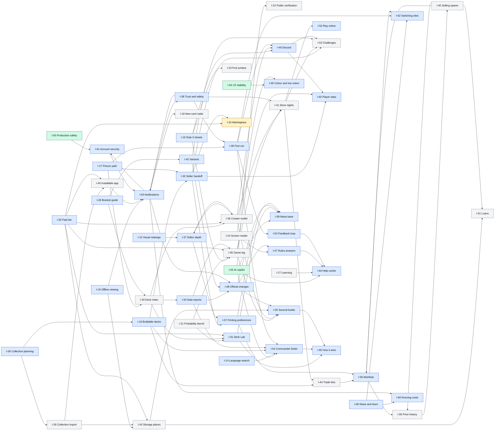

# Slice Dependency Graph

> **Checked:** 2026-11-10, on `chore/docs-roadmap-wave2` · **Generated by** a script kept outside the repo, which reads every spec's "Delivery slices" table and the [roadmap](../roadmap.md). Rerun it before trusting this page after a spec or a roadmap `Depends on` line changes.

Scheduled agents pick slices from the dependency columns. This page checks those columns against each other and against the roadmap, and lists the slices that can start today.

## Method

1. **Nodes.** Every numbered row of a spec's slice table is a node, written `I-NN/slice`: 662 rows in 55 specs. Three unnumbered rows that only track work owned elsewhere (I-36 and I-46) are skipped. A row whose cell reads "Moved to …" is a pointer, not work.
2. **Edges.** In a "Depends on" cell, bare numbers are slices of the same spec, "I-NN slice N" is a slice of another spec, and "I-NN" alone is the whole initiative. Text in brackets is a note, not a prerequisite, unless it only names a slice. "Or" marks an alternative. **Blocked**, an owner, counsel, a lawyer or a decision is a human gate. The sentences after each table that say "must not pick" or "wait for" add gates too.
3. **Priority.** Each slice takes its initiative's place in the Portfolio View, refined by the `Priority` line ("Next for slices 1 to 7; Later for …").
4. **Checks.** Dangling slice numbers, cycles, Next slices that wait for Later work or an owner without saying so, work with two possible owners, pointers to slices a later pass moved, delivery-order numbering, roadmap `Depends on` lines against the spec tables, and every "can start now" claim in the roadmap's prose, `Priority` lines and `Depends on` lines.
5. **Start now.** A slice can start now when every prerequisite has shipped, no gate applies, it is not owner work (a slice 0 with no code) and it is not a placeholder for another initiative's work. Only I-28 slice 1 (#1300) counts as shipped.

## Counts

| Check                                                                               |           Found |     Fixed in this pass |
| ----------------------------------------------------------------------------------- | --------------: | ---------------------: |
| Slices parsed / dependency edges / edges across initiatives                         | 662 / 973 / 294 |                      — |
| (a) A dependency on a slice number that does not exist                              |               0 |                      0 |
| (b) A cycle between slices                                                          |               0 |                      0 |
| (c) A Next slice that waits for Later or owner-gated work without saying so         |               7 | 0, left for a decision |
| (d) One piece of work with two possible owners                                      |               9 | 0, left for a decision |
| (e) A pointer to a slice that a later pass moved, or a takeover edge never recorded |              39 |                     39 |
| (f) A delivery-order number duplicated, skipped or out of sequence                  |               0 |                      0 |
| (g) A roadmap `Depends on` line that disagrees with the spec table                  |               5 |                      4 |
| (h) A "can start now" claim that depends on something (48 claims checked)           |               4 | 0, left for a decision |

The I-63 and I-59 takeovers of 2026-11-10 left most of the pointers: I-38 slice 13 is now I-63 slice 7; I-59's inbox and digest are I-63 slices 1 to 3 and 10; I-32 slice 12, I-45 slice 12 and I-56 slice 18 are I-59's. The moved rows now say so, and the slices that used them point at their new home. Four of the five disagreements in (g) were the same takeovers: the roadmap, written after the specs, already named I-63, so the spec tables were brought in line with it.

Initiative by initiative, three loops remain: I-36 and I-37, I-38 with I-61 and I-63, and I-45 with I-56 and I-59. Each passes through different slices, so no slice waits for itself.

## Slices that can start now

85 slices have no unmet dependency: 59 in Now or Next initiatives and 26 in Later ones. A Later slice is ready but not yet a priority. A note in brackets flags work shared with another slice, to build once, or a caveat.

| Initiative                 | Priority | Slices with no unmet dependency                                                                                                                                                                                                                                                                         |
| -------------------------- | -------- | ------------------------------------------------------------------------------------------------------------------------------------------------------------------------------------------------------------------------------------------------------------------------------------------------------- |
| I-02 AI copilot            | Now      | 1: Type every claim at the API boundary; 6: Record `stop_reason` and token usage per route (same work as I-30 slice 1); 8: Server-side card-data check of generated decks (partly shipped: `verifyGeneratedDeck`); 10: Public AI-use disclosure page and per-surface labels (same work as I-30 slice 5) |
| I-13 Visual redesign       | Next     | 1: Token corrections; 2: Remove the dead 3D stack and align the README with reality                                                                                                                                                                                                                     |
| I-14 Language search       | Next     | 1: Translate route + query display                                                                                                                                                                                                                                                                      |
| I-15 Rule 0 sheets         | Next     | 1: Sheet model, per-deck create and edit                                                                                                                                                                                                                                                                |
| I-17 Precon path           | Next     | 1: Catalogue model and one dated set imported                                                                                                                                                                                                                                                           |
| I-19 Offline viewing       | Next     | 1: Service worker skeleton with a versioned cache                                                                                                                                                                                                                                                       |
| I-30 Paid tier             | Next     | 1: Metered model client                                                                                                                                                                                                                                                                                 |
| I-31 Deck Lab              | Next     | 2: Card classification (card mana facts shared with I-58 slice 2)                                                                                                                                                                                                                                       |
| I-32 Seller handoff        | Next     | 2: Dated price snapshot from Scryfall… (the daily Scryfall job; build once)                                                                                                                                                                                                                             |
| I-34 Data reports          | Next     | 1: Index policy function                                                                                                                                                                                                                                                                                |
| I-37 Editor depth          | Next     | 1: Measurement baseline; 3: Shortcut registry, generated help; 10: Change log in each mutation transaction; 12: Finish, language, date added and Oracle identity on deck…                                                                                                                               |
| I-38 Trust and safety      | Next     | 1: Legal notice (identity fields supplied by the owner) and…; 2: Deletion defect; 4: Full JSON export endpoint with its schema and the guard test; 6: Privacy policy v1 rendered from the retention constants (final wording after slice 0); 12: Block, per-deck comment switch                         |
| I-39 First run             | Next     | 1: Stop the onboarding modal opening on public pages and cor…; 3: Delete or fix `GET /api/templates` (4.4); 4: Sentry replay settings and URL scrubbing (9.1–9.3)                                                                                                                                       |
| I-42 Variants              | Next     | 1: Format picker at creation and in deck settings; 2: Server-computed legality from Scryfall per deck load                                                                                                                                                                                              |
| I-46 Discord               | Next     | 1: Preview contract for every public page                                                                                                                                                                                                                                                               |
| I-47 Rules answers         | Next     | 1: CR import script with diff report; 3: Rulings bulk import                                                                                                                                                                                                                                            |
| I-49 Colour and low vision | Next     | 1: Measure and inventory; 2: `src/lib/a11y/palette.ts` and the token contrast test rea…; 11: Text sizes                                                                                                                                                                                                 |
| I-50 Play online           | Next     | 0: Export contract; 1: `CardPlatformInfo`                                                                                                                                                                                                                                                               |
| I-52 Feedback loop         | Next     | 3: Bug report; 6: Release-note schema, first notes for what is on `main`                                                                                                                                                                                                                                |
| I-55 Several builds        | Next     | 1: `resolveBuild` and the diff to a normalised change set                                                                                                                                                                                                                                               |
| I-56 Wishlists             | Next     | 0: Retire the favorites stubs; 1: One wanted list                                                                                                                                                                                                                                                       |
| I-57 Printing preferences  | Next     | 1: Defects 1 and 2; 2: `choosePrinting` with precedence and fallback                                                                                                                                                                                                                                    |
| I-58 Mana base             | Next     | 1: Karsten's tables as data; 2: Card mana facts on `ScryfallCard` (shared with I-31 slice 2)                                                                                                                                                                                                            |
| I-60 Player stats          | Next     | 1: Pure counting module                                                                                                                                                                                                                                                                                 |
| I-61 Account security      | Next     | 2: Session registry; 5: Argon2id with upgrade on sign-in                                                                                                                                                                                                                                                |
| I-62 Switching sites       | Next     | 0: Source register; 1: Bundle schema and the text adapter (coordinate the parser with I-57 slice 6); 2: Server write of one deck with all its rows in one transac…                                                                                                                                      |
| I-63 Notifications         | Next     | 1: Event model, catalogue; 5: Job route with `CRON_SECRET` (cadence from slice 0)                                                                                                                                                                                                                       |
| I-64 Help centre           | Next     | 1: Content model                                                                                                                                                                                                                                                                                        |
| I-65 How it wins           | Next     | 1: Route kinds, role and answer-class definitions as version…; 2: Read `manaValueNeeded`                                                                                                                                                                                                                |
| I-66 Running costs         | Next     | 1: Price book and cost model as pure functions; 3: CDN caching headers on the two shared-cache routes; 4: Image proxy                                                                                                                                                                                   |
| I-18 New-card radar        | Later    | 1: Dated set corpus fetch and cache                                                                                                                                                                                                                                                                     |
| I-20 Review                | Later    | 1: Reviewer role and invitation                                                                                                                                                                                                                                                                         |
| I-21 Probability bench     | Later    | 1: Seeded PRNG and shuffler                                                                                                                                                                                                                                                                             |
| I-23 Pod surface           | Later    | 1: Account linking, revocable                                                                                                                                                                                                                                                                           |
| I-24 Screen reader         | Later    | 1: Audit the deck view with a screen reader and record what…                                                                                                                                                                                                                                            |
| I-25 Third locale          | Later    | 1: Record the choice and its evidence in this spec                                                                                                                                                                                                                                                      |
| I-27 Learning              | Later    | 1: Content model, with the coverage test over warning classes                                                                                                                                                                                                                                           |
| I-29 Deck index            | Later    | 0: Source register with one `SourcePolicy` per researched so…; 1: Daily Scryfall bulk job (the daily Scryfall job; build once)                                                                                                                                                                          |
| I-35 Game log              | Later    | 1: `PodGame` and `PodGameSeat`                                                                                                                                                                                                                                                                          |
| I-36 Creator toolkit       | Later    | 1: Public projection used by the deck page and `/api/deck/[id]`; 7: Unique heading anchors and timestamp syntax in the primer…; 10: Creator page                                                                                                                                                        |
| I-40 Installable app       | Later    | 1: Manifest, PNG and maskable icons; 4: Playwright mobile WebKit and Chromium projects running…                                                                                                                                                                                                         |
| I-41 Store nights          | Later    | 1: `formPods` with its policy                                                                                                                                                                                                                                                                           |
| I-43 Storage places        | Later    | 1: Schema and migration for `StoragePlace`                                                                                                                                                                                                                                                              |
| I-44 Trade lists           | Later    | 4: Balance view                                                                                                                                                                                                                                                                                         |
| I-45 Selling spares        | Later    | 0: Spare computation…; 5: Per-copy condition and etched finish on collection rows… (coordinate with I-26 slice 1)                                                                                                                                                                                       |
| I-50 Play online           | Later    | 10: Deck check link (may build I-29 slice 2's canonical-list helper)                                                                                                                                                                                                                                    |
| I-51 Loans                 | Later    | 1: Schema and migration for `CardLoan`                                                                                                                                                                                                                                                                  |
| I-53 Challenges            | Later    | 1: `checkDeckAgainstRules`                                                                                                                                                                                                                                                                              |
| I-59 Price history         | Later    | 0: Measure tracked printings…; 1: One deck value function for the panel; 2: Neutral wording and colour checks in CI (8.3, 8.4)                                                                                                                                                                          |

Already in flight in a branch, so not for a new agent: I-28 slice 2 (`fix/official-bracket-definitions`) and I-39 slice 2 (`fix/guest-deck-survives-sign-up`).

Not on the list, although the roadmap says they can start: I-34 slices 6 and 7 wait for I-28 slice 4; I-35 slice 3 waits for I-29 slice 0; I-44 slice 1 waits for the owner to confirm I-56's amendment 1.4; I-53 slice 7 waits for I-36 slice 1 and slice 8 for I-21 slice 1.

## Initiative graph

An arrow runs from the initiative that must deliver a slice to the initiative that needs it. Arrows that a longer path already implies are left out, so follow the path rather than look for a direct arrow. Green is Now, blue Next, grey Later and amber Parked.

