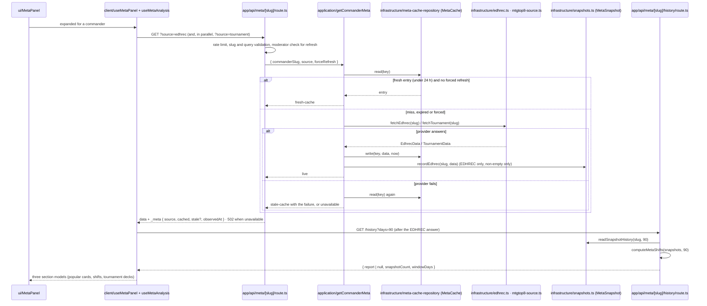

# Meta insights

> **Kind:** supporting. **Functional doc:** [docs/functional/meta-insights.md](../../../docs/functional/meta-insights.md).
> **Glossary:** [CONTEXT.md, Meta insights](../../../CONTEXT.md#meta-insights).
> **Decisions:** [ADR 0001](../../../docs/adr/0001-modular-monolith-by-bounded-context.md) (modular monolith),
> [ADR 0002](../../../docs/adr/0002-module-entry-points-index-server-client.md) (entry points),
> [ADR 0003](../../../docs/adr/0003-domain-as-readonly-data-and-pure-functions.md) (readonly domain),
> [ADR 0004](../../../docs/adr/0004-anti-corruption-layers-for-external-providers.md) (one adapter per provider),
> [ADR 0005](../../../docs/adr/0005-testing-strategy-fakes-contracts-and-characterization.md) (fakes, contracts, characterization),
> [ADR 0007](../../../docs/adr/0007-architecture-enforcement-in-stages.md) (boundary rules at `error`).
> **Status:** series closed with MI-07 (2026-11-13). MI-01 (#1453) and MI-02 (#1455) pinned the providers,
> MI-03 (#1479) moved the files, MI-04 (#1481) extracted the use case, MI-05 (#1482) split the panel,
> MI-06 (#1480) split the analysis hook; the fixes #1442, #1462 and #1483 landed alongside.

## Responsibilities

- **What the wider meta plays for a commander:** the cards EDHREC reports as popular, with their
  inclusion rates and the sample behind them; the recent tournament decks MTGTop8 lists for the
  commander, with their event context.
- **One answer a day per commander and source**, shared by every viewer: the read-through cache
  over `MetaCache`, with the stale answer served when a provider fails.
- **The history of a commander's EDHREC list**, one snapshot per UTC day kept for a year
  (`MetaSnapshot`), and the "what moved" report that differences two of them with bounds, never with
  an invented zero.
- **The meta panel and the trends view** of the builder page, and the two badges the AI suggestions
  panel borrows: the evidence-kind badge and the freshness line.

Not owned here:

- the **commander slug** (`src/lib/meta/commander-slug.ts`): the community context's, COM-02 moves it;
  this context imports it from `infrastructure/mtgtop8.ts`, `client/` and `ui/` (see
  [Boundary rules](#boundary-rules));
- the **HTTP concerns of the two meta routes** (`src/app/api/meta/[commanderSlug]/route.ts` and
  `history/route.ts`): the per-client rate limit, the slug and query validation, who may force a
  refresh, the `_meta` envelope and the status codes;
- the **AI suggestions panel** that renders the two badges (ai-copilot context).

## Layers

| Folder            | Holds                                  | Files                                                                                                                                                                                                                                                                                                                                                                                                                                                                                                                                                                                |
| ----------------- | -------------------------------------- | ------------------------------------------------------------------------------------------------------------------------------------------------------------------------------------------------------------------------------------------------------------------------------------------------------------------------------------------------------------------------------------------------------------------------------------------------------------------------------------------------------------------------------------------------------------------------------------ |
| `domain/`         | Readonly data and pure functions       | `types.ts`: `MetaCard`, `TournamentDeck`, `EdhrecData`, `TournamentData`, `MetaSource`, `CommanderMetaData`. `evidence-label.ts`: `MetaEvidenceKind`. `history.ts`: `computeMetaShifts`, `buildMetaTrendView`, `toCaptureDay`, `shiftMagnitude` and the bounded-shift arithmetic over truncated top-20 lists.                                                                                                                                                                                                                                                                        |
| `application/`    | The use case and its ports             | `get-commander-meta.ts`: `makeGetCommanderMeta`, the read-through answering a `CommanderMetaResult` of kind `fresh-cache`, `live`, `stale-cache` or `unavailable`. `ports.ts`: `MetaCacheRepository`, `MetaProvider`, `MetaHistory`, `Clock`.                                                                                                                                                                                                                                                                                                                                        |
| `infrastructure/` | One adapter per provider, Prisma store | `edhrec.ts`: `fetchEdhrecData`, EDHREC's JSON page mapped to `EdhrecData`. `mtgtop8-source.ts`: `fetchTournamentData`, the two MTGTop8 calls and the archetype-form cache. `mtgtop8.ts`: the MTGTop8 HTML parser and the archetype matching, no I/O. `meta-provider.ts`: the two adapters as the `MetaProvider` port. `meta-cache-repository.ts` (`server-only`): `prismaMetaCacheRepository` over `MetaCache`. `snapshots.ts` (`server-only`): `recordEdhrecSnapshot`, `readSnapshotHistory` and the window constants over `MetaSnapshot`. `fixtures/`: the recorded pages (MI-02). |
| `testing/`        | Fakes and contract suites (ADR 0005)   | `in-memory-meta-cache-repository.ts`: the `MetaCacheRepository` fake, with seeding and an outage switch. `meta-cache-repository-contract.ts`: the suite both the fake and the Prisma adapter pass.                                                                                                                                                                                                                                                                                                                                                                                   |
| `client/`         | Browser hooks and their pure state     | `useMetaPanel.ts`: the panel's state and the three section models. `useMetaAnalysis.ts`: the request to `GET /api/meta/:slug`, one call per source. `meta-source-state.ts`: `MetaState` and the begin, finish and fail transitions. `meta-api-response.ts`: the response type and the failure-reading rules. `useMetaShifts.ts`: `GET /api/meta/:slug/history`.                                                                                                                                                                                                                      |
| `ui/`             | React components                       | `MetaPanel.tsx` composes `MetaPanelHeader`, `CommanderMetaLinks` and the sections `EdhrecCardsSection` (rows `EdhrecCardRow`), `MetaShiftsSection` (rows `MetaShiftRow`) and `TournamentDecksSection` (rows `TournamentDeckRow`); `MetaSourceStatus` and `SkeletonRows` are the shared states; `MetaSourceDisclosure` the attribution line. `MetaTrendsView.tsx`: the standalone trends view. `RecommendationProvenance.tsx` and `ExternalRecommendationFreshness.tsx`: the badges the AI panel borrows.                                                                             |

## Public API

| Export                                                                         | Entry            | Purpose                                                              | Used by                                                 |
| ------------------------------------------------------------------------------ | ---------------- | -------------------------------------------------------------------- | ------------------------------------------------------- |
| `computeMetaShifts`                                                            | `index.ts`       | Difference the retained snapshots into a report                      | `app/api/meta/[commanderSlug]/history/route.ts`         |
| `EdhrecData`, `TournamentData`, `MetaSource`, `CommanderMetaData` (types)      | `index.ts`       | The shapes the route serves and the `source` discriminator           | the meta route and its tests                            |
| `getCommanderMeta` (+ `CommanderMetaResult`, `GetCommanderMetaQuery`, … types) | `server.ts`      | The wired read-through: fresh cache, else provider, else stale cache | `app/api/meta/[commanderSlug]/route.ts`                 |
| `readSnapshotHistory`, `DEFAULT_WINDOW_DAYS`, `MAX_WINDOW_DAYS`                | `server.ts`      | The history route's read and its window bounds                       | `history/route.ts`                                      |
| `fetchEdhrecData`, `fetchTournamentData`, `recordEdhrecSnapshot`               | `server.ts`      | One provider without the cache; the snapshot write                   | nobody outside the context today; published since MI-03 |
| `MetaPanel`, `MetaTrendsView`                                                  | `ui/<Component>` | The builder page's meta panel and trends view                        | `app/[locale]/builder/[deckId]/page.tsx`                |
| `RecommendationProvenance`, `ExternalRecommendationFreshness`                  | `ui/<Component>` | The evidence-kind badge and the freshness line                       | `components/deck/AISuggestionsPanel.tsx` (ai-copilot)   |

Who may import which entry (ADR 0002): `index.ts` is pure and safe anywhere, the Edge middleware
included; `server.ts` is `server-only`, for route handlers and server code; the `ui/` components are
imported by path from pages and components; `client/` has no importer outside the context, so there
is no `client.ts`. `entry-points.test.ts` pins the runtime export list of `index.ts` and `server.ts`.

### Boundary rules

Since MI-07 the context is listed in `CLOSED_CONTEXTS` of `.dependency-cruiser.cjs`, so its six
boundary rules run at `error` (`pnpm arch`): `domain/` imports only its own `domain/`, another
context's `index.ts` or the pure kernel; `application/` only its `domain/`, its ports, entry points
and the logger; `infrastructure/` never reaches `client/` or `ui/`; `testing/` is imported by tests
only; code outside `src/modules/` reaches the context through its entry points or a `ui/` path; and
components and hooks never import `server.ts`. `src/test/arch-context-boundaries.test.ts` pins the
severity.

The import of `src/lib/meta/commander-slug.ts` passes these rules because the allow-lists cover
`domain/` and `application/` only, and neither imports the slug: `infrastructure/mtgtop8.ts` folds
option names with it, `client/` builds the route URL with it, and `ui/CommanderMetaLinks.tsx` builds
the two links with it. When COM-02 publishes the slug from the community context's `index.ts`, the
three importers switch to that path and nothing else changes.

## Data flow

The meta panel, from the first opening to the rendered sections. The two sources are independent
requests; the history is asked only once EDHREC has answered, because that answer is what writes
today's snapshot.

The AI suggestions panel does not go through this flow: it renders `RecommendationProvenance`
and `ExternalRecommendationFreshness` with its own values.

## Invariants

| Rule                                                                                                                                                            | Source                                                      | Pinned by                                                                                                                                                                       |
| --------------------------------------------------------------------------------------------------------------------------------------------------------------- | ----------------------------------------------------------- | ------------------------------------------------------------------------------------------------------------------------------------------------------------------------------- |
| A stored answer is fresh for 24 h; a fresh entry is served without asking the provider, unless a moderator forces a refresh.                                    | Product (`META_CACHE_TTL_MS`); the route grants the refresh | `application/get-commander-meta.test.ts` "answers the stored cards … and asks no provider", "is bypassed when the refresh is forced"; `route.test.ts` forcing-a-refresh         |
| When the provider fails, the stored answer is served however old it is, and nothing is overwritten; with nothing stored the route answers 502.                  | Product: a dead provider must not blank a working panel     | `get-commander-meta.test.ts` "falls back to the stale entry … and writes nothing", "is unavailable …"; `route.test.ts` "serves stale tournament decks without overwriting them" |
| The stored row is parsed on read; a row of another shape is a miss, never a cast.                                                                               | ADR 0004 rule 1; MI-04 replaced the route's casts           | `infrastructure/meta-cache-repository.test.ts` "reads a row whose data is not an EDHREC answer as a miss" and siblings                                                          |
| Neither cache call throws: a failed read is a miss, a failed write is dropped (B2-12 decides the logging).                                                      | Pinned behaviour of the route before MI-04                  | `testing/meta-cache-repository-contract.ts`, run by the fake and the Prisma adapter                                                                                             |
| EDHREC: the top 20 by inclusion across every list of the page, one entry per name; a 404 is a commander EDHREC does not know, not an error.                     | Product; EDHREC's page shape (recorded 2026-11-12)          | `infrastructure/providers.replay.test.ts` (EDHREC block); `edhrec.test.ts`                                                                                                      |
| MTGTop8: decks led by the commander (its archetype) first, decks containing it as the fallback; an ignored card filter is "no deck", not the whole EDH section. | #1442 (accents), #1462 (the echo rule); recorded 2026-11-12 | `providers.replay.test.ts` (MTGTop8 block); `mtgtop8.test.ts`; `app/api/meta/[commanderSlug]/route.tournament.test.ts`                                                          |
| A changed provider page is rejected rather than read as an empty feed.                                                                                          | Product: an empty feed would be cached for a day            | `edhrec.test.ts` "rejects a changed EDHREC response shape …"; `mtgtop8-source.test.ts` "rejects changed tournament rows …"                                                      |
| One snapshot per commander per UTC day, never an empty one; a card missing from a truncated list is below the cut-off, so a shift is a bound.                   | Product; `history.ts` module note                           | `infrastructure/snapshots.test.ts`; `domain/history.test.ts` "never reports a vanished card as a fall to zero" and siblings                                                     |
| The history is read only after the EDHREC answer, and a commander change while the panel is open reads the new commander and shows nothing of the previous one. | #1483                                                       | `client/useMetaPanel.test.ts`; `ui/MetaPanel.characterization.test.tsx` "follows a commander change while open …"                                                               |
| The two sources are independent: a failure on one leaves the other's list on screen, with its own error and retry.                                              | Product                                                     | `client/meta-source-state.test.ts` "independence of the two sources"; `MetaPanel.characterization.test.tsx` the two "… with a retry that requests that source alone"            |

## Persistence and providers

**Tables owned.** `MetaCache` (one row per `commanderSlug` and `source`, `data` as `Json`, `cachedAt`,
`expiresAt`), written and read only by `infrastructure/meta-cache-repository.ts`. `MetaSnapshot` (one
row per `commanderSlug` and `capturedOn` UTC day, `data` as `Json`), written and read only by
`infrastructure/snapshots.ts`; rows older than 365 days are dropped when the commander is next
recorded. Nothing else reads either table.

**EDHREC** (`infrastructure/edhrec.ts`). `GET https://json.edhrec.com/pages/commanders/<slug>.json`,
the unofficial JSON page the EDHREC site itself loads, with the app's User-Agent and `src/lib/http`'s
10 s timeout. Read 2026-11-12: the page is served from S3 through CloudFront with
`cache-control: public, max-age=1620`, 130,809 bytes for Atraxa, 11 card lists and 288 card views;
EDHREC publishes no rate limit for it. A 404 is "no cards"; a 403 bot challenge and any other status
reject. The adapter keeps the top 20 by inclusion. Recording:
`fixtures/edhrec-commander-v1.ts`.

**MTGTop8** (`infrastructure/mtgtop8-source.ts`, parser `mtgtop8.ts`). Two calls to
`https://www.mtgtop8.com/search`: `GET` for the form, whose EDH archetype select held 852 options on
2026-11-12 and is cached in memory for 24 h per server instance; `POST` for the search, by archetype
id when the commander has one, else by card name. The site serves ISO-8859-1 and lists 25 decks a
page; the adapter keeps the first 5. The site publishes no rate limit; the panel's own limit is the
route's 30 requests a minute per client. Recordings: `fixtures/mtgtop8-search-form-v1.ts`,
`fixtures/mtgtop8-events-v1.ts`, `fixtures/mtgtop8-card-search-v1.ts` (all 2026-11-12).

**Failure behaviour.** A provider rejection reaches the use case, which serves the stale entry or
answers `unavailable`; the route logs the provider's message and answers the body without it. The
snapshot write never fails the answer (`recordEdhrecSnapshot` swallows and logs). The browser gives
each source 30 s and the history 15 s.

## Testing

| Suite                                                                        | Kind                                 | What it covers                                                                                                                                            |
| ---------------------------------------------------------------------------- | ------------------------------------ | --------------------------------------------------------------------------------------------------------------------------------------------------------- |
| `infrastructure/providers.replay.test.ts`                                    | Replay through MSW (ADR 0005 rule 4) | Both adapters against the recorded pages: what is read, every handled failure, the User-Agent, the form cache. Two pinned behaviours, named `(pinned; …)` |
| `infrastructure/edhrec.test.ts`, `mtgtop8-source.test.ts`, `mtgtop8.test.ts` | Solitary                             | The mapping rules, the search and fallback logic, the parser and the accent matching                                                                      |
| `testing/meta-cache-repository-contract.ts`                                  | Contract suite                       | Run by `testing/in-memory-meta-cache-repository.test.ts` and `infrastructure/meta-cache-repository.test.ts` (over `src/test/meta-cache-db-fake.ts`)       |
| `application/get-commander-meta.test.ts`                                     | Solitary, on the in-memory fakes     | Every outcome of the read-through, both sources                                                                                                           |
| `infrastructure/snapshots.test.ts`, `domain/history.test.ts`                 | Solitary                             | The snapshot keying, retention and validation; the differencing and its bounds                                                                            |
| `client/*.test.ts(x)`                                                        | Sociable hooks, stubbed `fetch`      | The request guards, the state machine, the panel model                                                                                                    |
| `ui/MetaPanel.characterization.test.tsx` (23 tests)                          | Characterization                     | Every state of the three sections, the request choreography, the commander change (#1483)                                                                 |
| `ui/*.test.tsx`                                                              | Components                           | The rows, the disclosure, the badges, the trends view                                                                                                     |
| `app/api/meta/[commanderSlug]/route.test.ts`                                 | Route, `MetaProvider` seam mocked    | The `_meta` envelope, the stale fallback, who may force a refresh (Prisma, Auth.js, the snapshot store, the rate limiter and the logger are mocked too)   |
| `app/api/meta/[commanderSlug]/route.tournament.test.ts`                      | Route, real adapters, MSW            | The accent round trip and the card-search fallback end to end in the process                                                                              |
| `app/api/meta/[commanderSlug]/history/route.test.ts`                         | Route                                | The window bounds, the null report, the count, the 500                                                                                                    |
| `entry-points.test.ts`                                                       | API pin                              | The runtime exports of `index.ts` and `server.ts`                                                                                                         |
| `e2e/mtgtop8-meta.spec.ts`                                                   | Playwright, tagged `@external`       | The tournament route against the live site; runs only when external tests are enabled                                                                     |

## Known gaps

- The cache repository and the route's moderator lookup swallow their errors silently, as the route
  did before MI-04; B2-12 decides what to log.
- On a provider failure the use case reads the cache a second time for the stale entry; reusing the
  first read would save one query on that path.
- The deck-versus-meta comparison (which popular cards the deck lacks) lives in `client/useMetaPanel.ts`;
  it is a candidate for `domain/`.
- `client/useMetaShifts.ts` reads the history body with an `as HistoryApiResponse` cast; a type
  guard like `meta-api-response.ts`'s would replace it.
- `MetaCard.imageUri` and the `synergy` evidence kind are declared but nothing produces them;
  `TournamentDeck.source` and the disclosure label admit `mtgdecks`, which no adapter yields.
- `ui/ExternalRecommendationFreshness.tsx` prints fixed English, outside next-intl.
- The route test still mocks five internal modules (the `MetaProvider` composition, the snapshot
  store, Prisma, Auth.js, the rate limiter and the logger); its ESLint suppression entry counts 4.
- The mutation-testing baseline of `domain/` was not recorded by the closing slice: Stryker was not
  run in MI-07 (the nightly covers `src/modules/*/domain/**`).
- The commander slug stays at `src/lib/meta/commander-slug.ts` until COM-02.
