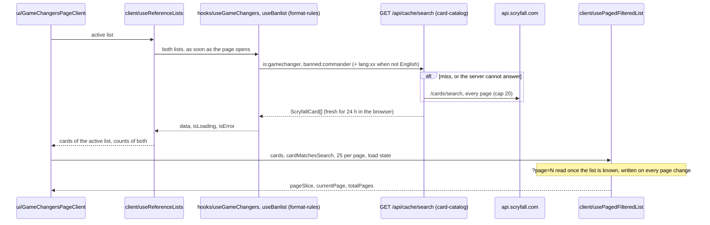

# Rules reference

> **Kind:** generic. **Functional doc:** [docs/functional/rules-reference.md](../../../docs/functional/rules-reference.md).
> **Glossary:** [CONTEXT.md, Rules reference and site](../../../CONTEXT.md#rules-reference-and-site).
> **Decisions:** [ADR 0001](../../../docs/adr/0001-modular-monolith-by-bounded-context.md) (modular monolith),
> [ADR 0002](../../../docs/adr/0002-module-entry-points-index-server-client.md) (entry points),
> [ADR 0003](../../../docs/adr/0003-domain-as-readonly-data-and-pure-functions.md) (readonly domain),
> [ADR 0007](../../../docs/adr/0007-architecture-enforcement-in-stages.md) (boundaries at `error` since RR-06).
> **Series:** RR-01 #1447 (characterization), #1459 (the `?page=N` fix), RR-02 #1473 (the move; it absorbed
> RR-03's loader split), RR-04 #1476 and RR-05 #1477 (the list page split), RR-06 (this README, the
> functional doc, the gate).

The reference pages a player reads rather than edits: the official Comprehensive Rules, with their
glossary and effective date, and the Game Changers and Commander banlist page. The context ships
one edition of the rules as a text file and renders it one chapter at a time; the Game Changers
and banlist page reads the live Scryfall lists through the format-rules hooks.

## Responsibilities

- Parse one edition of the Comprehensive Rules text into sections, chapters, rule paragraphs and
  glossary entries, and read its effective date.
- Search that parsed document: rule paragraphs first, then glossary entries, as a substring match.
- Render the rules one chapter (or the glossary) at a time on the server, with the effective date
  in the reader's locale.
- Show the Game Changers and the Commander banlist as a searched, paged grid with a zoom and a
  link to every printing, and mirror the page number in the URL so a page can be shared.

Not owned here: the deck-building rules themselves (`lib/deck/`, format-rules context), the
Scryfall client, the shared search cache and the card images (`lib/scryfall/`, card-catalog
context), the Game Changers and banlist hooks (`hooks/useGameChangers.ts`, `hooks/useBanlist.ts`,
format-rules context) and the printing selector (`components/card/PrintingSelectorModal`,
card-catalog context).

## Layers

| Folder            | Holds                            | Files                                                                                                                                                                                                                                                                                                                                                                                                                                                                                                                                                                                                                                                                                                                                                                                                                                                |
| ----------------- | -------------------------------- | ---------------------------------------------------------------------------------------------------------------------------------------------------------------------------------------------------------------------------------------------------------------------------------------------------------------------------------------------------------------------------------------------------------------------------------------------------------------------------------------------------------------------------------------------------------------------------------------------------------------------------------------------------------------------------------------------------------------------------------------------------------------------------------------------------------------------------------------------------- |
| `domain/`         | Readonly data and pure functions | `comprehensive-rules.ts`: the parsed shape of the rules (sections, chapters, paragraphs, glossary), `parseComprehensiveRules` and `searchComprehensiveRules`. `effective-date.ts`: `parseRulesEffectiveDate`, the "August 7, 2026" line as a UTC date.                                                                                                                                                                                                                                                                                                                                                                                                                                                                                                                                                                                               |
| `infrastructure/` | Server-only file access          | `rules-file.ts`: `RULES_FILE`, the edition the app ships, and the once-per-process `loadComprehensiveRules`. `data/MagicCompRules-20260807.txt`: the edition itself (effective 2026-08-07).                                                                                                                                                                                                                                                                                                                                                                                                                                                                                                                                                                                                                                                          |
| `client/`         | Browser state hooks              | `usePagedFilteredList.ts`: the search, the page slice and the `?page=N` URL sync of a list a visitor pages through (the deep link, the reset on a new search, the scroll on a page change). `useReferenceLists.ts`: the two Scryfall lists of the Game Changers and banlist page, the active one and each list's count, and the `ReferenceList` type.                                                                                                                                                                                                                                                                                                                                                                                                                                                                                                |
| `ui/`             | React components                 | `ComprehensiveRulesView.tsx`: the server-rendered rules browser; it takes the parsed rules from the page. `GameChangersPageClient.tsx`: the Game Changers and banlist page; a container that owns the active list, the zoomed card and the printings card and composes the pieces below. `ReferenceListTabs.tsx`: the two list toggles and the Comprehensive Rules link. `PagedCardList.tsx`: the search field, the loading and error messages, the result count, the grid and the pager. `ReferenceCardGrid.tsx`: the grid of tiles with the list's badge, or the empty message. `CardTile.tsx`: one card of the grid. `CardZoomModal.tsx`: the zoom of one card on the shared `Modal`, with the arrow-key navigation and the printings button. `card-image.ts`: which listed Scryfall image a tile or the zoom shows. `Pagination.tsx`: the pager. |

There is no `application/` folder: the context has one server read (the bundled file) and no
write, so the page is the adapter and calls the loader itself (see Known gaps). There is no
`testing/` folder: the parser is tested on fixture text and the loader on the real file.

## Public API

| Export                                                                                                                                            | Entry                       | Purpose                                                                                          | Used by                                     |
| ------------------------------------------------------------------------------------------------------------------------------------------------- | --------------------------- | ------------------------------------------------------------------------------------------------ | ------------------------------------------- |
| `searchComprehensiveRules`, the types `ComprehensiveRules`, `RulesSection`, `RulesChapter`, `RuleParagraph`, `GlossaryEntry`, `RulesSearchResult` | `index.ts`                  | Search a parsed edition; name its parts. Pure, usable on the server, in the browser and in tests | `ui/ComprehensiveRulesView`                 |
| `loadComprehensiveRules`                                                                                                                          | `server.ts` (`server-only`) | Read and parse the bundled edition once per server process                                       | `app/[locale]/rules/comprehensive/page.tsx` |
| `ComprehensiveRulesView`                                                                                                                          | `ui/ComprehensiveRulesView` | The rules browser, a Server Component                                                            | `app/[locale]/rules/comprehensive/page.tsx` |
| `GameChangersPageClient`                                                                                                                          | `ui/GameChangersPageClient` | The Game Changers and banlist page, a Client Component                                           | `app/[locale]/rules/game-changers/page.tsx` |

There is no `client.ts`: nothing client-side is imported outside the context, and the two hooks in
`client/` have one user, the page. `entry-points.test.ts` pins the runtime export list of each
entry point.

Who may import which ([ADR 0002](../../../docs/adr/0002-module-entry-points-index-server-client.md)):
`index.ts` from anywhere; `server.ts` from server code only (a client import fails the build
through `server-only`); the two views by their `ui/` path from pages and Client Components. Inside
the context, `ui/` reads `client/` and `index.ts`, the shared `components/ui`, the card-catalog
helpers under `lib/scryfall/` and the format-rules hooks; `client/` reads the format-rules hooks
and the Scryfall types; `infrastructure/` reads `domain/`; `domain/` reads only itself.

Since RR-06 listed `rules-reference` in `CLOSED_CONTEXTS` of `.dependency-cruiser.cjs`, `pnpm arch`
fails on a breach of the six boundary rules (`domain-imports-domain`,
`application-imports-domain-and-ports`, `infrastructure-not-browser`, `testing-only-from-tests`,
`through-entry-points` for code outside `src/modules/`, `browser-folders-not-server-entry`), on
top of the floor rules every context meets (`domain-is-pure`, `browser-layers-not-server`,
`application-is-not-an-adapter`, `public-api-only`). `src/test/arch-context-boundaries.test.ts`
pins the context as closed. The context has no entry in the known-violations baseline and never
had one.

## Data flow

The Comprehensive Rules page, a server render with no client JavaScript of its own:

```mermaid
sequenceDiagram
  participant Browser
  participant Page as app/[locale]/rules/comprehensive
  participant Loader as server.ts loadComprehensiveRules
  participant Parser as domain parseComprehensiveRules
  participant View as ui/ComprehensiveRulesView

  Browser->>Page: GET ?chapter=903&q=commander
  Page->>Loader: loadComprehensiveRules()
  alt first call in this process
    Loader->>Parser: text of data/MagicCompRules-20260807.txt
    Parser-->>Loader: ComprehensiveRules (cached)
  end
  Loader-->>Page: ComprehensiveRules
  Page->>View: rules, requestedChapter, requestedQuery
  Note over View: searchComprehensiveRules(rules, q); effective date formatted in UTC
  View-->>Browser: HTML: date, search results, contents, one chapter
```

The Game Changers and banlist page, rendered in the browser from two Scryfall lists:



## Invariants

| Invariant                                                                                                                      | Source                                                            | Pinned by                                                                                                                                                                             |
| ------------------------------------------------------------------------------------------------------------------------------ | ----------------------------------------------------------------- | ------------------------------------------------------------------------------------------------------------------------------------------------------------------------------------- |
| `domain/` never touches the file system or the network: the parser and the search take text and values                         | ADR 0003; `domain-is-pure` and `domain-imports-domain` at `error` | `entry-points.test.ts`, `pnpm arch`                                                                                                                                                   |
| The bundled file is read and parsed once per server process; every call returns the same instance                              | Product: a 1 MB parse per request would be waste                  | `infrastructure/rules-file.test.ts`: "returns the same cached instance on repeated calls"                                                                                             |
| The effective date is a calendar day at UTC midnight and is shown as that day wherever the server runs                         | The file states a day, not an instant                             | `domain/effective-date.test.ts`: "places the date at UTC midnight …"; `ui/ComprehensiveRulesView.test.tsx`: the two "states the effective date …" tests, run in `America/Los_Angeles` |
| Search returns rule paragraphs before glossary entries, in document order, at most 25; a blank query returns nothing           | Product                                                           | `domain/comprehensive-rules-search.test.ts`                                                                                                                                           |
| The English Scryfall list is the source of truth for membership, order and count; translated printings are a layer on top      | A `lang:` search returns only cards printed in that language      | `hooks/useGameChangers.ts` (format-rules); `ui/GameChangersPageClient.test.tsx`: "also asks Scryfall for French printings …"                                                          |
| A `?page=N` link opens page N once the list is known; a page the list has not, or no page, lands on page 1 and the URL says so | #1459; the landing rule is RR-01's pin                            | `client/usePagedFilteredList.test.ts`; `ui/GameChangersPageClient.test.tsx`, "pagination"                                                                                             |
| The zoom is a dialog: focus enters it, stays in it and returns to the tile that opened it                                      | #1340 (shared `Modal`); RR-05 Red                                 | `ui/CardZoomModal.test.tsx`; `ui/GameChangersPageClient.test.tsx`: "closes with the close button and gives focus back …"                                                              |
| Scryfall's 404 for a query with no match is an empty list, not a failure; a failed list leaves the other tab and the URL alone | Scryfall answers 404 to an empty search                           | `ui/GameChangersPageClient.test.tsx`, "loading and failure"; `client/usePagedFilteredList.test.ts`: "leaves the URL alone when the list failed to load"                               |

## Persistence and providers

No table. The context holds one data file and reads one provider.

### The Comprehensive Rules file

`infrastructure/data/MagicCompRules-20260807.txt`: the edition effective 2026-08-07, downloaded
from Wizards' rules page (<https://magic.wizards.com/en/rules>, which publishes each edition as
TXT, PDF and DOCX). UTF-8 without a byte-order mark, LF line endings, 9,359 lines. The parser also
accepts CRLF and treats a line of non-breaking spaces as blank, which is how Wizards' TXT comes.
`RULES_FILE` is built from literal path segments so Next.js traces the file into the production
build; `pnpm build` lists it in `.next/server/app/[locale]/rules/comprehensive/page.js.nft.json`.

The file name carries the edition date, and documents and agent rules cite the path, so a new
edition touches every place below. **Drop-in checklist** for `MagicCompRules-<YYYYMMDD>.txt`:

1. Add the new file under `infrastructure/data/`, converted to UTF-8 and LF, and delete the old
   one: the app ships one edition (open owner decision OD-13 of the master plan).
2. `infrastructure/rules-file.ts`: the last `RULES_FILE` segment and the header comment.
3. `infrastructure/rules-file.test.ts`: the path regex and the real-file assertions (the effective
   date, the nine sections, chapter 903, the glossary size).
4. `domain/effective-date.ts` (header example) and `domain/effective-date.test.ts` ("reads the
   date exactly as the bundled rules file prints it"). The fixture dates in
   `domain/comprehensive-rules.test.ts` and `ui/ComprehensiveRulesView.test.tsx` cite the edition
   too; they keep working but should follow.
5. The layer table and this section of the README; `docs/functional/rules-reference.md` (the
   effective date and the sources).
6. Outside the context: `CONTEXT.md` (the "Rule sources" paragraph, with its check date, and the
   Comprehensive Rules row), `.agents/rules/general-principles.mdc`, `src/lib/deck/game-constants.ts`
   (header), `docs/adr/0006-comment-and-documentation-standard.md`,
   `docs/adr/0009-legality-is-a-report-and-the-server-owns-rules.md`,
   `docs/engineering/code-documentation.md` ("Citing the Comprehensive Rules"). A repository grep
   for `MagicCompRules-` finds them all; the product specs that name the edition are dated
   research notes and stay as they are.
7. Re-check every `CR nnn.n[a]` cited in `src/` against the new text: rules move between editions
   (I-47 counted 109 renumbered and 211 reworded rules between 2026-08-07 and 2026-11-06). The
   P0-25 citation guard will automate this check once it lands; until then `grep -rn "CR [0-9]"
src/` and the new file are the tools.
8. Run `pnpm build` once and confirm the new file name in the page's `.nft.json`.

Two older copies of the rules (effective 2026-02-27) sit in `docs/rules/` and
`.agents/skills/mtg-rules/references/comprehensive-rules.txt`; they are not the reference
(`CONTEXT.md`, "Rule sources") and OD-13 decides whether they go.

### Scryfall, through the card catalog

The Game Changers and banlist page reads two searches, `is:gamechanger` and `banned:commander`,
plus `is:gamechanger lang:<xx>` and `banned:commander lang:<xx>` with `include_multilingual` when
the viewer's locale is not English. Each goes through the shared server cache first
(`GET /api/cache/search`, fresh for one hour, card-catalog context) and reaches
`api.scryfall.com/cards/search` only on a miss or when the server cannot answer, paced by the
catalog's request queue (Scryfall's rate limits, <https://scryfall.com/docs/api/rate-limits>, read
2026-11-10: 2 requests per second on `/cards/search`). `fetchAllPages` follows `has_more` up to 20
pages of 175 cards; both lists are far below that. The browser keeps each answer fresh for 24 hours
(`STALE_TIME_24H`), so a banlist change reaches an open tab within a day and a fresh tab at once.

Failure behaviour: a 404 is an empty list; any other failure shows the error message for that tab
only; nothing is retried until the query goes stale. The zoom's "View all arts" opens the
catalog's `PrintingSelectorModal`, which searches `!"<name>" game:paper` with `unique=prints`.

The lists themselves follow Wizards' announcements, which Scryfall applies on the day: the Game
Changers list was introduced on 2025-02-11 and last changed on 2026-02-09 (53 cards); the
Commander banlist last changed on 2026-02-09. Sources and dates are in
[docs/references/game-changers.md](../../../docs/references/game-changers.md) and
[docs/references/banlists.md](../../../docs/references/banlists.md); the page shows no date (I-48).

## Testing

The strategy follows [ADR 0005](../../../docs/adr/0005-testing-strategy-fakes-contracts-and-characterization.md).
`TZ=UTC npx vitest run src/modules/rules-reference`: 11 files, 101 tests.

- **Characterization (RR-01, #1447; #1459 and RR-05 added to it).** `ui/GameChangersPageClient.test.tsx`
  (33) is sociable: the real page, the real format-rules hooks, the Scryfall client and the
  printing selector run; MSW answers the shared cache (always a miss) and Scryfall; Next's router
  is replaced because the page writes `?page=N`. One accepted seam, the `@/i18n/navigation` stub.
  Tests named "pins: …" record behaviour kept on purpose.
- **Solitary tests** on the pure parts: `domain/comprehensive-rules.test.ts` (8, fixture text),
  `domain/comprehensive-rules-search.test.ts` (2), `domain/effective-date.test.ts` (10),
  `ui/card-image.test.ts` (6), `client/usePagedFilteredList.test.ts` (10, a stub router).
- **The real file.** `infrastructure/rules-file.test.ts` (6) parses the bundled edition: its
  path, date, nine sections, chapter 903, glossary size and the process cache.
- **Components.** `ui/CardZoomModal.test.tsx` (10, the dialog on the shared `Modal`),
  `ui/Pagination.test.tsx` (9), `ui/ComprehensiveRulesView.test.tsx` (5, a parsed fixture, the
  server intl mocked per locale, the server clock west of UTC). `entry-points.test.ts` (2).
- **Mutation testing.** `stryker.config.mjs` mutates `src/modules/*/domain/**`, so the two domain
  files are in the nightly advisory run; no score was recorded in this slice.
- **E2E.** No Playwright spec drives the two pages. `e2e/warmup.setup.ts` warms
  `/rules/game-changers`; `e2e/banlist-printings.spec.ts` is an `@external` check of Scryfall's
  data, not of the app.

## Known gaps

- **The edition is behind.** The app serves the rules effective 2026-08-07; Wizards' page linked
  the 2026-11-06 edition when I-47 was researched (2026-11). The update is product work
  ([I-47](../../../docs/product/specs/i47-rules-answers-for-this-deck.md), slice 1, which also
  plans an import script and a diff report); the checklist above is the manual path.
- **No loader port (RR-03's remainder, decided "not needed" in RR-06).** A port earns its place
  with a second adapter or a consumer that must be tested without the real file. Today there is
  one edition and one adapter, the view already takes the parsed `rules` as a prop (its tests pass
  a fixture), and the parser is pure, so no test needs a fake loader. A port returns with I-47's
  several editions (`versions.ts`), where the use case that picks an edition would own it.
- **No `application/` layer.** The comprehensive rules page calls `loadComprehensiveRules` itself;
  with one read and no decision there is no use case to extract. I-47 changes that.
- **Two older copies of the rules** in `docs/rules/` and the `mtg-rules` skill (see above); OD-13.
- `ReferenceListTabs.tsx` is a row of toggle buttons, not a WAI-ARIA tablist (`tablist`, `tab`,
  `aria-selected`, arrow keys between tabs). RR-01 pins the buttons; the pattern is a `fix/`
  follow-up with its own Red, since it changes what assistive technology announces.
- `ui/card-image.ts` belongs to the card catalog beside `lib/scryfall/images.ts`; it moves there
  once the branch editing that file (P1-49) has merged.
- The first load of the Game Changers page without `?page` rewrites the URL to `?page=1`
  (RR-01's pin, kept by #1459); a product call, not a bug.
- The lists carry no date and no history ([I-48](../../../docs/product/specs/i48-official-changes-reach-every-deck.md)).
- The Comprehensive Rules text is English only, whatever the locale; rule paragraphs have no
  anchor, so no link reaches one rule (I-47, slice 2).
